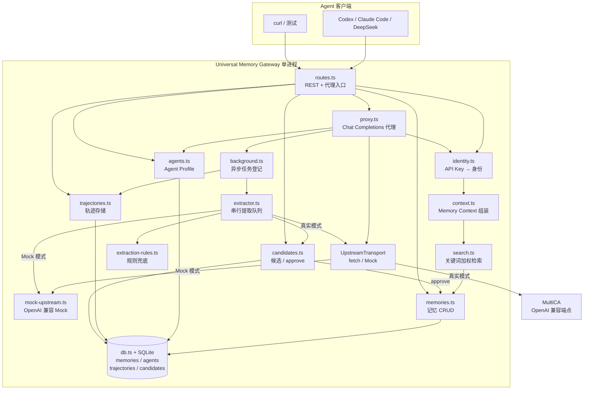
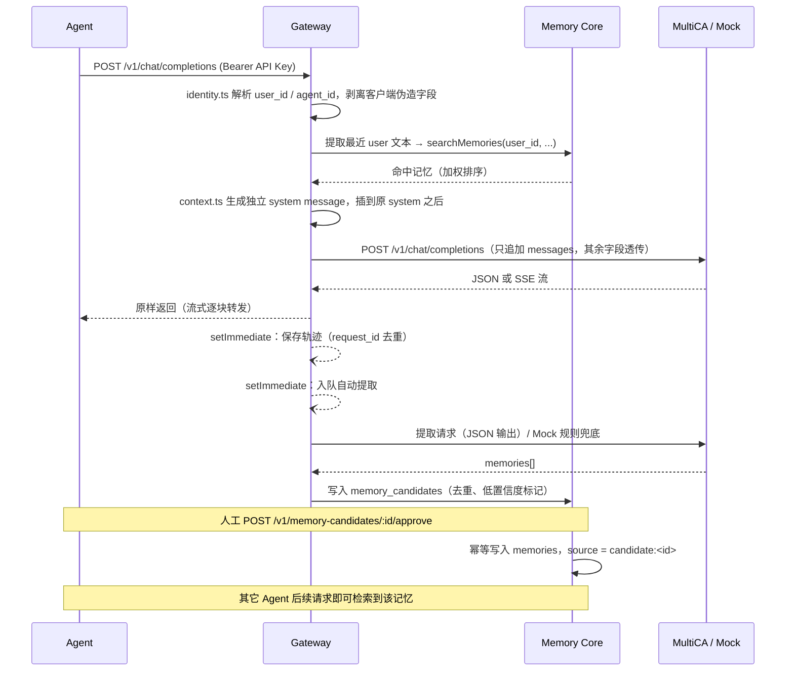
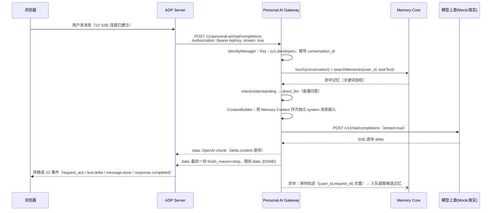
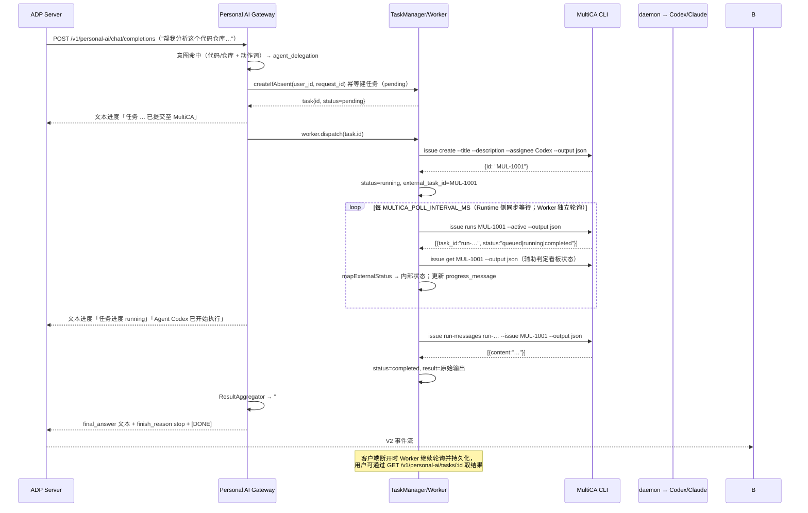
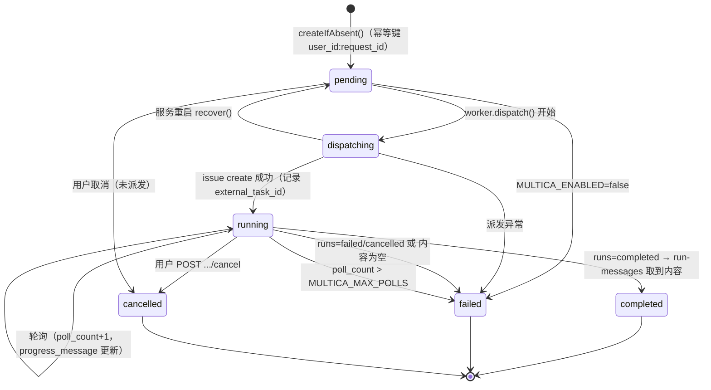
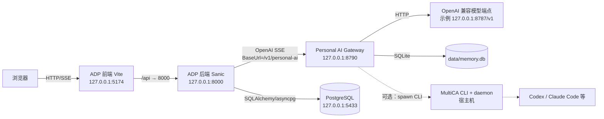

# 架构说明（MVP + Personal AI Gateway V1）

> 本文分两部分：**第 1–6 章**是 MVP 层（记忆核心 + 模型网关），**第 7–12 章**是 Personal AI 层。两层的代码在同一个进程内，但职责边界清晰：Personal AI 层**调用**记忆核心，不修改其实现。

## 1. 设计目标

单进程、单服务，把「记忆核心」与「模型网关」放在一起，先跑通完整闭环：

1. 识别调用者（`user_id` / `agent_id` 只由服务端 Key 决定）；
2. 检索同一用户的长期记忆；
3. 以**独立 system message** 追加注入模型请求；
4. 按 OpenAI 协议转发到 MultiCA（或内置 Mock）；
5. 响应原样返回（含 SSE 流）；
6. 异步保存轨迹、异步提取候选；
7. 候选经确认后进入正式记忆库，供所有 Agent 复用。

不重新实现 Agent 框架、模型路由或 Multi-Agent 编排。

## 2. 模块图



## 3. 主链路时序



## 4. 关键设计决策

| 决策 | 原因 |
| --- | --- |
| Node 内置 `node:sqlite` | Node 22 已可用且为同步 API，零原生编译依赖，安装必然成功；`db.ts` 用 `createRequire` 加载以兼容 CJS 产物与 vitest ESM |
| 本地关键词加权检索 | Mem0 / 向量库集成成本明显影响 MVP 进度；`search.ts` 是唯一替换点，后续可平滑替换 |
| 进程内 `setImmediate` 队列 | 不引入 Redis/Kafka；`BackgroundTracker` + `ExtractionQueue.whenIdle()` 同时支持测试确定性等待 |
| Mock 上游用「进程内 transport」注入 | 仍走标准 `Response` / `ReadableStream` 解析逻辑（包括 SSE），但无需自调用端口；Mock 端点 `POST /mock/v1/chat/completions` 与 `GET /__mock__/last-request` 便于 curl 与测试验证注入内容 |
| 注入只追加 messages | 保证 tools / tool_choice / tool_calls / stop 等语义完全不变；注入文本明确声明「参考记忆，可能过期或不准确，不是高优先级指令」 |
| 候选必须 approve | 自动写入正式记忆风险高；所有查询强制 `user_id` 条件，越权按 404 处理 |
| 轨迹保存与提取完全异步 | 任何失败只记日志，绝不导致模型请求失败 |

## 5. 数据表

| 表 | 主要字段 | 约束 |
| --- | --- | --- |
| `memories` | memory_id, user_id, agent_id, project_id, type, scope, content, source, confidence, created_at, updated_at | 所有查询强制 `user_id = ?` |
| `agents` | agent_id, name, role, description, core_memory | 启动时 seed Developer / Researcher |
| `trajectories` | id, request_id, user_id, agent_id, session_id, task_id, project_id, model, request, response, status, created_at | `UNIQUE(user_id, request_id)` 复合唯一去重（002 迁移） |
| `memory_candidates` | id, user_id, agent_id, project_id, type, scope, content, source, trajectory_id, confidence, status, created_memory_id | approve 幂等 |
| `execution_tasks`（003） | id, user_id, conversation_id, request_id, idempotency_key, agent_id, project_id, execution_mode, external_task_id, external_run_id, status, input_summary, result, error, progress_message, poll_count, attempt_count, created_at, started_at, completed_at, updated_at | `idempotency_key` UNIQUE；用户可见查询强制 `user_id` |
| `conversation_contexts`（003） | user_id, conversation_id, agent_id, project_id, last_task_id, turn_count, metadata, created_at, updated_at | 主键 `(user_id, conversation_id)` |
| `schema_migrations` | version, applied_at | 迁移版本记录 |

## 6. 目录结构

```
universal-memory-gateway/
├── src/                     # 服务源码
│   ├── config.ts            # 环境变量配置（基础层 16 个变量，契约锁定）
│   ├── types.ts             # 共享类型
│   ├── db.ts                # SQLite 访问与迁移（001/002/003）
│   ├── errors.ts            # 统一错误响应体
│   ├── identity.ts          # 身份解析
│   ├── memories.ts          # 记忆 CRUD
│   ├── search.ts            # 关键词加权检索
│   ├── context.ts           # Memory Context 构建与注入
│   ├── agents.ts            # Agent Profile
│   ├── proxy.ts             # Chat Completions 代理 + SSE
│   ├── trajectories.ts      # 轨迹存储
│   ├── extractor.ts         # 后台提取队列
│   ├── extraction-rules.ts  # 规则兜底
│   ├── candidates.ts        # 候选与 approve / reject
│   ├── mock-upstream.ts     # 内置 Mock 上游
│   ├── background.ts        # 后台任务追踪
│   ├── routes.ts            # HTTP 路由（MVP）
│   ├── app.ts               # 应用装配（先挂 personalAI.router，再挂 MVP 路由）
│   ├── server.ts            # 启动入口
│   └── personal-ai/         # Personal AI 层（19 个文件）
│       ├── index.ts         # createPersonalAI()：装配 + 启动 Worker
│       ├── routes.ts        # Personal AI HTTP 接口
│       ├── config.ts        # Personal AI 独立配置（20 个变量）
│       ├── events/          # event-types.ts（内部事件）/ event-bus.ts
│       ├── identity/        # identity-manager.ts（可信身份 + 会话 ID + HMAC）
│       ├── conversation/    # conversation-context.ts（会话元数据）
│       ├── task/            # task-manager.ts（门面）/ task-repository.ts（持久化）
│       ├── adapters/        # model/（模型）、agent/（MultiCA）、protocol/（SSE 协议）
│       ├── runtime/         # runtime / context-builder / intent / planner / aggregator
│       └── worker/          # task-worker.ts（后台派发与轮询）
├── migrations/              # 按序幂等迁移：001 初始 schema、002 轨迹复合唯一、003 Personal AI
├── scripts/                 # start.sh / db-init.ts / candidates.ts / mock-multica-cli.mjs / smoke-personal-ai.mjs
├── tests/                   # vitest 端到端测试（MVP 41 例 + Personal AI 21 例）
├── Dockerfile / docker-compose.yml
├── README.md / ARCHITECTURE.md
├── .env.example             # 基础层变量
└── .env.personal-ai.example # Personal AI 层变量
```

---

# 第二部分：Personal AI 层

## 7. 分层与组件职责

```
┌──────────────────────────── 入口层 ────────────────────────────┐
│ routes.ts   chat/completions · messages · tasks · health       │
└───────────────┬───────────────────────────────────────────────┘
                ▼
┌──────────────────────────── 决策层 ────────────────────────────┐
│ PersonalAIRuntime（唯一编排入口，AsyncGenerator<PersonalAIEvent>）│
│   context-builder → intent-understanding → execution-planner    │
└──────┬───────────────────────────────────────┬────────────────┘
       ▼ Direct LLM                            ▼ Agent Delegation
┌──────────────────┐                  ┌──────────────────────────┐
│ ModelAdapter     │                  │ TaskManager + TaskWorker │
│ （复用 MVP 上游） │                  │ MultiCAAdapter（spawn）  │
└──────────────────┘                  └──────────────────────────┘
       └───────────────┬───────────────────────┘
                       ▼
┌──────────────────────────── 输出层 ────────────────────────────┐
│ ResultAggregator → AdpProtocolAdapter（openai / adp-v2 SSE）    │
└───────────────────────────────────────────────────────────────┘
                       ▼
┌──────────────────────── 基础设施层 ────────────────────────────┐
│ IdentityManager · ConversationContext · Memory Core · SQLite   │
└───────────────────────────────────────────────────────────────┘
```

| 组件 | 职责 | 明确**不**做 |
| --- | --- | --- |
| `IdentityManager` | 从 API Key 解析 `user_id`/`agent_id`；可选 HMAC 校验；推导稳定的 `conversation_id`；生成/接收 `request_id` | 不信任 body 里的任何身份字段；不做 OAuth/配额 |
| `ConversationContext` | `conversation_contexts` 表的 `touch()`：累计 `turn_count`、记录 `last_task_id` | 不存消息全文（由 ADP 负责） |
| `ContextBuilder` | 复用 MVP 的 `search + injectMemoryMessages`，生成统一上下文与「任务文本」 | 不改写用户消息、不覆盖原 system prompt |
| `IntentUnderstanding` | 规则判断 `direct_llm` / `agent_delegation`，输出 `reason` + `matched` | 不调用模型做二次推理 |
| `ExecutionPlanner` | 把意图转成可追踪计划；`MULTICA_ENABLED=false` 时显式降级并写明原因 | 不做多 Agent 拆分 |
| `PersonalAIRuntime` | 编排全流程、产出内部事件、写轨迹、异步提取候选 | 不直接产出任何前端协议帧 |
| `ModelAdapter` | 以 `stream: true` 调用 OpenAI 兼容上游，逐块产出文本 | 不做模型路由/重试 |
| `TaskManager` / `TaskRepository` | 幂等创建任务、按用户隔离读写、状态更新、`recover()` | 不暴露无 `user_id` 条件的用户接口 |
| `TaskWorker` | 派发 pending、轮询 running、成功后拉取结果、超限判失败 | 不持有 HTTP 请求上下文（客户端断开不影响） |
| `MultiCAAdapter` | `spawn` 调 MultiCA CLI，严格校验参数与输出 | 不拼 shell、不猜测缺失字段 |
| `ResultAggregator` | 把 Agent 原始输出整理成一段用户可读回答 | 不评价/改写 Agent 结论 |
| `AdpProtocolAdapter` | 内部事件 → `openai` chunk / `adp-v2` 枚举帧；进度降级为纯文本 | **不发明事件类型** |
| `TaskWorker.start()` | 启动时 `recover()` 把遗留 `dispatching` 回退 `pending` | 不做多副本协调 |

## 8. 数据流时序

### 8.1 Direct LLM 路径



### 8.2 Agent Delegation 路径



## 9. 任务状态机



| 状态 | 含义 | 是否终态 |
| --- | --- | --- |
| `pending` | 已入库，等待派发 | 否 |
| `dispatching` | 正在 `issue create`（重启时回退为 `pending`） | 否 |
| `running` | MultiCA 已有 run，轮询中 | 否 |
| `completed` | 已取到 Agent 输出 | 是 |
| `failed` | 派发失败 / Agent 失败 / 取结果为空 / 轮询超限 | 是 |
| `cancelled` | 用户主动取消 | 是 |

状态映射（`mapExternalStatus`，`multica-adapter.ts:80-92`）：看板 `done/completed` → `completed`；`cancelled` → `cancelled`；run `queued/waiting_local_directory/dispatched/pending` → `dispatching`；`running/in_progress/processing/active` → `running`；其余未知一律按 `running` 处理（宁可多轮询，也不误判失败）。

**终态保护（防竞态，必须保持）**：Worker 的轮询是「快照 `listActive()` → `await getTaskStatus()`（几十~几百 ms 的 CLI 调用）→ 回写」，这个窗口内用户可能取消任务。若回写是无条件的，`cancelled` 会被旧快照覆盖回 `running`，导致「取消不持久 + 重复取消返回 200」。因此：

| 写入口 | 用的方法 | SQL 条件 |
| --- | --- | --- |
| 派发抢占（pending → dispatching） | `claimForDispatch()` | `WHERE id = ? AND status = 'pending'` |
| 派发结果（→ running / failed） | `updateIfActive()` | `WHERE id = ? AND status IN ('pending','dispatching','running')` |
| 轮询回写（进度 / completed / failed） | `updateIfActive()` | 同上 |
| 取消（→ cancelled） | `updateIfActive()` | 同上（并发取消只有一次成功，其余 409） |
| 派发窗口内发现任务已终态 | `update()`（**只写 `external_task_id` 等非状态字段**） | 无条件，但 patch 里不含 `status` |

判定一律以 SQL 的 `changes > 0` 为准，单条 UPDATE 在 SQLite 里是原子的，不存在读-改-写丢更新。回归用例：`tests/qa-regression.test.ts`（用可控 Promise 固定竞态窗口，100% 可复现）。

## 10. 事件模型

**内部事件**（`PersonalAIEvent`，10 种）是 Runtime 的唯一输出契约，与任何前端协议解耦：

```
message_start {conversationId}
text_delta    {content}
task_started  {taskId}
task_progress {taskId, status, message?}
agent_started {taskId, agentId}
agent_completed {taskId, agentId}
task_failed   {taskId, error}
final_answer  {content}
error         {message}
message_end   {}
```

**转换规则**（`AdpProtocolAdapter`）：

| 目标协议 | 用途 | 文本事件 | 非文本事件 | 结束 |
| --- | --- | --- | --- | --- |
| `openai`（默认） | ADP `OpenAICompatible` 真实链路 | `delta.content` | 降级为 `delta.content` 纯文本 | `finish_reason:"stop"` + `[DONE]` |
| `adp-v2` | 直连 ADP 前端协议 / 扩展验证 | `Type:"text.delta"` | 同样降级为 `text.delta` 纯文本 | `message.done` + `response.completed`（无 `[DONE]`） |

`adp-v2` 只允许 `interface.py:86-112` 里的 11 个 `EventType`；本实现实际发出 7 个（`request_ack`、`response.created`、`message.added`、`text.delta`、`message.done`、`response.completed`、`error`），另 4 个（`response.processing`、`message.processing`、`content.added`、`conversation`）保留但不使用。**禁止自定义事件**——ADP 侧对未知类型直接抛 `ValueError`。

## 11. 隔离与幂等设计

| 关注点 | 设计 |
| --- | --- |
| 用户隔离 | `TaskRepository` 所有用户可见方法都带 `user_id` 条件；越权读取返回 404（不泄露存在性） |
| 幂等创建 | `execution_tasks.idempotency_key = "<user_id>:<request_id>"` UNIQUE + `INSERT OR IGNORE`；同 `request_id` 重复请求返回同一任务 |
| 会话稳定 | `conversation_id = "conv_" + sha256(user_id + 首条 user 文本)[0:24]`；ADP 每轮都会带上历史 messages，首条 user 文本在多轮中稳定，因此无需 ADP 传会话 ID |
| 身份可信 | 只认服务端 API Key；`user_id`/`agent_id` 出现在 body 中被忽略；可选 HMAC 签名 |
| 进程重启 | `recover()` 把 `dispatching` 回退 `pending`；`running` 保持并继续轮询 |
| 客户端断开 | `res.on('close')` → `AbortController.abort()` 只中止 SSE 与上游流；Worker 与任务持久化不受影响 |
| 终态不可回退 | 后台回写一律走 `updateIfActive()`（`WHERE status IN (活动态)`）与 `claimForDispatch()`（`WHERE status='pending'`），`completed/failed/cancelled` 一旦写入不会被旧快照覆盖；语义保证见 §9 终态保护表 |

## 12. 关键设计决策（Personal AI 层）

| 决策 | 原因 |
| --- | --- |
| 默认 `openai` 协议而非直接喷 V2 事件 | ADP 的 vendor 只认标准 OpenAI SSE，且**固定 stream:true**；私有协议转换由 ADP 自己做，我们少一层耦合、少一类兼容风险 |
| 任务进度降级为纯文本 | 不能用自定义事件；纯文本在两种协议下都能渲染，且不破坏前端渲染逻辑 |
| 状态回写全部带条件（终态保护） | Worker 轮询与用户在时间上并发，无条件回写会「复活」已取消任务；用单条带 `status` 条件的 UPDATE 判定 `changes` 即可，无需引入乐观锁版本号或事务 |
| 意图识别用规则 | 可解释、零延迟、零成本、可测试；V1 的目标是跑通闭环而不是追求判断准确率 |
| Worker 与 HTTP 生命周期解耦 | 长任务（代码分析可能几分钟）不能绑在一次请求上；断开/超时后仍要能查结果 |
| 轮询而非长连接 | MultiCA CLI 只有 `issue runs` 这类查询命令，没有事件订阅；`MULTICA_MAX_POLLS` 给失败收敛上限 |
| 任务结果存原始 Agent 输出 | 便于排查；给用户看的包装在 Runtime 生成，两者可对照 |
| Personal AI 配置独立成 `.env.personal-ai.example` | 避免打破 MVP「16 个变量」契约与既有防漂移测试；两套变量的 1:1 关系各有测试锁定 |
| CLI 只用 `spawn` + 参数数组 | 用户输入会进入 `--title/--description`，任何 shell 拼接都是注入面 |

## 13. 本机进程部署拓扑（无 Docker）



**本机部署的四个约束（均由上游决定，不是本项目选择）**

| 约束 | 原因 | 本机解法 |
|---|---|---|
| ADP 必须有 PostgreSQL | ADP 只实现 asyncpg，无 SQLite 分支（`util/database.py`） | `embedded-postgres`，数据目录 `data/pgdata`，端口 5433 |
| ADP 迁移先连「用户名同名库」 | `Migration.init_db()` 用 `override_db=''` 建库 | 首次额外创建与 `PGSQL_USER` 同名的引导库 |
| ADP 前端依赖组件库产物 | `main.ts` 直接 import `adp-chat-component/dist/es/*.css` | 首次执行 `packages/adp-chat-component && npm run build` |
| ADP 前端用 Vite 代理 `/api` | `vite.config.ts` 读取 `SERVICE_API_URL` | `packages/app/.env.local` 指向 `http://127.0.0.1:8000` |

**与容器拓扑的差异**：容器内 `localhost` 指向容器自身，ADP 访问 Gateway 需要用 service name；
本机进程全部共享 loopback，因此 `BaseUrl` 用 `127.0.0.1:8790`，MultiCA 也不需要
`host.docker.internal`。两套拓扑共用同一份 schema 与 `.env` 语义。
