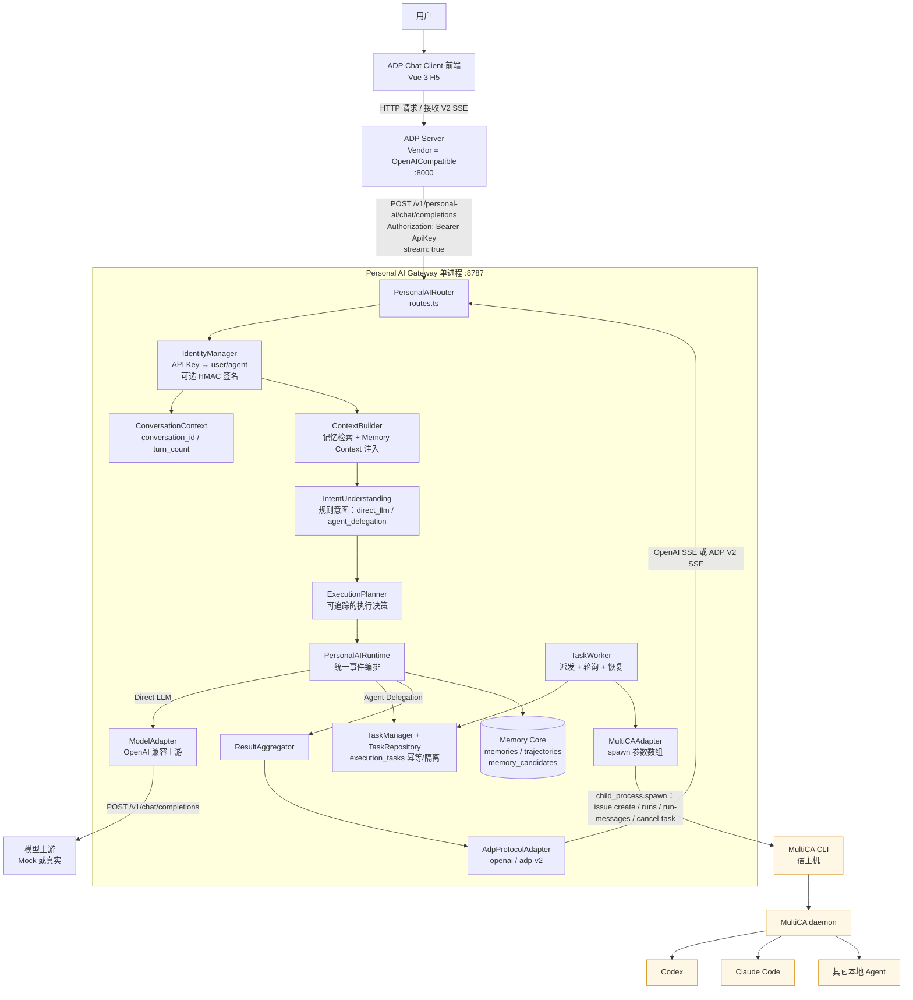

# 知忆（Zhiyi）

> **知忆是个人 AI 经验操作系统**。前端使用 ADP Chat 作为日常工作台，后端 Gateway 驱动模型、记忆与外部 Agent 接入。
> 完整产品定位、核心表面与演进路线详见 [PRODUCT.md](./PRODUCT.md)。

---

## 1. 快速开始

### 环境要求

- Node.js **>= 22.5.0**（使用内置 `node:sqlite`，无需原生编译）
- npm >= 10

```bash
cd universal-memory-gateway
cp .env.example .env        # 默认值复制即可运行，无需任何外部凭证
cp .env.personal-ai.example .env.personal-ai   # Personal AI 层配置（MultiCA 默认关闭）
npm install
npm run build
npm start
```

或者一键脚本：

```bash
bash scripts/start.sh
```

启动后：

```bash
curl http://127.0.0.1:8787/health
```

> `node:sqlite` 在 Node 22 中仍是实验特性，启动时可能看到 `ExperimentalWarning: SQLite is an experimental feature`，不影响功能。

数据库会在首次启动时按序幂等执行 `migrations/` 下的 SQL（001 初始 schema、002 轨迹去重维度修正、003 Personal AI 任务与会话表）+ schema 版本表，并写入内置的 Developer / Researcher 两个 Agent Profile。也可手动执行：

```bash
npm run db:init
```

### Docker

```bash
docker compose up --build
# sqlite 数据持久化在 volume memory-data:/app/data
```

---

## 2. 配置说明

所有配置从环境变量读取（`.env` 或 `docker-compose.yml`），敏感信息不硬编码。完整清单见 `.env.example`。

| 变量 | 默认值 | 说明 |
| --- | --- | --- |
| `PORT` | `8787` | 服务端口 |
| `DATABASE_URL` | `./data/memory.db` | SQLite 文件；`:memory:` 为纯内存 |
| `MULTICA_BASE_URL` | 空 | MultiCA 地址；**留空自动启用内置 Mock** |
| `MULTICA_API_KEY` | 空 | 真实联调用的 Bearer Token |
| `DEFAULT_MODEL` | `mock-gpt` | 客户端未传 model 时的默认值 |
| `MOCK_UPSTREAM` | `true` | 显式开启内置 Mock 上游 |
| `UPSTREAM_TIMEOUT_MS` | `30000` | 上游超时（毫秒） |
| `MEMORY_ENABLED` | `true` | 是否自动注入记忆上下文 |
| `MEMORY_AUTO_EXTRACT` | `true` | 是否后台自动提取候选记忆 |
| `MEMORY_MAX_ITEMS` | `5` | 单次注入最大记忆条数 |
| `MEMORY_TOKEN_BUDGET` | `800` | 注入预算（按字符粗估，1 token ≈ 4 字符） |
| `EXTRACT_MIN_CONFIDENCE` | `0.6` | 低于该值的候选标记为 `low_confidence` |
| `API_KEYS` | 空 → 内置开发 Key | JSON 映射，见下 |
| `DEFAULT_USER_ID` / `DEFAULT_AGENT_ID` | `u1` / `developer` | 未提供或未识别 Key 时的兜底身份 |

### 开箱即用的开发 API Key

| API Key | user_id | agent_id | 用途 |
| --- | --- | --- | --- |
| `dev-key-developer` | `u1` | `developer` | 研发 Agent |
| `dev-key-researcher` | `u1` | `researcher` | 调研 Agent（与 Developer 共享 u1 记忆） |
| `dev-key-user2` | `u2` | `developer` | 另一个用户，用于验证严格隔离 |

通过 `Authorization: Bearer <key>` 或 `X-API-Key: <key>` 传递。**服务端绝不信任请求体中的 `user_id` / `agent_id`**，它们会被忽略并从转发请求中剥离；未提供 Key 时使用兜底身份，保证本地 PoC 可跑。

自定义映射示例：

```bash
API_KEYS='{"codex-prod":{"user_id":"alice","agent_id":"codex"},"claude-prod":{"user_id":"alice","agent_id":"claude-code"}}'
```

上下文 ID 可通过 header 或 body 扩展字段传入（header 优先）：`X-Session-Id` / `X-Task-Id` / `X-Project-Id` 支持 header 与 body；`X-Request-Id`（`request_id` 用于轨迹去重）**仅支持 header**，body 中的 `request_id` 会被忽略并从上游请求中剥离。

---

## 3. 真实 MultiCA 联调

本地**没有** MultiCA 模型凭证，因此默认走内置 Mock。真实联调需要三项配置：

| 配置 | 说明 |
| --- | --- |
| `MULTICA_BASE_URL` | MultiCA 的 OpenAI 兼容服务根地址，例如 `https://multica.example.com`（网关会拼接 `/v1/chat/completions`；若地址已含 `/v1` 或完整路径则自动识别） |
| `MULTICA_API_KEY` | Bearer Token，网关转发时自动加 `Authorization: Bearer <key>` |
| `DEFAULT_MODEL` | MultiCA 上实际可用的模型名（客户端未传 `model` 时使用） |

同时把 `MOCK_UPSTREAM=false`（或删除），并且 `MULTICA_BASE_URL` 不能为空：

```bash
MOCK_UPSTREAM=false
MULTICA_BASE_URL=https://multica.example.com
MULTICA_API_KEY=sk-xxxxxxxx
DEFAULT_MODEL=your-model-name
```

真实模式下：

- 聊天请求与提取请求都按 **OpenAI Chat Completions 协议**转发到 `<MULTICA_BASE_URL>/v1/chat/completions`；
- 提取器要求模型返回 JSON（`response_format: {type: "json_object"}`），若模型不支持或调用失败，会自动回退到内置规则提取，不会阻塞主链路；
- `/__mock__/*` 调试端点与 `/mock/v1/chat/completions` 在真实模式下**不再暴露**。

> 参考：本地 `multica` 开源项目是 Agent 任务看板平台，不提供本任务所需的多模型路由推理端点；本网关不重新实现模型路由 / Multi-Agent 编排，只做标准 OpenAI 协议转发。

---

## 4. API 清单

| 方法 | 路径 | 说明 |
| --- | --- | --- |
| GET | `/health` | 服务状态（db、upstream/mock、记忆开关） |
| POST | `/v1/chat/completions` | **代理入口**：OpenAI 兼容，支持非流式与 SSE 流式 |
| POST | `/v1/memories` | 创建记忆 |
| GET | `/v1/memories` | 记忆列表（可按 agent/project/type/scope 过滤、分页） |
| GET | `/v1/memories/:id` | 按 id 读取（强制 user_id 隔离） |
| PATCH | `/v1/memories/:id` | 更新记忆 |
| DELETE | `/v1/memories/:id` | 删除记忆 |
| POST | `/v1/memories/search` | 关键词加权检索，返回命中与分数 |
| POST | `/v1/agents` | 创建 / 覆盖 Agent Profile |
| GET | `/v1/agents` | Profile 列表（含内置 Developer / Researcher） |
| GET | `/v1/agents/:id/profile` | 读取单个 Profile |
| POST | `/v1/trajectories` | 手动补录轨迹（按 `(user_id, request_id)` 去重） |
| GET | `/v1/trajectories` | 轨迹列表（按当前用户过滤、简单分页） |
| GET | `/v1/memory-candidates` | 候选列表（可按 status 过滤） |
| POST | `/v1/memory-candidates/:id/approve` | 确认入库（幂等） |
| POST | `/v1/memory-candidates/:id/reject` | 拒绝候选 |
| GET | `/v1/memory-desk/memories` | **记忆台**：正式记忆列表（支持 type/scope/category/status 过滤与分页） |
| POST | `/v1/memory-desk/memories` | **记忆台**：手动创建正式记忆（`source='manual'`，可挂载证据轨迹） |
| GET | `/v1/memory-desk/candidates` | **记忆台**：候选记忆列表（默认 `pending`，支持 status 过滤与分页） |
| GET | `/v1/memory-desk/candidates/:id` | **记忆台**：候选详情（含 `evidence_trajectory_ids` 与人机对话证据摘要） |
| POST | `/v1/memory-desk/candidates/:id/approve` | **记忆台**：审批候选入库（幂等；强校验有效证据轨迹，无有效证据拒绝 400） |
| POST | `/v1/memory-desk/candidates/:id/reject` | **记忆台**：拒绝候选记忆（幂等；已通过的候选禁止拒绝 409） |
| GET | `/__mock__/last-request` | **仅 Mock 模式**：最后一次上游请求（用于验证注入） |
| POST | `/__mock__/configure` | **仅 Mock 模式**：设置响应行为 |
| POST | `/__mock__/reset` | **仅 Mock 模式**：清空请求记录并复位行为 |
| POST | `/mock/v1/chat/completions` | **仅 Mock 模式**：直连 Mock 上游 |
| POST | `/v1/personal-ai/chat/completions` | **Personal AI 对话入口**（ADP 用的就是它，OpenAI 兼容 + SSE），详见 [§10](#10-personal-ai-api-说明) |
| POST | `/v1/personal-ai/messages` | Personal AI 的 ADP V2 SSE 直连模式 |
| GET | `/v1/personal-ai/tasks` | 当前用户的执行任务列表 |
| GET | `/v1/personal-ai/tasks/:id` | 单个任务（非本人 404） |
| POST | `/v1/personal-ai/tasks/:id/cancel` | 取消未完成任务（已终态 409） |
| GET | `/health/personal-ai` | Personal AI / ADP / Memory / MultiCA daemon 聚合健康 |

### 记忆字段

`memory_id, user_id, agent_id, project_id, type, scope, content, source, confidence, created_at, updated_at`

- `type`: `identity | episodic | semantic | procedural | working`
- `scope`: `personal | agent | project | organization`
- 检索优先级：**当前用户个人记忆 > 当前 Agent 专属 > 当前 Project > 关键词相关性 > 置信度 > 更新时间**
- 同一条 `personal` 记忆对同一用户的所有 Agent 可见；其它 Agent 的 `scope=agent` 记忆、其它项目的 `scope=project` 记忆不可见。

### Mock 上游可配置行为

`POST /__mock__/configure` 请求体：

```json
{ "mode": "auto", "status": 200, "delayMs": 0, "errorBody": {}, "chunks": ["a", "b"] }
```

`mode` 取值：`auto`（默认文本）、`text`、`tool`（返回 tool_calls）、`error`（返回 `status` 与 `errorBody`）、`slow`（延迟到超时）、`stream`（强制 SSE 分块）。`delayMs` 可给任意模式加延迟，`chunks` 可自定义流式文本分片。

---

## 5. curl 示例

下例假设服务在 `http://127.0.0.1:8787`。

### 5.1 创建一条用户偏好记忆

```bash
curl -s -X POST http://127.0.0.1:8787/v1/memories \
  -H 'Content-Type: application/json' \
  -H 'Authorization: Bearer dev-key-developer' \
  -d '{
    "content": "技术方案优先考虑简单、可维护，避免不必要的复杂架构",
    "type": "semantic",
    "scope": "personal",
    "confidence": 0.95
  }'
```

### 5.2 Developer 发起模型请求

```bash
curl -s -X POST http://127.0.0.1:8787/v1/chat/completions \
  -H 'Content-Type: application/json' \
  -H 'Authorization: Bearer dev-key-developer' \
  -d '{
    "model": "mock-gpt",
    "messages": [{"role":"user","content":"帮我设计一个 Java 服务架构"}]
  }'
```

### 5.3 查看上游实际收到的请求（验证注入）

```bash
curl -s http://127.0.0.1:8787/__mock__/last-request
```

响应中的 `request.messages` 会多出一条独立 `system` message，含 `[Memory Context]`、免责文案与上面的偏好。若原请求自带 system prompt，注入的 system 会放在它**之后**，不覆盖、不改工具定义。

### 5.4 Researcher 读取同一份记忆（上下文有角色差异）

```bash
curl -s -X POST http://127.0.0.1:8787/v1/chat/completions \
  -H 'Content-Type: application/json' \
  -H 'Authorization: Bearer dev-key-researcher' \
  -d '{
    "messages": [{"role":"user","content":"帮我调研 Java 服务架构方案"}]
  }'
curl -s http://127.0.0.1:8787/__mock__/last-request
```

两个 Agent 都能读到该偏好，但注入文本中的「当前 Agent / 检索关注点」不同（Developer 侧重技术栈、架构决策、历史 Bug；Researcher 侧重技术选型、评估标准）。

### 5.5 搜索记忆

```bash
curl -s -X POST http://127.0.0.1:8787/v1/memories/search \
  -H 'Content-Type: application/json' \
  -H 'Authorization: Bearer dev-key-developer' \
  -d '{"query":"技术方案优先考虑简单可维护架构","limit":5}'
```

### 5.6 用户隔离验证

```bash
# u2 搜索不到 u1 的记忆
curl -s -X POST http://127.0.0.1:8787/v1/memories/search \
  -H 'Content-Type: application/json' \
  -H 'Authorization: Bearer dev-key-user2' \
  -d '{"query":"简单 可维护 架构"}'

# u2 直接读取 u1 的记忆 id 返回 404
curl -s -i http://127.0.0.1:8787/v1/memories/<u1-memory-id> \
  -H 'Authorization: Bearer dev-key-user2'
```

### 5.7 自动提取 → 候选 → approve

```bash
# 触发一次含长期价值信息的对话
curl -s -X POST http://127.0.0.1:8787/v1/chat/completions \
  -H 'Content-Type: application/json' \
  -H 'Authorization: Bearer dev-key-developer' \
  -d '{"messages":[{"role":"user","content":"我们决定采用 PostgreSQL 作为主数据库，以后请记住这个技术栈偏好"}]}'

# 稍等后台任务完成（进程内队列，通常毫秒级），查看轨迹与候选
curl -s 'http://127.0.0.1:8787/v1/trajectories' -H 'Authorization: Bearer dev-key-developer'
curl -s 'http://127.0.0.1:8787/v1/memory-candidates' -H 'Authorization: Bearer dev-key-developer'
# 或用 CLI：npm run candidates -- pending u1

# 确认入库（幂等，重复调用不会再插入记忆）
curl -s -X POST http://127.0.0.1:8787/v1/memory-candidates/<candidate-id>/approve \
  -H 'Content-Type: application/json' \
  -H 'Authorization: Bearer dev-key-developer' -d '{}'
```

### 5.8 SSE 流式

```bash
curl -N -X POST http://127.0.0.1:8787/v1/chat/completions \
  -H 'Content-Type: application/json' \
  -H 'Authorization: Bearer dev-key-developer' \
  -d '{"stream":true,"messages":[{"role":"user","content":"请流式回答"}]}'
```

### 5.9 tool_calls 透传

```bash
curl -s -X POST http://127.0.0.1:8787/__mock__/configure \
  -H 'Content-Type: application/json' -d '{"mode":"tool"}'

curl -s -X POST http://127.0.0.1:8787/v1/chat/completions \
  -H 'Content-Type: application/json' \
  -H 'Authorization: Bearer dev-key-developer' \
  -d '{
    "model":"mock-gpt",
    "tools":[{"type":"function","function":{"name":"get_weather","description":"查天气","parameters":{"type":"object","properties":{"city":{"type":"string"}}}}}],
    "tool_choice":"auto",
    "messages":[
      {"role":"user","content":"深圳天气怎么样"},
      {"role":"assistant","content":null,"tool_calls":[{"id":"call_1","type":"function","function":{"name":"get_weather","arguments":"{\"city\":\"Shenzhen\"}"}}]},
      {"role":"tool","tool_call_id":"call_1","content":"晴 26 度"}
    ]
  }'
# 复位：curl -s -X POST http://127.0.0.1:8787/__mock__/reset -d '{}'
```

### 5.10 记忆台（Memory Desk）治理链路

记忆台统一通过 `/v1/memory-desk` 前缀提供轻量管理接口，身份严格通过 API Key 解析，越权一律 404。

#### 1. 查看待审批候选记忆列表（默认 pending，支持分页）

```bash
curl -s -H "Authorization: Bearer dev-key-developer" \
  "http://127.0.0.1:8787/v1/memory-desk/candidates?limit=10&offset=0"
```

响应示例：
```json
{
  "items": [
    {
      "id": "cand_a1b2c3d4",
      "user_id": "u1",
      "type": "semantic",
      "scope": "personal",
      "category": "preference",
      "content": "包管理工具统一使用 pnpm",
      "confidence": 0.95,
      "status": "pending",
      "evidence_trajectory_ids": ["req_20261114_trace1"]
    }
  ],
  "total": 1,
  "limit": 10,
  "offset": 0
}
```

#### 2. 查看候选详情与证据轨迹摘要

审查候选记忆时可直接获取人机交互摘要（用户提问与模型答复截取）：

```bash
curl -s -H "Authorization: Bearer dev-key-developer" \
  "http://127.0.0.1:8787/v1/memory-desk/candidates/cand_a1b2c3d4"
```

响应示例：
```json
{
  "candidate": {
    "id": "cand_a1b2c3d4",
    "content": "包管理工具统一使用 pnpm",
    "status": "pending"
  },
  "evidence_trajectory_ids": ["req_20261114_trace1"],
  "evidence_trajectories": [
    {
      "id": "traj_001",
      "request_id": "req_20261114_trace1",
      "agent_id": "developer",
      "model": "deepseek-chat",
      "user_prompt": "以后所有项目统一用 pnpm 管理依赖",
      "assistant_response": "已记录该规范，后续依赖管理优先使用 pnpm。",
      "created_at": "2026-11-14T10:00:00.000Z"
    }
  ]
}
```

#### 3. 审批通过候选入库（幂等；无证据或证据无效返回 400）

```bash
curl -s -X POST -H "Authorization: Bearer dev-key-developer" \
  "http://127.0.0.1:8787/v1/memory-desk/candidates/cand_a1b2c3d4/approve"
```

响应示例：
```json
{
  "ok": true,
  "idempotent": false,
  "memory": {
    "memory_id": "mem_e5f6g7h8",
    "user_id": "u1",
    "type": "semantic",
    "scope": "personal",
    "content": "包管理工具统一使用 pnpm",
    "source": "candidate:cand_a1b2c3d4",
    "verified_by_user": true,
    "evidence_trajectory_ids": ["req_20261114_trace1"]
  },
  "candidate": {
    "id": "cand_a1b2c3d4",
    "status": "approved",
    "created_memory_id": "mem_e5f6g7h8"
  }
}
```

#### 4. 在正式记忆库中查询已审核记忆

```bash
curl -s -H "Authorization: Bearer dev-key-developer" \
  "http://127.0.0.1:8787/v1/memory-desk/memories?scope=personal&type=semantic"
```

#### 5. 拒绝候选记忆（幂等）

```bash
curl -s -X POST -H "Authorization: Bearer dev-key-developer" \
  "http://127.0.0.1:8787/v1/memory-desk/candidates/cand_a1b2c3d4/reject"
```

#### 6. 手动录入正式记忆（标记 source=manual，支持挂载证据轨迹）

```bash
curl -s -X POST -H "Authorization: Bearer dev-key-developer" \
  -H "Content-Type: application/json" \
  -d '{
    "content": "职业角色为资深架构师，代码注释遵循最新设计规范",
    "type": "semantic",
    "scope": "personal",
    "category": "profile",
    "evidence_trajectory_ids": ["req_20261114_trace1"]
  }' \
  "http://127.0.0.1:8787/v1/memory-desk/memories"
```

---

## 6. 五大验证场景（手动复现步骤）

| 场景 | 操作 | 预期 |
| --- | --- | --- |
| 一 记忆写入 | §5.1 创建偏好 → `GET /v1/memories` | 返回 201，记忆可按 id / 列表查询，字段完整 |
| 二 跨 Agent 读取 | §5.2 Developer 请求、§5.4 Researcher 请求，各查一次 `__mock__/last-request` | 两次上游请求都含该偏好；注入 system 的 Agent 角色/关注点文本不同；原消息与工具语义不变 |
| 三 隔离 | §5.6 用 `dev-key-user2` search / GET u1 的记忆 | search 无命中，GET 返回 404，PATCH/DELETE 也返回 404 |
| 四 自动提取 | §5.7 完成一次含「我们决定 / 记住 / 技术栈」的对话 | 轨迹存在（含 request/response/model/上下文 ID）→ 产生候选（带 `trajectory_id`）→ approve 后进入正式记忆库 → 其它 Agent 可检索 |
| 五 代理 | §5.2 非流式、§5.8 SSE、`/__mock__/configure` 设 `mode=tool` / `mode=error` / `mode=slow` | 非流式保持 id/object/created/model/choices/usage；SSE 逐块以 `[DONE]` 结束；tool_calls 原样透传；上游错误原样回传；超时返回 504 |

自动化测试覆盖以上全部场景：

```bash
npm test
```

---

## 7. 测试与常用命令

```bash
npm install         # 安装依赖（纯 JS 依赖，无原生编译）
npm run build       # tsc 编译 + 复制 migrations 到 dist
npm test            # vitest 全量测试（临时数据库 + 自启 Mock 上游，不污染主库）
npm run db:init     # 幂等初始化数据库并 seed Agent Profile
npm run candidates -- pending u1   # CLI 查看候选记忆
npm run dev         # tsx 直接运行源码（无需编译）
node scripts/smoke-personal-ai.mjs # 真实 HTTP 冒烟（需先 build；真实端口 + 文件库 + stub CLI），等价于 npm run smoke
```

测试使用 `:memory:` 纯内存 SQLite 数据库与随机端口，完全不污染主库，也无需清理临时文件。

---

---

## 8. Personal AI Gateway V1

### 8.1 定位与兼容承诺

在第 1–7 章的「记忆核心 + 模型网关」（下称 **MVP 层**）之上，新增一层 **Personal AI 层**：同一个进程、同一个端口，同时承担四件事：

1. **对话入口**：ADP Chat Client 的 `OpenAICompatible` vendor 直接指向本服务，用户在 Web UI 里聊天即可；
2. **意图判断**：规则驱动、可解释（关键词 + 动作词），V1 **不**调用模型做「要不要调 Agent」的二次推理；
3. **任务编排**：代码/仓库/排查类任务交给本机 **MultiCA CLI**，由 MultiCA daemon 调度 Codex / Claude Code 等 Agent 真正执行；
4. **结果汇总与记忆沉淀**：Agent 输出经 `ResultAggregator` 整理成一段回答，同时复用 MVP 的轨迹保存 + 候选记忆提取。

> **兼容承诺（已被测试锁定）**：MVP 层的 16 个环境变量、`/v1/*` REST、`/v1/chat/completions` 代理语义**完全不变**；`tests/` 中 41 个 MVP 用例保持全绿，`.env.example` 与 `src/config.ts` 仍一一对应。Personal AI 的新变量全部放在独立的 `.env.personal-ai.example`。

### 8.2 最终架构



**为什么默认走 `openai` 协议**：ADP 的 `OpenAICompatible` vendor 只认标准 OpenAI SSE，并且**永远是 `stream: true`**（`server/vendor/openai_compatible/openai_compatible.py:186`）。它收到我们的 chunk 后，自己转换成前端要的 V2 SSE 事件（`to_event()`）。所以「ADP 私有协议」的复杂度留在 ADP 内部，本 Gateway 只产标准 OpenAI 流——这是真实链路；`adp-v2` 协议仅用于直连调试/扩展验证。

### 8.3 目录结构（含 `src/personal-ai` 子树）

```
universal-memory-gateway/
├── src/
│   ├── app.ts                        # 装配：personalAI.router 优先挂载，再挂 MVP 路由
│   ├── server.ts                     # 启动入口（自动读取 .env / .env.personal-ai）
│   ├── db.ts                         # SQLite + 迁移（001/002/003）
│   ├── config.ts                     # 基础层 16 个变量（契约不变）
│   ├── personal-ai/                  # ★ Personal AI 层（19 个文件）
│   │   ├── index.ts                  # createPersonalAI()：装配全部子模块并启动 Worker
│   │   ├── routes.ts                 # HTTP 接口（chat/completions、messages、tasks、health）
│   │   ├── config.ts                 # Personal AI 独立配置（20 个变量）
│   │   ├── events/
│   │   │   ├── event-types.ts        # 内部 PersonalAIEvent 联合类型（10 种）
│   │   │   └── event-bus.ts          # 进程内事件分发
│   │   ├── identity/identity-manager.ts        # 可信身份 + conversation_id 推导 + HMAC
│   │   ├── conversation/conversation-context.ts # conversation_contexts 表读写
│   │   ├── task/
│   │   │   ├── task-manager.ts       # 门面：只暴露带 user_id 约束的操作
│   │   │   └── task-repository.ts    # execution_tasks 持久化 / 幂等 / recover()
│   │   ├── adapters/
│   │   │   ├── model/model-adapter.ts          # 复用 MVP 上游（transport 注入）
│   │   │   ├── agent/agent-adapter.ts          # Agent 执行平台接口
│   │   │   ├── agent/multica-adapter.ts        # MultiCA CLI 实现（spawn + 严格校验）
│   │   │   └── protocol/adp-protocol-adapter.ts # 内部事件 → openai / adp-v2 SSE
│   │   ├── runtime/
│   │   │   ├── personal-ai-runtime.ts # 唯一决策与编排入口（异步事件生成器）
│   │   │   ├── context-builder.ts     # 统一上下文（记忆命中 + system 注入）
│   │   │   ├── intent-understanding.ts # 规则意图识别
│   │   │   ├── execution-planner.ts   # 执行计划（含降级判断）
│   │   │   └── result-aggregator.ts   # Agent 结果 → 用户可读回答
│   │   └── worker/task-worker.ts      # 后台派发/轮询 Worker（不依赖 HTTP 生命周期）
│   ├── routes.ts / proxy.ts / memories.ts / search.ts / context.ts / extractor.ts ...
│   └── mock-upstream.ts              # 内置 OpenAI 兼容 Mock（本地无凭证也能跑通）
├── migrations/
│   ├── 001_init.sql                  # 初始 schema + schema_migrations
│   ├── 002_trajectory_request_scope.sql  # 轨迹按 (user_id, request_id) 去重
│   └── 003_personal_ai.sql           # execution_tasks / conversation_contexts
├── scripts/
│   ├── start.sh                      # 本地一键启动（.env + .env.personal-ai）
│   ├── db-init.ts                    # 幂等建库 + seed Agent Profile
│   ├── candidates.ts                 # CLI 查看候选记忆
│   ├── mock-multica-cli.mjs          # MultiCA CLI 测试替身（可注入 stuck/sleep）
│   └── smoke-personal-ai.mjs         # ★ 真实 HTTP 冒烟（编译产物 + 真文件库 + stub CLI）
├── tests/                            # vitest：MVP 41 例 + Personal AI 27 例 + QA 回归 3 例 = 71 例
├── Dockerfile / docker-compose.yml    # compose 含 gateway / personal-ai-gateway / adp-chat-client
├── README.md / ARCHITECTURE.md
├── .env.example                      # 基础层 16 个变量（契约锁定）
└── .env.personal-ai.example          # Personal AI 层 20 个变量
```

---

## 9. ADP Chat Client 接入

### 9.1 APP_CONFIGS 配置示例

ADP 用 `APP_CONFIGS`（JSON 数组）描述「一个对话应用」。要让它把本 Gateway 当作后端，`Vendor` 必须是 `OpenAICompatible`：

```bash
APP_CONFIGS='[
  {
    "Vendor": "OpenAICompatible",
    "ApplicationId": "personal-ai-gateway",
    "Comment": "Personal AI Gateway（本地）",
    "DisplayName": "知忆",
    "Avatar": "http://127.0.0.1:8000/static/brand/zhiyi-256.png",
    "Greeting": "你好，我是你的个人 AI。长任务我会交给本地 Agent 执行。",
    "OpeningQuestions": ["帮我分析这个代码仓库的架构", "解释一下 CAP 定理"],
    "BaseUrl": "http://127.0.0.1:8787/v1/personal-ai",
    "ApiKey": "dev-key-developer",
    "ModelName": "mock-gpt",
    "Temperature": 0.7,
    "MaxTokens": 2000
  }
]'
```

字段来源逐一核实过（`server/vendor/openai_compatible/openai_compatible.py:41-48,136-142`）：

| 字段 | 说明 |
| --- | --- |
| `Vendor` | 固定 `OpenAICompatible`（另有 `OpenAI` / `Ollama` 子类，行为一致） |
| `ApplicationId` | 应用唯一 ID，任意字符串 |
| `BaseUrl` | **指向本 Gateway 的 `/v1/personal-ai` 前缀** |
| `ApiKey` | 会被放进 `Authorization: Bearer <ApiKey>`；本 Gateway 用它解析 `user_id` / `agent_id`。**非 localhost 地址时该字段必填**（ADP 源码强校验） |
| `ModelName` | 透传给我们的 `model` 字段；本地 Mock 模式下随意填 |
| `Temperature` / `MaxTokens` | 透传，Mock 模式忽略 |
| `DisplayName` / `Avatar` / `Greeting` / `OpeningQuestions` | 仅前端展示 |

> ⚠️ **`BaseUrl` 的路径陷阱（务必注意）**：ADP 会自行拼接 `/chat/completions`，并且有这样的规整逻辑——`if not base_url.endswith('/v1') and '/v1/' not in base_url: base_url += '/v1'`。
> 我们要的最终地址是 `/v1/personal-ai/chat/completions`，因此 `BaseUrl` 必须写成 `http://host:port/v1/personal-ai`：
> 它**不以** `/v1` 结尾（第一个条件为真），但**包含** `/v1/`（第二个条件为假），整体判断为假 → 不会追加多余的 `/v1`。
> 若写成 `http://host:port/v1/personal-ai/`（末尾斜杠）或 `http://host:port`，最终 URL 会变成 `/v1/personal-ai//chat/completions` 或 `/v1/chat/completions`，前者 404、后者会打到 MVP 代理而不是 Personal AI 层。

### 9.2 协议转换链路

```
浏览器（ADP 前端）
   │  ① HTTP 请求 + 接收 V2 SSE（request_ack / response.created / text.delta / ...）
   ▼
ADP Server（Vendor=OpenAICompatible）
   │  ② 按 OpenAI Chat Completions 请求我们，固定 "stream": true，
   │     header: Authorization: Bearer <ApiKey>
   ▼
本 Gateway  /v1/personal-ai/chat/completions
   │  ③ 输出标准 OpenAI SSE：data: {"choices":[{"delta":{"content":"..."}}]} ... data: [DONE]
   ▼
ADP Server
   │  ④ 内部把每个 delta 转成 EventType 枚举内的事件（to_event()）
   ▼
浏览器（V2 SSE）
```

因此：**我们不需要、也不应该向 ADP 前端直接喷私有事件**。任务进度一律编码成普通文本（`delta.content`），由 ADP 当作回复正文渲染。

### 9.3 启动方式

```bash
# 本机（不使用 Docker）：
# 终端 A —— 本 Gateway（Personal AI + ADP 后端）
cp .env.example .env && cp .env.personal-ai.example .env.personal-ai
npm install && npm run build && npm start        # http://127.0.0.1:8787

# 终端 B —— ADP Chat Client（独立仓库，本仓库未修改其任何文件）
cd ../adp-chat-client
# 按其 README 在 server/.env 配置 APP_CONFIGS（§9.1）与 SECRET_KEY
make dev            # 并行启动 server + UI；server 端口取 server/.env 的 SERVER_HTTP_PORT
# 或按其 README 用 Docker 启动（镜像内固定监听 8000）
```

容器化编排见 §15.2（`docker-compose.yml` 已加 `adp-chat-client` 与 `personal-ai-gateway` 两个服务）。

> **未验证项**：本机没有 Docker，也未安装 ADP server 的 Python 运行时依赖（其 `uv sync` / `make init` 未执行），因此没有真正启动 ADP 前端。所以「ADP UI 里真实对话」这条链路**未实际跑通**，只在源码层面逐行核对了 vendor 请求格式（`openai_compatible.py:136-201`）与事件枚举（`interface.py:86-112`），并用 §16 的协议级 E2E 覆盖了 Gateway 侧的等价行为。

---

## 10. Personal AI API 说明

所有端点都以 `src/personal-ai/routes.ts` 为准。身份规则与 MVP 一致：**`user_id` / `agent_id` 只能来自服务端 API Key 映射**，body 里的 `user_id` / `agent_id` 一律忽略。

### 10.1 路由清单

| 方法 | 路径 | 说明 |
| --- | --- | --- |
| POST | `/v1/personal-ai/chat/completions` | **主入口**（ADP 用的就是它）。OpenAI 兼容；默认 SSE 流式，`stream: false` 返回非流式 JSON |
| POST | `/v1/personal-ai/messages` | ADP V2 SSE 直连模式，只输出源码枚举内的事件（调试/A2A 扩展用）；`PERSONAL_AI_ENABLED=false` 时与主入口一致返回 503 |
| GET | `/v1/personal-ai/tasks` | 当前用户任务列表，`?limit=`（默认 50，上限 200） |
| GET | `/v1/personal-ai/tasks/:id` | 单个任务；非本人任务返回 **404**（不泄露存在性） |
| POST | `/v1/personal-ai/tasks/:id/cancel` | 取消未完成任务；不存在 404，已终态 409 |
| GET | `/health/personal-ai` | 聚合健康：Personal AI / ADP / Memory Core / MultiCA daemon / 活跃任务数 |

### 10.2 请求头

| Header | 说明 |
| --- | --- |
| `Authorization: Bearer <apiKey>` 或 `X-API-Key` | 身份来源（必需；未识别时退化为 `u1` / `developer`） |
| `X-PersonalAI-Timestamp` + `X-PersonalAI-Signature` | 配置 `PERSONAL_AI_SHARED_SECRET` 后**强制校验**：`hex(HMAC_SHA256(secret, "<timestamp>.<rawBody>"))`，且时间戳偏移不得超过 `PERSONAL_AI_SIGNATURE_MAX_AGE_MS` |
| `X-Conversation-Id` | 覆盖默认的 `conversation_id` 推导 |
| `X-Request-Id` | 幂等键来源（同一 `user_id` + 同一 `request_id` 只创建一个任务/一条轨迹） |
| `X-Session-Id` / `X-Task-Id` / `X-Project-Id` | 透传到轨迹 |
| `X-PersonalAI-Protocol: adp-v2`（或 `?protocol=adp-v2`） | 仅对 `chat/completions` 生效，覆盖输出协议 |

### 10.3 对话（Direct LLM）示例

```bash
curl -s -X POST http://127.0.0.1:8787/v1/personal-ai/chat/completions \
  -H 'Content-Type: application/json' \
  -H 'Authorization: Bearer dev-key-developer' \
  -d '{
    "model": "mock-gpt",
    "messages": [{"role":"user","content":"解释一下 CAP 定理"}],
    "stream": false
  }'
```

```json
{
  "id": "chatcmpl-2f0c...",
  "object": "chat.completion",
  "created": 1762000000,
  "model": "mock-gpt",
  "choices": [{ "index": 0, "message": { "role": "assistant", "content": "……" }, "finish_reason": "stop" }],
  "usage": { "prompt_tokens": 0, "completion_tokens": 0, "total_tokens": 0 }
}
```

> `usage` 恒为 0：本地 Mock / OpenAI 兼容上游不返回 token 用量时不猜测填充。

流式（`stream` 缺省或 `true`）返回 `text/event-stream`：

```
data: {"id":"chatcmpl-...","object":"chat.completion.chunk","created":1762000000,"model":"mock-gpt","choices":[{"index":0,"delta":{"role":"assistant"},"finish_reason":null}]}

data: {"...同上...","choices":[{"index":0,"delta":{"content":"你好"},"finish_reason":null}]}

data: {"...同上...","choices":[{"index":0,"delta":{},"finish_reason":"stop"}]}

data: [DONE]
```

### 10.4 任务（Agent Delegation）示例

```bash
curl -s -X POST http://127.0.0.1:8787/v1/personal-ai/chat/completions \
  -H 'Content-Type: application/json' \
  -H 'Authorization: Bearer dev-key-developer' \
  -H 'X-Request-Id: demo-req-1' \
  -d '{"messages":[{"role":"user","content":"帮我分析这个 Java 代码仓库的架构实现"}],"stream":false}'
```

回复正文（纯文本，进度 + 汇总结果）：

```
[Personal AI] 任务 task_6ee50a9f-… 已提交至 MultiCA，等待本地 daemon 领取。

[Personal AI] 任务进度 running：已创建 MultiCA issue MUL-1001（todo）

[Personal AI] Agent Codex 已开始执行。

## Agent 执行结果

- 任务：`task_6ee50a9f-…`
- 执行 Agent：Codex

读取任务上下文
Agent 已完成分析：……
```

查询任务：

```bash
curl -s 'http://127.0.0.1:8787/v1/personal-ai/tasks?limit=10' -H 'Authorization: Bearer dev-key-developer'
```

```json
{
  "items": [
    {
      "id": "task_6ee50a9f-c900-4117-b3d4-90948a398558",
      "user_id": "u1",
      "conversation_id": "conv_9d3f…",
      "request_id": "demo-req-1",
      "idempotency_key": "u1:demo-req-1",
      "agent_id": "Codex",
      "project_id": null,
      "execution_mode": "agent_delegation",
      "external_task_id": "MUL-1001",
      "external_run_id": "run-MUL-1001-0001",
      "status": "completed",
      "input_summary": "帮我分析这个 Java 代码仓库的架构实现",
      "result": "读取任务上下文\nAgent 已完成分析：……",
      "error": null,
      "progress_message": "MultiCA run=run-MUL-1001-0001 status=completed",
      "poll_count": 3,
      "attempt_count": 1,
      "created_at": "2026-11-11T13:20:12.001Z",
      "started_at": "2026-11-11T13:20:12.100Z",
      "completed_at": "2026-11-11T13:20:13.400Z",
      "updated_at": "2026-11-11T13:20:13.400Z"
    }
  ]
}
```

> `result` 保存的是 **Agent 原始输出**（`issue run-messages` 拼接）；给用户看的 `## Agent 执行结果` 包装只出现在对话回复里（`ResultAggregator`）。两者都能在同一份任务记录与回复中对照。

取消：

```bash
curl -s -X POST http://127.0.0.1:8787/v1/personal-ai/tasks/task_6ee50a9f-…/cancel \
  -H 'Content-Type: application/json' -H 'Authorization: Bearer dev-key-developer' -d '{}'
```

```json
{
  "ok": true,
  "task": { "...": "status = cancelled" },
  "external_cancelled": true,
  "note": "内部任务与 MultiCA run 均已取消"
}
```

- `external_cancelled` 表示是否同时取消了 MultiCA run（需要 `external_run_id` 且 CLI 可用）；
- 已 `completed` / `failed` / `cancelled` 的任务返回 **409**，理由在 `error.message`（`任务无法取消：already_completed`）。

### 10.5 健康检查示例

```bash
curl -s http://127.0.0.1:8787/health/personal-ai
```

```json
{
  "status": "ok",
  "personal_ai": { "enabled": true, "protocol": "openai", "signature_required": false },
  "adp": { "configured": false, "reachable": null },
  "memory_core": { "db": "ok", "memory_enabled": true },
  "multica": {
    "enabled": true,
    "cli_path": "/path/to/scripts/mock-multica-cli.mjs",
    "daemon_required": true,
    "daemon": { "status": "running", "available": true },
    "poll_interval_ms": 250,
    "max_concurrent_tasks": 3
  },
  "tasks": { "active": 0 },
  "time": "2026-11-11T13:20:14.213Z"
}
```

- `adp.reachable` 为 `null` 表示未配置 `PERSONAL_AI_ADP_HEALTH_URL`（**不是失败**）；
- 数据库不可用时 `status = degraded` 且 HTTP 503。

---

## 11. SSE 协议说明

### 11.1 内部事件模型独立于任何前端协议

`src/personal-ai/events/event-types.ts` 定义 10 种内部事件，Runtime 只产出这些事件；**协议转换全部收敛在 `adapters/protocol/adp-protocol-adapter.ts`**。

| 内部事件 | 携带字段 | 在 `openai`（默认）下的表现 | 在 `adp-v2` 下的表现 |
| --- | --- | --- | --- |
| `message_start` | conversationId | `delta: {role:"assistant"}` | `request_ack` + `response.created` + `message.added` |
| `text_delta` | content | `delta: {content}` | `Type: "text.delta"` |
| `final_answer` | content | `delta: {content}` | `Type: "text.delta"` |
| `task_started` | taskId | 纯文本进度 | `Type: "text.delta"`（纯文本） |
| `task_progress` | status / message | 纯文本进度 | `Type: "text.delta"`（纯文本） |
| `agent_started` | agentId | 纯文本进度 | `Type: "text.delta"`（纯文本） |
| `agent_completed` | agentId | 纯文本进度 | `Type: "text.delta"`（纯文本） |
| `task_failed` | error | 纯文本进度 | `Type: "text.delta"`（纯文本） |
| `error` | message | `delta: {content:"[错误] …"}` | `Type: "error"`（`Error.Code = -1`） |
| `message_end` | — | `finish_reason: "stop"` + `data: [DONE]` | `message.done` + `response.completed` |

**关键约束：任务进度一律降级为纯文本**，绝不发明自定义事件类型——因为 ADP 的 `to_event()` 对未知 `Type` 直接抛 `ValueError`，前端收到未知事件会中断渲染。

### 11.2 `adp-v2` 协议：只允许源码里的 11 个枚举值

依据 `adp-chat-client/server/vendor/interface.py:86-112`（`EventType`）：

| # | 枚举值 | 本 Gateway 是否发出 |
| --- | --- | --- |
| 1 | `request_ack` | ✅ |
| 2 | `response.created` | ✅ |
| 3 | `response.processing` | ❌（保留，未使用） |
| 4 | `response.completed` | ✅ |
| 5 | `message.added` | ✅ |
| 6 | `message.processing` | ❌（保留，未使用） |
| 7 | `message.done` | ✅ |
| 8 | `content.added` | ❌（保留，未使用） |
| 9 | `text.delta` | ✅ |
| 10 | `error` | ✅ |
| 11 | `conversation` | ❌（保留，未使用） |

> 注意区分 **事件类型** 与 **报文里嵌套的 `Type` 字段**：`Record.Messages[].Type` 的取值是 `MessageType`（`reply` / `thought` / `tool_call` / `task_execution` / `recommendation` / `notice` / `question`），`Contents[].Type` 的取值是 `ContentType`（`text` / `image` / `widget` / `file` / …）。它们不是事件类型，出现 `"Type":"reply"`、`"Type":"text"` 是**正确**的。测试按 SSE 帧解析、只校验每个 `data: {json}` 帧的**顶层** `Type`（见 `tests/personal-ai.test.ts`）。

`GET/POST` 直连 `adp-v2` 的帧示例：

```
data: {"Type":"request_ack","RequestAck":{"Role":"user","RecordId":"…","ConversationId":"conv_…","Status":"completed","Messages":[{"Type":"reply","Contents":[{"Type":"text","Text":""}]}]}}

data: {"Type":"response.created","Response":{"Role":"assistant","Status":"processing", …}}

data: {"Type":"message.added","Message":{"Type":"reply","Status":"processing", …}}

data: {"Type":"text.delta","MessageId":"…","ContentIndex":0,"Text":"你好"}

data: {"Type":"message.done","MessageId":"…","Message":{ …"Status":"completed","Contents":[{"Type":"text","Text":"你好"}]}}

data: {"Type":"response.completed","Response":{ …"Status":"completed" }}
```

注意：`adp-v2` **没有** `[DONE]` 结束符，以 `response.completed` 结束。

### 11.3 上游错误与超时

- 上游报错：不中断连接，输出 `[错误] <message>` 文本 + `finish_reason: "stop"` + `[DONE]`；
- Agent 任务超过 `PERSONAL_AI_STREAM_MAX_MS` 仍未完成：输出降级提示（含 `GET /v1/personal-ai/tasks/<id>` 查询地址），**后台 Worker 继续跑完并持久化**；
- 客户端断开（浏览器关页）：服务端 `AbortController` 取消上游流，任务不受影响。

---

## 12. MultiCA CLI 接入说明

本机已安装 `multica 0.6.1-overlay.13`（`/Users/mll/.local/bin/multica`）。Adapter 用到的每个子命令都与 `multica <cmd> --help` 逐条校对过：

| 用途 | 实际命令（Adapter 的 `json()` 统一追加 `--output json`） |
| --- | --- |
| 创建任务 | `multica issue create --title <t> --description <d> [--assignee <agent>]` |
| 指派 Agent | `multica issue assign <issue-id> --to <agent>`（CLI 另有 `--to-id <uuid>`，Adapter 用 `--to`） |
| 查询在跑的 run | `multica issue runs <issue-id> --active` |
| 查询 issue 状态（辅助判定） | `multica issue get <issue-id>` |
| 拉取执行输出 | `multica issue run-messages <run-id> --issue <issue-id>`（CLI 另有 `--since <seq>`） |
| 取消执行 | `multica issue cancel-task <run-id> --issue <issue-id>` |
| daemon 健康 | `multica daemon status` |

### 12.1 安全与健壮性约束

| 约束 | 实现位置 |
| --- | --- |
| **只用 `spawn` + 参数数组**，`shell: false`，永不拼接 shell 字符串 | `multica-adapter.ts:107-112` |
| 所有外部 ID 走白名单正则 `/^[A-Za-z0-9_.:-]{1,128}$/` | `checkId()` |
| Agent 名白名单 `/^[A-Za-z0-9_ .+\-]{1,128}$/` | `checkAgent()` |
| 标题/描述去除控制字符并限长（300 / 8000） | `cleanText()` |
| 单次命令超时 `MULTICA_COMMAND_TIMEOUT_MS`，超时 `SIGKILL` 并抛 `kind: "timeout"` | `createCliRunner()` |
| stdout 上限 1 MiB，超限抛 `kind: "parse"` | 同上 |
| 非 0 退出码只回显 stderr **首行**（≤200 字符），不落敏感信息 | 同上 |
| 日志只记录「子命令 + 耗时 + 退出码」，不记录描述正文/密钥 | `logger.info('[multica] issue create 耗时 115ms…')` |
| 取消必须带 `run id`，没有 run id 时返回 `external_cancelled: false` 并说明原因 | `cancelTask()` |

### 12.2 环境变量

| 变量 | 默认 | 说明 |
| --- | --- | --- |
| `MULTICA_ENABLED` | `false` | 关闭时不创建 Adapter，意图判断自动降级为直连模型 |
| `MULTICA_CLI_PATH` | `multica` | 通过 PATH 查找；也可填绝对路径（如 §16 冒烟用的 stub） |
| `MULTICA_CLI_CWD` | 进程 cwd | 子进程工作目录（MultiCA 需要在具体仓库目录下才能拿到代码上下文） |
| `MULTICA_WORKSPACE` | 空 | 预留的 workspace 标识（当前仅记录在配置中，未传给 CLI） |
| `MULTICA_DAEMON_REQUIRED` | `true` | 目前**仅透出**在 `/health/personal-ai` 的 `multica.daemon_required` 字段，不参与任何判定（V1 未据此拒绝任务） |
| `MULTICA_POLL_INTERVAL_MS` | `3000` | Worker 轮询间隔（同时决定 Runtime 等待任务的 sleep 下限 100ms） |
| `MULTICA_COMMAND_TIMEOUT_MS` | `30000` | 单条 CLI 命令超时 |
| `MULTICA_MAX_CONCURRENT_TASKS` | `3` | 单轮最多处理的任务数（并发上限） |
| `MULTICA_MAX_POLLS` | `200` | 单任务轮询次数上限，超限判定 failed |
| `MULTICA_DEFAULT_AGENT` | 空 | `--assignee` 的值；留空由 MultiCA 默认分配 |

### 12.3 本机真实现状与测试替身

```bash
$ multica auth status
No server configured. Run 'multica setup' first.
$ multica daemon status
Daemon: stopped
```

因此**真实 Agent 执行链路未验证**（无法派发到 Codex / Claude Code）。为此仓库提供 `scripts/mock-multica-cli.mjs` 作为 CLI 替身：

- 参数与真实 CLI `--help` 一致，只模拟 `--output json` 的输出形状；
- 状态机：`issue runs` 依次返回 `queued` → `running` → `completed`（第 4 次起稳定 completed）；
- 可注入：`MULTICA_STUB_SLEEP_MS`（延迟，测超时）、`MULTICA_STUB_STUCK=1`（永远 queued，测取消/降级）；
- 状态文件：`MULTICA_STUB_STATE`（默认 `./data/multica-stub-state.json`）。

测试/冒烟通过 `MULTICA_CLI_PATH=<repo>/scripts/mock-multica-cli.mjs` 注入，生产环境不要设置。

---

## 13. 数据库迁移

按文件名顺序幂等执行，已在 `src/db.ts` 的 `MIGRATIONS` 中登记：

| 版本 | 内容 | 幂等性 |
| --- | --- | --- |
| `001_init` | `memories` / `agents` / `trajectories` / `memory_candidates` / `schema_migrations` | 全部 `CREATE TABLE IF NOT EXISTS`，**每次启动无条件重放**，同时负责建版本表 |
| `002_trajectory_request_scope` | 轨迹唯一键改为 `UNIQUE(user_id, request_id)`（修跨用户 request_id 碰撞） | 先查 `schema_migrations` 是否已应用 |
| `003_personal_ai` | `execution_tasks`（任务状态机）+ `conversation_contexts`（会话元数据）+ 3 个索引 | 同上；全部 `IF NOT EXISTS` |

新增表：

| 表 | 主要字段 | 约束 |
| --- | --- | --- |
| `execution_tasks` | id, user_id, conversation_id, request_id, idempotency_key, agent_id, project_id, execution_mode, external_task_id, external_run_id, status, input_summary, result, error, progress_message, poll_count, attempt_count, created_at, started_at, completed_at, updated_at | `idempotency_key = "<user_id>:<request_id>"` **UNIQUE**；所有用户可见查询强制带 `user_id` |
| `conversation_contexts` | user_id, conversation_id, agent_id, project_id, last_task_id, turn_count, metadata, created_at, updated_at | 主键 `(user_id, conversation_id)` |

手工初始化：

```bash
npm run db:init        # 幂等建库 + seed Developer / Researcher Profile
```

**重启恢复**：`TaskWorker.start()` 会先调用 `repo.recover()`，把上一进程遗留的 `dispatching` 任务回退为 `pending` 重新派发（`running` 任务保持原状，靠 `poll_count` 上限收敛）。

---

## 14. Personal AI 层环境变量（20 个）

独立文件 `.env.personal-ai.example`（`src/server.ts` 会自动读取 `.env.personal-ai`；`scripts/start.sh` 会 `source` 它）。与 `src/personal-ai/config.ts` 严格一一对应，并有防漂移测试。

| 变量 | 默认 | 说明 |
| --- | --- | --- |
| `PERSONAL_AI_ENABLED` | `true` | `false` 时对话端点返回 503 |
| `PERSONAL_AI_PROTOCOL` | `openai` | `openai`（真实链路）/ `adp-v2`（直连调试） |
| `PERSONAL_AI_SHARED_SECRET` | 空 | 非空则强制 HMAC 签名校验，缺失/过期/错误一律 401 |
| `PERSONAL_AI_SIGNATURE_MAX_AGE_MS` | `300000` | 签名时间窗（5 分钟） |
| `PERSONAL_AI_API_KEYS` | 空 | JSON：`{"key":{"user_id":"u1","agent_id":"developer"}}`；留空沿用 `DEFAULT_API_KEYS` |
| `PERSONAL_AI_STREAM_MAX_MS` | `120000` | SSE 最长等待时间；超时输出降级提示，后台继续执行 |
| `PERSONAL_AI_AGENT_KEYWORDS` | 内置 ~30 个 | 委派意图关键词，JSON 数组或逗号分隔 |
| `PERSONAL_AI_ADP_HEALTH_URL` | 空 | ADP 健康检查地址（容器内用服务名，不能用 localhost） |
| `MODEL_BASE_URL` | 空 | 覆盖基础层 `MULTICA_BASE_URL`（模型上游，非 MultiCA CLI） |
| `MODEL_API_KEY` | 空 | 覆盖基础层 `MULTICA_API_KEY` |
| `MULTICA_ENABLED` | `false` | 见 §12.2 |
| `MULTICA_CLI_PATH` | `multica` | 同上 |
| `MULTICA_WORKSPACE` | 空 | 同上 |
| `MULTICA_CLI_CWD` | 进程 cwd | 同上 |
| `MULTICA_DAEMON_REQUIRED` | `true` | 同上 |
| `MULTICA_POLL_INTERVAL_MS` | `3000` | 同上 |
| `MULTICA_COMMAND_TIMEOUT_MS` | `30000` | 同上 |
| `MULTICA_MAX_CONCURRENT_TASKS` | `3` | 同上 |
| `MULTICA_MAX_POLLS` | `200` | 同上 |
| `MULTICA_DEFAULT_AGENT` | 空 | 同上 |

> 命名坑位提醒：**基础层的 `MULTICA_BASE_URL` / `MULTICA_API_KEY` 是「模型代理上游地址/密钥」，与 MultiCA CLI 无关**。这是历史命名，为避免破坏 MVP 契约没有改名，Personal AI 的 CLI 配置统一用 `MULTICA_CLI_*` / `MULTICA_ENABLED` 区分。

---

## 15. 启动步骤

### 15.1 本地（推荐用于验收）

```bash
cp .env.example .env
cp .env.personal-ai.example .env.personal-ai

# 打开 Agent 委派（需要本机 multica，且 daemon 已启动）
#   .env.personal-ai 里改：MULTICA_ENABLED=true、MULTICA_CLI_CWD=<你的代码仓库目录>
# 只想验证直连模型链路则保持 MULTICA_ENABLED=false

npm install
npm run build
npm start                    # http://127.0.0.1:8787

curl -s http://127.0.0.1:8787/health/personal-ai
```

一键脚本（自动复制两份 env、安装、编译、启动）：`bash scripts/start.sh`

### 15.2 Docker Compose

```bash
# 需先 clone ADP 前端仓库到同级目录（compose 的 build context 是 ../adp-chat-client）
git clone <adp-chat-client> ../adp-chat-client

docker compose up --build
#   gateway              → http://127.0.0.1:8787    （MVP 基线）
#   personal-ai-gateway  → http://127.0.0.1:8788    （Personal AI + ADP 后端）
#   adp-chat-client      → http://127.0.0.1:8000    （对话前端）
```

要点：

- `personal-ai-gateway` **复用同一个 Dockerfile**，只是环境变量不同；sqlite 分别持久化在 `memory-data` / `personal-ai-data` 两个 volume；
- `adp-chat-client` 的 build context 是 `../adp-chat-client`，`dockerfile: docker/Dockerfile`（其 Dockerfile 内是 `COPY docker/server .`，所以 context 必须是仓库根）；
- 两个 healthcheck：`personal-ai-gateway` 打 `/health/personal-ai`；`adp-chat-client` 打 `/system/config`（源码 `server/router/system.py:24`）；
- **MultiCA 跑在宿主机**：容器里没有 `multica` 可执行文件，也无法 spawn 宿主机进程，因此默认 `MULTICA_ENABLED=false`。要在容器内验证委派，需要把 CLI 与配置目录挂进容器并把 daemon 地址改成 `host.docker.internal`（compose 里已给 `extra_hosts: host.docker.internal:host-gateway` 与被注释的挂载示例，未实测）。

> **未验证项**：本机没有 Docker，`docker compose` 相关配置**未实际构建/运行过**；ADP 镜像构建（需 Python 3.12 + `uv sync`）同样未验证。

---

## 16. 测试与验证结果（如实记录）

### 16.1 自动化测试

```bash
npm test
```

```
 Test Files  7 passed (7)
      Tests  71 passed (71)
```

- 其中 **41 例为 MVP 原有回归**（`memories` 9 + `proxy` 11 + `extraction` 7 + `isolation-regression` 3 + `config-context` 11；覆盖记忆 CRUD、跨 Agent 复用、用户隔离、自动提取、代理、SSE、配置/文档防漂移），**全部保持通过**；
- **26 例 Personal AI**（`tests/personal-ai.test.ts` 25 例 + `tests/config-context.test.ts` 1 例 `.env.personal-ai.example` 防漂移）：协议适配、意图与计划、状态映射、conversation_id 推导、HMAC 签名、任务幂等/恢复/并发、CLI runner（超时/异常退出/JSON 解析）、Direct LLM 流式与非流式、记忆注入不覆盖 system、任务隔离与取消、客户端断开、ADP V2 事件枚举、`PERSONAL_AI_ENABLED=false` 双端点 503、健康端点，以及 **4 例取消终态保护回归**（见 §16.5）；
- **3 例独立回归**（`tests/qa-regression.test.ts`，QA 提供，未改动其断言）：① 用可控 `getTaskStatus` Promise 把「快照 → 异步 CLI → 回写」的竞态窗口钉死；② 用可控 `createTask` Promise 覆盖「派发窗口内取消」；③ 取消与 `maxPolls` 交叉——达到轮询上限的失败判定也不得覆盖 `cancelled`。

### 16.2 真实 HTTP 冒烟（编译产物 + 真文件库 + stub CLI）

```bash
npm run build
node scripts/smoke-personal-ai.mjs
```

真实执行结果：**21/21 通过**，两阶段。修复取消竞态（§16.5）后**连续执行 3 次，均为 21/21、退出码 0**（带 `set -o pipefail`）：

```
run 1: exit=0  == 冒烟结果：21/21 通过 ==
run 2: exit=0  == 冒烟结果：21/21 通过 ==
run 3: exit=0  == 冒烟结果：21/21 通过 ==
```

> 修复前的真实情况：同一份代码连跑 5 次有 2 次只有 18/20，失败项正是阶段 2 的「取消后仍为 cancelled」与「重复取消 409」。这是 QA 独立验证发现的 P1 竞态（根因与修复见 §16.5），不是偶发环境问题，因此现在把它固化成冒烟断言 + 4 个单元/集成用例。

下文的端口 / task id / issue 号都是某次真实运行的输出（每次运行都会不同，可重复执行验证）。

阶段 1（`dist/src/server.js`，随机端口，`data/qa-smoke-*.db`）：

```
[PASS] 服务启动并 /health 可达 — port=49755
[PASS] /health/personal-ai 返回 ok 且暴露 personal_ai / memory_core / multica / tasks — status=200 protocol=openai active=0
[PASS] MultiCA stub daemon 报告 running — daemon={"status":"running","available":true}
[PASS] Direct LLM 非流式返回 chat.completion — status=200 len=19
[PASS] Direct LLM 流式为 text/event-stream 并以 [DONE] 结束 — frames=6
[PASS] 流式 chunk 符合 OpenAI chat.completion.chunk — chunks=5
[PASS] 流式拼接出非空助手文本 — "这是 Mock 上游 的流式逐块回复。"
[PASS] Agent Delegation 响应包含进度反馈与最终结果 — len=429
[PASS] 任务落库且状态 completed — id=task_6ee50a9f-… status=completed
[PASS] external_task_id 来自 MultiCA CLI（issue create） — external_task_id=MUL-1001 external_run_id=run-MUL-1001-0001
[PASS] 任务 result 保存 Agent 原始输出（run-messages） — result_len=46
[PASS] u2 任务列表为空（严格隔离） — items=0
[PASS] u2 读取 u1 任务返回 404 — status=404
[PASS] 原有 /v1/chat/completions 代理回归可用 — status=200
```

关键证据：

```
task.id               = task_6ee50a9f-c900-4117-b3d4-90948a398558
task.external_task_id = MUL-1001
task.external_run_id  = run-MUL-1001-0001
task.status           = completed
task.result           = "读取任务上下文\nAgent 已完成分析：建议优先采用简单可维护的方案，避免不必要的复杂架构。"
SSE 首帧              = data: {"id":"chatcmpl-06bd…","object":"chat.completion.chunk","created":…,"model":"mock-gpt","choices":[{"index":0,"delta":{"role":"assistant"},"finish_reason":null}]}
SSE 末帧              = "data: [DONE]"
Delegation 回复       = "\n[Personal AI] 任务 task_6ee50a9f-… 已提交至 MultiCA，等待本地 daemon 领取。\n\n[Personal AI] 任务进度 running：已创建 MultiCA issue MUL-1001（todo）\n\n[Personal AI] Agent Codex 已开始执行。\n…"
```

阶段 2（`MULTICA_STUB_STUCK=1` + `PERSONAL_AI_STREAM_MAX_MS=1200`，另一个随机端口 + 独立数据库）：

```
[PASS] 任务长时间未完成时返回降级提示（含任务查询接口） — len=374
[PASS] 任务停留在 running/dispatching — status=running external=MUL-1001
[PASS] 取消未完成任务返回 200 且状态为 cancelled — status=200 task_status=cancelled external_cancelled=true
[PASS] 取消后任务状态持久化为 cancelled — status=cancelled
[PASS] 跨过一个轮询周期后仍为 cancelled（终态不被旧快照覆盖） — status=cancelled poll_count=5
[PASS] 重复取消已取消任务返回 409 — status=409
```

冒烟结束后服务收到 `SIGTERM` 正常退出，端口释放；数据文件留在 `data/qa-smoke-*.db`（`data/` 已在 `.gitignore`）。

### 16.3 构建

```bash
npm run build
# tsc -p tsconfig.json 零错误；migrations 自动复制到 dist/migrations
```

### 16.4 明确「未验证」的三项及原因

| 项 | 状态 | 原因 |
| --- | --- | --- |
| ADP Chat Client UI 中的真实对话 | **未验证** | 本机无 Docker、未安装/启动 ADP 前端运行环境；已用协议级 E2E 覆盖网关侧等价行为，并逐行核对 vendor 请求格式与事件枚举源码 |
| 真实 MultiCA daemon 执行（派发到 Codex / Claude Code） | **未验证** | `multica auth status` = `No server configured`、`daemon status` = `stopped`；已用 `scripts/mock-multica-cli.mjs` 覆盖 spawn / JSON / 轮询 / 取消全链路 |
| Docker 构建与 Compose 编排 | **未验证** | 本机没有 Docker；compose 服务、healthcheck、volume 均为按源码编写的配置，未经构建验证 |
| 真实模型凭证（非 Mock 上游） | **未验证** | 本机无模型凭证，全程使用内置 Mock 上游 |

### 16.5 已修缺陷记录

| # | 严重级 | 现象 | 根因 | 修复 |
| --- | --- | --- | --- | --- |
| 1 | **P1（并发竞态）** | 用户取消任务后，状态被 Worker 轮询用旧快照覆盖回 `running`：取消不持久、紧接着重复取消返回 200 而不是 409；同一份代码冒烟 5 次有 2 次失败 | `TaskWorker.pollOne()` / `dispatch()` 在 `await getTaskStatus()` / `await createTask()` 之后**无条件**回写 `status`，而快照取自 `listActive()`；`TaskRepository.update()` 也不限制状态回退 | ① `TaskRepository` 新增 `updateIfActive()`（`WHERE id=? AND status IN ('pending','dispatching','running')`，按 `changes>0` 判定）与 `claimForDispatch()`（`WHERE id=? AND status='pending'`，单条 UPDATE 完成校验+流转）；② Worker 派发抢占、派发结果、轮询回写、取消全部改走这两个方法；③ 派发窗口内发现任务已终态时，只补记 `external_task_id`（不含 `status`）并尽力 `cancel-task` 回收外部 run；④ `TaskManager.update()` 门面收敛为终态保护更新 |
| 2 | P3（一致性） | `PERSONAL_AI_ENABLED=false` 时 `/v1/personal-ai/messages` 仍返回 200，而 `/chat/completions` 已返回 503 | 该路由漏了开关校验 | 与主入口一致，先 `identify()` 再校验 `config.enabled`，返回同样的 503 信封 |

修复后的验证：

| 项 | 真实结果 |
| --- | --- |
| `npx vitest run tests/qa-regression.test.ts`（QA 提供的确定性竞态用例，**未改动其断言**） | 3/3 通过（修复前 100% 失败） |
| `npm test` | 7 文件 / **71 用例全绿** |
| `npm run build` | tsc 零错误 |
| `npm run smoke` ×3（`set -o pipefail` 取退出码） | **21/21、21/21、21/21，3 次退出码均为 0** |
| 变异验证（临时把 `updateIfActive` 的 `AND status IN (...)` 去掉，跑 4 个新用例） | **3 例失败**（取消采样、派发窗口、maxPolls 三例），把守卫加回即全绿 → 证明用例不是空转；重复取消那例属 API 契约，两种实现都通过 |

新增的 4 个回归用例（`tests/personal-ai.test.ts` → `describe('回归：取消终态保护（P1 竞态）')`）：

| 用例 | 断言要点 | 结果 |
| --- | --- | --- |
| 取消后跨过 ≥2 个轮询周期，REST 与 DB 仍为 cancelled | stub 每次 CLI 慢 1s 制造「轮询在途」窗口；取消后每 100ms 采样一次共 1.4s，**每一次** GET 都必须为 `cancelled`，DB 行同样为 `cancelled` | 通过 |
| 重复取消返回 409 | 第一次 200 + `cancelled`，第二次 409 且 `error.message` 含 `already_cancelled` | 通过 |
| 派发窗口内取消（可控 `createTask` Promise 挂起时取消） | `dispatch()` 期间取消后，`createTask` 返回不得把状态改回 `running`；`external_task_id` 仍记录（审计）；`cancelTask` 被调用一次回收外部 run | 通过 |
| 取消后达到 `maxPolls` 上限也不变 failed | 先把 `poll_count` 推到上限、`maxPolls=1`，再在轮询在途时取消；轮询返回后状态仍为 `cancelled` | 通过 |

> **回收能力的真实边界（不要让断言误导）**：派发窗口用例断言了 `cancelTask` 被调用一次，但真实 CLI 下该调用**因缺少 run id 而直接返回 false**（`multica-adapter.ts:296`），属于 no-op——它保证的是「内部状态不被覆盖 + 调用链存在」，**不保证外部 issue/run 被真正取消**。详见 §17.2。

修复涉及的源码文件：`src/personal-ai/task/task-repository.ts`（`buildPatch` / `updateIfActive` / `claimForDispatch`）、`src/personal-ai/task/task-manager.ts`、`src/personal-ai/worker/task-worker.ts`、`src/personal-ai/routes.ts`、`src/personal-ai/adapters/protocol/adp-protocol-adapter.ts`（新增 `frameEventType`）。

---

## 17. 已知限制与后续扩展（MVP + Personal AI）

### 17.1 MVP 层已有意不做

- **检索引擎**：仅本地关键词加权（中文单字 + 二元组、英文词），无向量检索 / 语义相似度 / 知识图谱；长文本与同义改写召回有限。后续可替换为 Mem0 或向量库，`search.ts` 是唯一替换点。
- **提取器**：Mock 模式与真实模型失败时走关键词规则兜底，可能漏召回或产生噪声；低置信度候选不会自动入库，全部需要人工 approve。重复检测基于归一化文本包含关系，非语义去重。
- **后台任务**：进程内 `setImmediate` 串行队列，进程重启会丢失未完成任务；不引入 Redis/Kafka。
- **身份**：仅静态 API Key 映射，无签名校验、无 OAuth、无多租户配额；未提供 Key 时用兜底身份，仅适合本地 PoC。
- **Agent Profile**：全局共享配置（所有用户读取同一份 role / description / core_memory），第一版未做按用户隔离与写入权限控制，`POST /v1/agents` 会覆盖同名 Profile。
- **存储**：单文件 SQLite（`node:sqlite` 实验 API），无连接池 / 读写分离 / 备份；WAL 模式，适合单机。
- **兼容性**：请求字段按 OpenAI Chat Completions 透传，未逐一校验所有厂商私有字段；流式只解析 `delta.content`，`delta.tool_calls` 仅透传不拼接进轨迹文本。
- **可观测性**：仅 stdout 日志，无指标 / 链路追踪；轨迹按 `(user_id, request_id)` 去重，未做全链路 trace。
- **上游**：真实模式只转发到配置的单一 MultiCA 端点，不做模型路由、重试、限流与 Multi-Agent 编排。

### 17.2 Personal AI 层新增限制

- **意图识别是规则，不是模型推理**：关键词 + 动作词双命中才委派 Agent，容易漏判（例如「帮我看看这个 bug」不含代码类关键词）或误判。规则集中在 `intent-understanding.ts` 与 `PERSONAL_AI_AGENT_KEYWORDS`，可按需调。
- **单 Agent、单任务串行**：一次对话最多派生一个委派任务；Worker 按 `MULTICA_MAX_CONCURRENT_TASKS` 并发轮询，但没有优先级队列、没有重试退避、没有 Agent 间的协同（AutoGen / AgentScope 那类多 Agent 编排明确不做）。
- **轮询而非事件订阅**：靠 `issue runs` 定时轮询获取状态，延迟 = `MULTICA_POLL_INTERVAL_MS` + CLI 启动开销（本机实测单次 44–115ms）。MultiCA 若提供 webhook/流式接口，可替换 `pollOne()`。
- **结果获取依赖 run id**：`issue run-messages` 需要 run id；任务长时间未领取到 run 时会判定失败并给出明确错误，而不是空结果。
- **取消的「外部回收」是尽力而为，但「内部状态」是确定的**：内部状态一旦置为 `cancelled` 即受终态保护、不会被 Worker 回写覆盖（§16.5 P1）；MultiCA 侧的 `cancel-task` 需要 `external_run_id` 且 CLI 可用，失败只记 warn，并通过 `external_cancelled: false` 如实上报，由调用方决定是否人工介入。
- **派发窗口内的「外部回收」在真实 CLI 下是 no-op**：`TaskWorker.dispatch()` 在 `createTask` 返回后若发现任务已被取消，会调用 `adapter.cancelTask(created.externalTaskId)` 做 best-effort 回收，但**未传 run id**，而 `MultiCAAdapter.cancelTask()` 在缺少 run id 时直接 `return false`（`multica-adapter.ts:296`，因为 CLI 的 `cancel-task` 必须要有 run id）。因此：内部状态仍然是正确的 `cancelled`，但**真实 CLI 下这次外部回收通常不会生效**，可能残留一个已创建、无人认领的 issue/run。Stub 场景验证的是「调用链与状态不被覆盖」；要做到真回收，需先 `issue runs <issue-id>` 拿到 run id 再取消——V1 未实现，作为已知限制接受。
- **没有真正的用户会话隔离存储**：`conversation_contexts` 只记录 `turn_count` / `last_task_id` 等元数据，完整消息历史由 ADP 负责（ADP 自己存 `ChatRecord`）。本 Gateway 不重复建消息表。
- **SSE 长连接上限 120s**（`PERSONAL_AI_STREAM_MAX_MS`）：超时后返回降级提示，长任务需要走任务查询接口取结果；没有做 SSE 心跳/重连。
- **签名校验是最小实现**：只有 HMAC-SHA256 + 时间窗，没有 nonce 防重放、没有密钥轮转、没有多租户密钥体系。
- **单进程内 Worker**：多副本部署会重复派发（幂等键能挡住重复任务创建，但轮询仍会重复）。要水平扩展需要把 Worker 拆成独立进程或加分布式锁。

### 17.3 后续扩展建议

1. **意图识别升级**：把规则命中结果作为 hint，用小模型/分类器二次确认，并把「用户纠正」写回候选记忆。
2. **任务中间态流式化**：MultiCA 若有 run 事件流，把 `task_progress` 从轮询改为订阅，进度就能做到秒级。
3. **多 Agent 编排**：在 `execution_tasks` 上加 `parent_task_id`，支持「规划 Agent → 并行子任务 → 汇总 Agent」的 DAG。
4. **记忆写入闭环**：把 Agent 执行结论自动生成候选记忆（当前只对对话回复做提取），并按项目维度隔离。
5. **可观测性**：把 `[personal-ai] mode=... reason=...` 与 CLI 耗时接入结构化日志/指标，便于定位「为什么不委派」「为什么慢」。
6. **安全**：本 Gateway 与 ADP 之间加 mTLS 或内网 ACL；`PERSONAL_AI_SHARED_SECRET` 在公网部署时**必须**配置。

## 18. macOS 本机部署（无 Docker）

完整步骤、配置模板与故障排查见 **[docs/LOCAL-DEPLOYMENT.md](docs/LOCAL-DEPLOYMENT.md)**；
本机真实环境实测结果见 **[docs/LOCAL-E2E-REPORT.md](docs/LOCAL-E2E-REPORT.md)**。

### 18.1 拓扑与端口

```text
浏览器
  → ADP Chat Client（Vite 5174 + Sanic 8000）
  → Personal AI Gateway（Node 8790）
      ├─ 真实模型（OpenAI 兼容端点，本机示例 http://127.0.0.1:8787/v1）
      ├─ SQLite（./data/memory.db）
      └─ MultiCA CLI（可选；需 OAuth 登录 + daemon）
```

| 端口 | 服务 | 说明 |
|---|---|---|
| 8790 | Personal AI Gateway | 默认端口；8787 常被本机模型代理占用，故错开 |
| 8000 | ADP 后端 | `SERVER_HTTP_PORT` |
| 5174 | ADP 前端 | Vite dev server，`/api` 代理到 8000 |
| 5433 | PostgreSQL | ADP 必需；无 Docker 时用 `embedded-postgres`（数据在 `data/pgdata`） |
| 8787 | 本机模型代理 | 外部依赖，不要占用 |

### 18.2 最短启动路径

```bash
# 0) 自检
bash scripts/local/check-env.sh

# 1) PostgreSQL（首次：npm install --prefix data/pg-node embedded-postgres）
node scripts/local/start-postgres.mjs

# 2) Gateway（另开终端）
bash scripts/local/start-gateway.sh

# 3) ADP（另开终端；首次会自动 uv sync / npm install / 构建组件库）
bash scripts/local/start-adp.sh

# 4) 健康检查 + 真实环境冒烟
bash scripts/local/check-health.sh
bash scripts/local/smoke-e2e.sh

# 5) 打开 UI
open http://127.0.0.1:5174/
```

停止：`bash scripts/local/stop-local.sh`（只停 cwd 属于本项目或 `../adp-chat-client` 的进程）。

### 18.3 真实环境验证结果（2026-11-11，本机实测）

| 项 | 结果 |
|---|---|
| Build | PASS（tsc 零错误） |
| 自动化测试 | PASS（7 文件 / 71 用例） |
| Gateway / SQLite / 真实模型 | PASS（`upstream.mode=remote`，`DeepSeek-V4-Flash-baidu-oneapi`） |
| ADP UI 真实对话 | PASS（3 轮；回答引用记忆 Rust / local-first / Bluebird / 禁 K8s） |
| 用户隔离 | PASS（u2 检索 0、越权 404、伪造 user_id 落库为 u2） |
| 服务重启 | PASS（memories/contexts/trajectories 保留，模型仍可用） |
| 真实 MultiCA Agent | **BLOCKED**（`multica auth status` = Not authenticated，daemon = stopped） |

### 18.3.1 真实 MultiCA Agent 委派（2026-11-12 已启用并验证）

`multica login` 完成后已在 `.env.personal-ai` 打开 `MULTICA_ENABLED=true`（workspace「海王星」，
默认执行者 MVP-首席架构师）。真实链路验证通过：知忆创建 issue（NEPT-2 / NEPT-3）→ 分派 Agent →
本地 daemon 执行 → `in_review` 映射为完成 → `run-messages` 聚合取回结论。

过程中修复两个真实环境问题：
1. run 结束后 `issue runs --active` 返回空、board 状态 `in_review` 未映射，导致任务永远 running
   → 回退全量 runs + 把 `in_review` 视为 completed；
2. `run-messages` 混入 tool_use / tool_result → 只聚合 `type=text` 并按 seq 排序。

注意：委派是**真实外部任务**，会消耗 MultiCA 额度；触发条件是消息同时命中代码类关键词与动作
诉求（「帮我分析代码仓库…」）。结果除返回给对话外，Agent 也会写回 MultiCA 任务评论。

### 18.4 真实环境新增的四个修复

`src/extractor.ts` / `src/personal-ai/*`：

1. 提取器请求上游时补上 `Authorization: Bearer`（此前只发 `content-type`，真实鉴权端点会失败）。
2. 上游不支持 `response_format: json_object` 时，自动重试一次纯提示词模式，并增强 JSON 解析（兼容 ```json 围栏）。
3. 非流式响应 `usage` 改为真实值：请求上游时带 `stream_options.include_usage`，读取流末尾 usage 回填（此前硬编码 0）。
4. 非流式上游错误改为返回对应 4xx/5xx 状态码 + OpenAI 错误体（此前以 HTTP 200 + 文本返回）。

### 18.5 与 Docker 部署的关系

`docker-compose.yml` 保留不动，仍可用于容器化场景；本机部署只是提供一条
**不依赖 Docker**、可调试、可观测的等价路径。两者共用同一套 `.env` 语义与同一份 SQLite schema。

---

## 19. 自填模型 API、自选模型与 DUCX 认证（V1.1）

> 详细原理与故障排查见 [`docs/MODEL-PROVIDERS.md`](docs/MODEL-PROVIDERS.md)。

### 19.1 打开设置页

```
http://127.0.0.1:8790/settings
```

ADP 聊天界面右下角也提供「模型设置」入口（新标签页打开）。**保存后立即生效，无需重启网关或刷新聊天页**。

可配置项：

| 字段 | 说明 |
|---|---|
| API Base URL | 任意 OpenAI 兼容上游，如 `http://127.0.0.1:8787/v1` 或 `https://oneapi-comate.baidu-int.com/v1` |
| API Key | Bearer 凭证；留空表示不修改，页面只显示掩码 |
| 认证方式 | `api_key` / `ducx` / `none` |
| DUCX 路径 | 默认 `~/.baidu-cx/baidu-cx/bin/ducx` |
| 模型 | 可搜索的完整列表（ID / 名称 / 能力标签），点击选中或手动输入任意 ID；切换上游后若旧模型名不存在会自动改选第一个 |
| 模型列表来源 | `auto`（默认，合并 `/v1/models` + Baidu `/openapi/v2/available_models`）/ `single`（仅主列表） |
| 模型优先级 | `settings`（忽略 ADP 固定 `ModelName`）/ `request`（按请求体） |
| 模型列表路径 | 默认 `/models`；Baidu 也可用 `/openapi/v2/available_models` |

列表默认**合并两个来源**：Baidu OneAPI 的 `/v1/models` 只有 29 个模型，
`/openapi/v2/available_models` 还能补出 `auto` / `custom-auto` / `自定义模型组` 等特殊模型并附带
图像、思考、倍率、上下文长度等能力元数据。规则：剥离 `-内部` 后缀、非内部版本优先；
无 `capability` 的条目**保留并标记「无能力信息」**（codex-mixin 会直接排除，导致
`custom-auto` / `自定义模型组` 被漏掉）。补充端点不存在时静默忽略，不影响主列表。

内置三个预设：**本机 codex-mix 代理**、**Baidu OneAPI · DUCX 登录态**、**自定义 OpenAI 兼容端点**。

### 19.2 DUCX 认证（参考 codex-mixin）

DUCX 是百度 Codex fork 的登录态认证。实现方式与 `Edward-lyz/codex-mixin` 的
`provider/auth/ducx.rs` 一致：启动一次性 loopback 捕获服务 → 用
`-c model_providers.oneapi.base_url=<loopback>` 让 DUCX 完成握手 → 捕获
`comate_custom_header` / `Authorization` → 杀掉 DUCX 进程 → 注入到知忆自己的上游请求。
认证头缓存 60 秒，遇 401/403 自动失效并重新铸造；**header 值不写日志、不回传页面**。

前置条件：本机已登录百度 Codex（`~/.baidu-cx` 且 `~/.comate/login-user` 有用户）。
未登录时设置页 / 健康检查会显示 `DUCX 可执行文件：未找到` 或铸造失败原因，不会退化为 Mock。

**来源上报（避免被判定为未知来源）**：仅带认证头调用模型，OneAPI 侧可能缺少 DUCX 的
code-usage 记录。知忆参照 codex-mixin 的 report hook 实现了同款上报：从
`~/.baidu-cx/baidu-cx/hooks/data-report` 捕获 `x-auth-client-token`，在每次对话开始时异步向
`http://ducc-data.baidu-int.com:8501/api/rest/v1/ducx/upload/query` 上报
session / model / prompt / repo / username（本机实测返回 200）。设置页可用「DUCX 来源上报」
开关关闭，或点「测试来源上报」验证；上报失败只记日志，不影响回答。详见
[`docs/MODEL-PROVIDERS.md`](docs/MODEL-PROVIDERS.md) §3.1。

### 19.3 生效范围

一次保存同时作用于三条链路，避免出现「聊天换了 API、后台记忆提取还打旧地址」：

- `src/personal-ai/adapters/model/model-adapter.ts`：ADP → 知忆 的主对话链路
- `src/proxy.ts`：`/v1/chat/completions` OpenAI 兼容代理
- `src/extractor.ts`：后台候选记忆提取

### 19.4 设置 API

| 方法 | 路径 | 说明 |
|---|---|---|
| GET | `/settings` | 设置页（零依赖静态 HTML） |
| GET | `/v1/zhiyi/settings` | 当前配置（API Key 仅掩码）+ 预设 + DUCX 状态 |
| PUT | `/v1/zhiyi/settings` | 保存并立即生效 |
| POST | `/v1/zhiyi/settings/reset` | 恢复 `.env` 默认、停用运行期覆盖 |
| GET | `/v1/zhiyi/models?refresh=1` | 拉取并合并模型列表，返回 `data` / `sources` / `merged` |
| GET | `/v1/models` | OpenAI 兼容模型列表（同样是合并后的完整列表） |
| POST | `/v1/zhiyi/settings/test` | `{"chat":true}` 时额外发一次真实对话 |
| POST | `/v1/zhiyi/settings/ducx/refresh` | 强制重新铸造 DUCX 认证头 |

```bash
# 切到 Baidu OneAPI + DUCX，并选用 GLM-5.3
curl --noproxy '*' -X PUT http://127.0.0.1:8790/v1/zhiyi/settings \
  -H 'content-type: application/json' \
  -d '{"baseUrl":"https://oneapi-comate.baidu-int.com/v1","authMode":"ducx","model":"GLM-5.3","modelsPath":"/models"}'

curl --noproxy '*' http://127.0.0.1:8790/v1/models
```

### 19.5 安全与持久化

- 配置写入 `ZHIYI_SETTINGS_PATH`（默认 `data/model-settings.json`），权限 `600`，`data/` 已在 `.gitignore`。
- 写接口默认**只允许 127.0.0.1**；若需远程管理，设置 `ZHIYI_SETTINGS_TOKEN`，请求带 `Authorization: Bearer <token>`（设置页右下角可填，仅存浏览器 localStorage）。
- 不要把这个令牌或 API Key 写进 Git；`.env` 权限保持 600。

### 19.6 测试

`tests/model-settings.test.ts` 覆盖 URL 规整、配置校验 / 脱敏、文件持久化与权限、
DUCX 缓存与失效、401 自动重试、双来源模型合并与 Baidu 富列表规范化、补充端点降级、
运行期设置接入 ModelAdapter、设置 API 鉴权。
全量：`npm test`（8 文件 / 103 用例）。
