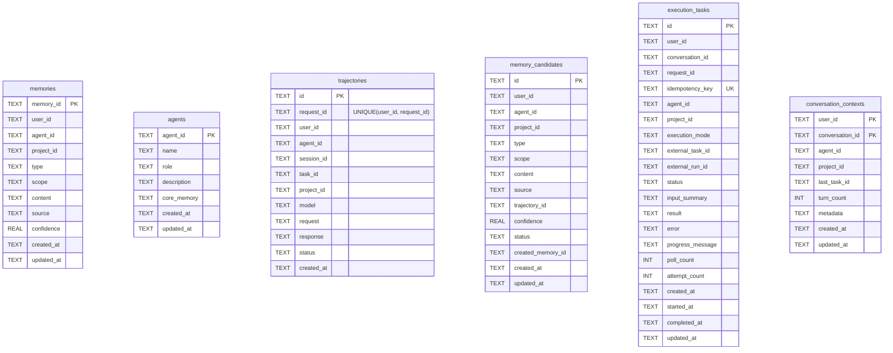
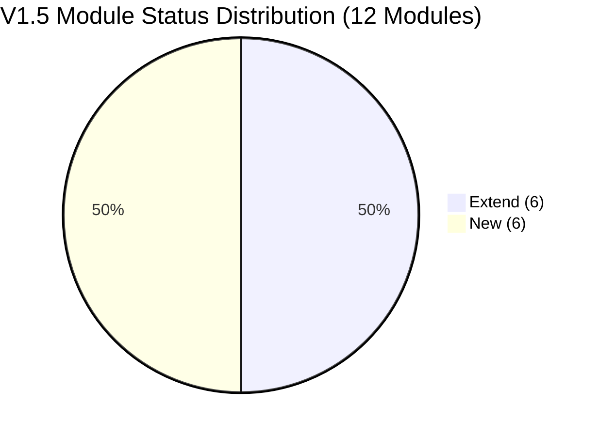

# 知忆 (Zhiyi) Personal AI V1.5 Architecture Gap Analysis

> V1 → V1.5 演进差距分析：基于源码审计与测试基线，逐模块标注 Reuse / Extend / New / Defer。本文档与 `docs/v1.5/` 系列文档（`DATA_MODEL.md`、`RUNTIME_DESIGN.md`、`API_DESIGN.md`、`OPEN_SOURCE_RESEARCH.md`、`IMPLEMENTATION_PLAN.md`）保持统一架构约定。

---

## 1. V1 Actual Capabilities

### 1.1 Memory Core (`src/` root)

| Capability | Key Files | Description |
|---|---|---|
| Identity Resolution | [identity.ts](file:///Users/mll/code/code/agent/universal-memory-gateway/src/identity.ts) | API Key → `(user_id, agent_id)`，服务端决策，客户端身份字段全部忽略 |
| Memory CRUD | [memories.ts](file:///Users/mll/code/code/agent/universal-memory-gateway/src/memories.ts) | `MemoryStore`：create / getById / list / update / remove / count / allForUser，严格 `user_id` 隔离 |
| Keyword Search | [search.ts](file:///Users/mll/code/code/agent/universal-memory-gateway/src/search.ts) | `tokenize()` 中英文分词 + `searchMemories()` 加权打分，无向量 DB |
| Context Injection | [context.ts](file:///Users/mll/code/code/agent/universal-memory-gateway/src/context.ts) | `buildMemoryContext()` → 独立 system message 注入，不覆盖原有指令 |
| Trajectory Collection | [trajectories.ts](file:///Users/mll/code/code/agent/universal-memory-gateway/src/trajectories.ts), [002_trajectory_request_scope.sql](file:///Users/mll/code/code/agent/universal-memory-gateway/migrations/002_trajectory_request_scope.sql) | 按 `(user_id, request_id)` 复合唯一约束存储对话轨迹（002 迁移修复跨用户冲突） |
| Memory Extraction | [extractor.ts](file:///Users/mll/code/code/agent/universal-memory-gateway/src/extractor.ts), [extraction-rules.ts](file:///Users/mll/code/code/agent/universal-memory-gateway/src/extraction-rules.ts), [candidates.ts](file:///Users/mll/code/code/agent/universal-memory-gateway/src/candidates.ts) | 规则/模型提取候选记忆 → 人工 approve → 进入正式记忆库 |
| Agent Profile | [agents.ts](file:///Users/mll/code/code/agent/universal-memory-gateway/src/agents.ts) | `AgentStore`：seed 内置 `developer` / `researcher`，CRUD，`core_memory` 关注词影响检索加权 |
| OpenAI-Compatible Proxy | [proxy.ts](file:///Users/mll/code/code/agent/universal-memory-gateway/src/proxy.ts) | 透明代理 + 记忆注入 |
| Model Settings | [upstream/model-settings.ts](file:///Users/mll/code/code/agent/universal-memory-gateway/src/upstream/model-settings.ts), [upstream/service.ts](file:///Users/mll/code/code/agent/universal-memory-gateway/src/upstream/service.ts) | 运行时模型配置管理 |
| Database Layer | [db.ts](file:///Users/mll/code/code/agent/universal-memory-gateway/src/db.ts) | `node:sqlite` (`DatabaseSync`)，WAL，幂等迁移框架（`MIGRATIONS` 清单） |
| Type System | [types.ts](file:///Users/mll/code/code/agent/universal-memory-gateway/src/types.ts) | `MemoryType` (5), `MemoryScope` (4), `CandidateStatus` (4) 等全局类型 |

### 1.2 Personal AI Runtime (`src/personal-ai/`)

| Capability | Key Files | Description |
|---|---|---|
| Runtime Orchestration | [runtime/personal-ai-runtime.ts](file:///Users/mll/code/code/agent/universal-memory-gateway/src/personal-ai/runtime/personal-ai-runtime.ts) | `PersonalAIRuntime.run()` `AsyncGenerator<PersonalAIEvent>`，唯一编排入口 |
| Trusted Identity | [identity/identity-manager.ts](file:///Users/mll/code/code/agent/universal-memory-gateway/src/personal-ai/identity/identity-manager.ts) | API Key 映射 + HMAC-SHA256 签名 + 会话 ID 推导（`deriveConversationId`） |
| Intent Understanding | [runtime/intent-understanding.ts](file:///Users/mll/code/code/agent/universal-memory-gateway/src/personal-ai/runtime/intent-understanding.ts) | 纯 Regex 规则：greeting → `direct_llm`；action_verbs + agent_keywords → `agent_delegation` |
| Execution Planning | [runtime/execution-planner.ts](file:///Users/mll/code/code/agent/universal-memory-gateway/src/personal-ai/runtime/execution-planner.ts) | intent → 单步 `ExecutionPlan` (`mode`/`agentId`/`title`/`description`)，单任务单 Agent |
| Context Builder | [runtime/context-builder.ts](file:///Users/mll/code/code/agent/universal-memory-gateway/src/personal-ai/runtime/context-builder.ts) | 复用 Memory Core，构建统一上下文 |
| Result Aggregation | [runtime/result-aggregator.ts](file:///Users/mll/code/code/agent/universal-memory-gateway/src/personal-ai/runtime/result-aggregator.ts) | Agent 原始输出 → 用户可读回答 |
| Task Repository | [task/task-repository.ts](file:///Users/mll/code/code/agent/universal-memory-gateway/src/personal-ai/task/task-repository.ts) | `execution_tasks` 表：幂等创建（`idempotency_key`）、终态保护（CAS `updateIfActive`）、原子抢占（`claimForDispatch`） |
| Task Manager | [task/task-manager.ts](file:///Users/mll/code/code/agent/universal-memory-gateway/src/personal-ai/task/task-manager.ts) | 门面层：用户隔离读写 + `cancelForUser` |
| Task Worker | [worker/task-worker.ts](file:///Users/mll/code/code/agent/universal-memory-gateway/src/personal-ai/worker/task-worker.ts) | 后台轮询，进程重启恢复（`dispatching` → `pending`），并发受 `maxConcurrentTasks` 限制 |
| Conversation Context | [conversation/conversation-context.ts](file:///Users/mll/code/code/agent/universal-memory-gateway/src/personal-ai/conversation/conversation-context.ts) | `conversation_contexts` 表：仅 `turn_count` + `last_task_id`，**无消息历史** |
| Event System | [events/event-types.ts](file:///Users/mll/code/code/agent/universal-memory-gateway/src/personal-ai/events/event-types.ts), [events/event-bus.ts](file:///Users/mll/code/code/agent/universal-memory-gateway/src/personal-ai/events/event-bus.ts) | 10 种内部事件 + 进程内异步通道（`createEventChannel`） |
| Model Adapter | [adapters/model/model-adapter.ts](file:///Users/mll/code/code/agent/universal-memory-gateway/src/personal-ai/adapters/model/model-adapter.ts) | 流式调用上游 OpenAI-compatible LLM，DUCX auth 刷新 |
| Agent Adapter | [adapters/agent/multica-adapter.ts](file:///Users/mll/code/code/agent/universal-memory-gateway/src/personal-ai/adapters/agent/multica-adapter.ts), [adapters/agent/agent-adapter.ts](file:///Users/mll/code/code/agent/universal-memory-gateway/src/personal-ai/adapters/agent/agent-adapter.ts) | MultiCA CLI `spawn`（`shell: false`），安全校验，状态映射 |
| Protocol Adapter | [adapters/protocol/adp-protocol-adapter.ts](file:///Users/mll/code/code/agent/universal-memory-gateway/src/personal-ai/adapters/protocol/adp-protocol-adapter.ts) | `PersonalAIEvent` → OpenAI SSE / ADP V2 SSE（严格限制 11 个顶层事件枚举） |
| HTTP Routes | [routes.ts](file:///Users/mll/code/code/agent/universal-memory-gateway/src/personal-ai/routes.ts) | `/v1/personal-ai/chat/completions`、`/messages`、`/tasks`、`/tasks/:id`、`/tasks/:id/cancel`、`/health/personal-ai` |

### 1.3 Data Schema (`migrations/001`–`003`)

---

## 2. Test Baseline

| Metric | Value |
|---|---|
| Build | `npm run build` ✅ clean |
| Test Suite | `npm test` (`vitest run --reporter=verbose`) → **104/104 passed** |
| Test Files | 8 files, 8.38s |
| Skipped / Failed | 0 / 0 |
| Live Smoke Script | `npm run smoke` → `scripts/smoke-personal-ai.mjs`（用于本地 HTTP 冒烟检查） |
| Test Style | 全部使用 Mock / Stub（`MockUpstream`、`scripts/mock-multica-cli.mjs`）；`npm test` 中未接入真实 MultiCA daemon、真实 LLM 或 ADP 前端 UI |

**Test File Breakdown (8 files, 104 tests):**

| Test File | Test Count | Category / Coverage |
|---|---|---|
| [tests/model-settings.test.ts](file:///Users/mll/code/code/agent/universal-memory-gateway/tests/model-settings.test.ts) | 32 | MVP Memory — 运行时模型服务设置与路由 |
| [tests/personal-ai.test.ts](file:///Users/mll/code/code/agent/universal-memory-gateway/tests/personal-ai.test.ts) | 27 | Personal AI — Runtime、身份、意图、计划、任务、事件、协议（直接操作 `execution_tasks`） |
| [tests/config-context.test.ts](file:///Users/mll/code/code/agent/universal-memory-gateway/tests/config-context.test.ts) | 12 | MVP Memory — 配置契约与上下文注入 |
| [tests/proxy.test.ts](file:///Users/mll/code/code/agent/universal-memory-gateway/tests/proxy.test.ts) | 11 | MVP Memory — OpenAI 兼容代理 |
| [tests/memories.test.ts](file:///Users/mll/code/code/agent/universal-memory-gateway/tests/memories.test.ts) | 9 | MVP Memory — 记忆 CRUD 与检索 |
| [tests/extraction.test.ts](file:///Users/mll/code/code/agent/universal-memory-gateway/tests/extraction.test.ts) | 7 | MVP Memory — 轨迹采集与候选记忆提取 |
| [tests/isolation-regression.test.ts](file:///Users/mll/code/code/agent/universal-memory-gateway/tests/isolation-regression.test.ts) | 3 | MVP Memory — 跨用户隔离回归测试 |
| [tests/qa-regression.test.ts](file:///Users/mll/code/code/agent/universal-memory-gateway/tests/qa-regression.test.ts) | 3 | MVP Memory — QA 回归（含 `execution_tasks` 查询/更新验证） |

> [!IMPORTANT]
> V1.5 演进期间必须保持全部 **104 个测试 100% 通过**：不可删除或重命名 `execution_tasks` 表，不可破坏 `/v1/personal-ai/tasks`、`/v1/personal-ai/tasks/:id`、`/v1/personal-ai/tasks/:id/cancel` 契约，且不引入额外运行时 npm 依赖。

---

## 3. V1.5 Gap Matrix

V1.5 范围覆盖全部 **12 个核心模块**（**6 个 Extend + 6 个 New，0 个 Defer**）：

| # | Module | Status | Current State (V1) | V1.5 Need | Code Reference |
|---|---|---|---|---|---|
| 1 | **Assistant Identity** | **Extend** | API Key → `(user_id, agent_id)`，HMAC 签名，`conversation_id` 推导 | 结合 `users` 表注入用户画像、偏好、时区与工作风格 | [identity-manager.ts](file:///Users/mll/code/code/agent/universal-memory-gateway/src/personal-ai/identity/identity-manager.ts), [identity.ts](file:///Users/mll/code/code/agent/universal-memory-gateway/src/identity.ts) |
| 2 | **User Profile** | **New** | 无用户实体，仅 `config.apiKeys` 的 `(user_id, agent_id)` 映射 | `users` 表：保存 `display_name`、`preferences`、`timezone`、`work_style` | [config.ts L10](file:///Users/mll/code/code/agent/universal-memory-gateway/src/personal-ai/config.ts#L10) (`Identity`) |
| 3 | **Goal Management** | **New** | 无目标概念 | `goals` 表 + `goal_projects` M:N 关联，支持目标生命周期与进度追踪 | — |
| 4 | **Project Management** | **Extend** | `project_id` 仅作为透传 TEXT 字段存在于 `memories` / `trajectories` / `execution_tasks` / `conversation_contexts` | 一等实体 `projects` 表，M:N 关联目标，上下文聚合与成员隔离 | [001_init.sql](file:///Users/mll/code/code/agent/universal-memory-gateway/migrations/001_init.sql), [types.ts](file:///Users/mll/code/code/agent/universal-memory-gateway/src/types.ts) |
| 5 | **Milestone Management** | **New** | 无阶段里程碑概念 | `milestones` 表：关联 `goal_id` 或 `project_id`，提供阶段门禁与达成追踪 | — |
| 6 | **Task Management** | **Extend** | `execution_tasks` 仅记录单次 Agent 执行（CAS 终态保护、幂等键、重启恢复） | **Scheme B**：保留并扩展 `execution_tasks`（新增 `task_id` FK、`timeout_at`、`timeout` 状态），新增业务 `tasks` 表（`btask_` 前缀、子任务 `parent_task_id`、1:N 执行） | [task-repository.ts](file:///Users/mll/code/code/agent/universal-memory-gateway/src/personal-ai/task/task-repository.ts), [003_personal_ai.sql](file:///Users/mll/code/code/agent/universal-memory-gateway/migrations/003_personal_ai.sql), [routes.ts L333-L335](file:///Users/mll/code/code/agent/universal-memory-gateway/src/personal-ai/routes.ts#L333-L335) |
| 7 | **Agent Registry** | **Extend** | `agents` 表仅含 `(agent_id, name, role, description, core_memory)` | 扩展 `capabilities`、`execution_backend`、`permission_policy`、`status`、`concurrency_limit`、`instructions` | [agents.ts](file:///Users/mll/code/code/agent/universal-memory-gateway/src/agents.ts) |
| 8 | **Task Orchestration** | **Extend** | Regex 意图识别 → 单步 `ExecutionPlan` → 单 Agent 派发 | `PersonalAIRuntime` 内引入 `AssistantPlanner`、`PolicyChecker`、`ExecutionController` 与 `execution_plans`（多步/并行执行 + 审批门禁 + ADP 降级兼容） | [intent-understanding.ts](file:///Users/mll/code/code/agent/universal-memory-gateway/src/personal-ai/runtime/intent-understanding.ts), [execution-planner.ts](file:///Users/mll/code/code/agent/universal-memory-gateway/src/personal-ai/runtime/execution-planner.ts), [personal-ai-runtime.ts](file:///Users/mll/code/code/agent/universal-memory-gateway/src/personal-ai/runtime/personal-ai-runtime.ts) |
| 9 | **Memory Integration** | **Extend** | 关键词分词检索 + scope/type/agent/project 加权打分；无业务实体关联 | 保留 Memory Core（**不引入向量 DB**），新增 `memory_links` 关联 Goal/Project/Task，区分事实/偏好/经验/临时上下文与 Agent ACL | [search.ts](file:///Users/mll/code/code/agent/universal-memory-gateway/src/search.ts), [context.ts](file:///Users/mll/code/code/agent/universal-memory-gateway/src/context.ts) |
| 10 | **Approval Manager** | **New** | 无审批机制，命中规则立即派发执行 | `approval_requests` 表 + 服务端 `PolicyChecker`（风险分级、超时、撤销 `revoked`、作用域与审计） | — |
| 11 | **Proactive Engine** | **New** | 纯被动响应 HTTP 请求，无定时/主动触发机制 | **受控 V1.5 范围**：仅 5 类明确触发器，复用 `TaskWorker` 定时器模式 + `EventBus` + `scheduled_jobs`，支持去重/冷却/时区/暂停/重启恢复（无自主循环） | [task-worker.ts](file:///Users/mll/code/code/agent/universal-memory-gateway/src/personal-ai/worker/task-worker.ts), [event-bus.ts](file:///Users/mll/code/code/agent/universal-memory-gateway/src/personal-ai/events/event-bus.ts) |
| 12 | **Notification Manager** | **New** | 仅请求活跃期通过 SSE 推送文本进度，断开后无异步投递 | `notifications` 表：持久化异步通知、去重、已读状态追踪（应用内查询为主 + 可选 Webhook） | [event-types.ts](file:///Users/mll/code/code/agent/universal-memory-gateway/src/personal-ai/events/event-types.ts), [event-bus.ts](file:///Users/mll/code/code/agent/universal-memory-gateway/src/personal-ai/events/event-bus.ts) |

### Status Distribution Summary

### V1 → V1.5 Evolution Overview

```mermaid
flowchart TD
    subgraph V1["V1 — Current"]
        ID1["Identity<br/>(API Key mapping)"]
        MEM1["Memory Core<br/>(keyword search)"]
        INTENT1["Intent<br/>(regex rules)"]
        PLAN1["Planner<br/>(single step)"]
        EXEC1["execution_tasks<br/>(task_ prefix)"]
        WORKER1["TaskWorker<br/>(in-process)"]
        AGENT1["agents table<br/>(name, role, core_memory)"]
        EVENT1["EventBus<br/>(in-process channel)"]
    end

    subgraph V15["V1.5 — Target"]
        ID2["Identity + Users ★<br/>(display_name, work_style, tz)"]
        MEM2["Memory Core + memory_links<br/>(entity links, ACL, no vector DB)"]
        INTENT2["Intent<br/>(regex fast-path + LLM)"]
        PLAN2["AssistantPlanner +<br/>ExecutionController"]
        GOAL["Goal Management ★<br/>(goals + goal_projects)"]
        PROJ["Project Management<br/>(projects table)"]
        MILE["Milestone Management ★<br/>(milestones)"]
        TASK2["Business Tasks ★ (btask_)<br/>1:N → execution_tasks (task_)"]
        APPROVAL["Approval Manager ★<br/>(PolicyChecker + approval_requests)"]
        AGENT2["Agent Registry<br/>(+ capabilities, backend, policy)"]
        PROACTIVE["Proactive Engine ★<br/>(scheduled_jobs, 5 bounded triggers)"]
        NOTIF["Notification Manager ★<br/>(notifications, dedup, read state)"]
        WORKER2["TaskWorker<br/>(reused + timeout + recovery)"]
    end

    ID1 -.->|extend| ID2
    MEM1 -.->|extend| MEM2
    INTENT1 -.->|extend| INTENT2
    PLAN1 -.->|extend| PLAN2
    EXEC1 -.->|extend with task_id FK| WORKER2
    AGENT1 -.->|extend| AGENT2
    EVENT1 -.->|persist & bridge| NOTIF
    WORKER1 -.->|timer pattern| PROACTIVE
    GOAL --> PROJ
    PROJ --> MILE
    MILE --> TASK2
    PLAN2 --> APPROVAL
    APPROVAL --> TASK2
    PROACTIVE --> NOTIF

    style GOAL fill:#4CAF50,color:#fff
    style MILE fill:#4CAF50,color:#fff
    style APPROVAL fill:#4CAF50,color:#fff
    style PROACTIVE fill:#4CAF50,color:#fff
    style NOTIF fill:#4CAF50,color:#fff
    style ID2 fill:#2196F3,color:#fff
    style PROJ fill:#2196F3,color:#fff
    style TASK2 fill:#2196F3,color:#fff
    style AGENT2 fill:#2196F3,color:#fff
    style PLAN2 fill:#2196F3,color:#fff
    style MEM2 fill:#2196F3,color:#fff
```

> 绿色 = New 模块 &nbsp; | &nbsp; 蓝色 = Extend 模块

---

## 4. Module Reuse & Extension Plans

### 4.1 Assistant Identity — Extend

**Current state:** [identity-manager.ts](file:///Users/mll/code/code/agent/universal-memory-gateway/src/personal-ai/identity/identity-manager.ts) 中的 `resolvePersonalAIIdentity()`（L109-L163）输出 `PersonalAIIdentity`，包含 `user_id, agent_id, api_key, from_default, request_id, session_id, task_id, project_id, conversation_id, signature_verified`。

**Reuse:**
- 服务端 API Key → `(user_id, agent_id)` 映射（忽略客户端伪造字段）
- HMAC-SHA256 请求签名校验（`verifySignature()`，L66-L83）
- 稳定会话 ID 推导（`deriveConversationId()`，L91-L107）

**Extend:**
- `resolvePersonalAIIdentity()` 保持纯函数身份解析；在 `PersonalAIRuntime` / `ContextBuilder` 阶段根据 `user_id` 查询 `users` 表，补充 `display_name`、`timezone`、`locale`、`preferences`、`work_style`。
- 若 `users` 表尚无该 `user_id` 记录，按默认配置懒加载或使用安全默认值，确保所有 V1 测试无需预置 `users` 行即可通过。

### 4.2 Project Management — Extend

**Current state:** `project_id` 已作为可空 TEXT 列存在于 `memories`、`trajectories`、`execution_tasks`、`conversation_contexts` 四张表中：
- [memories.ts L103-L106](file:///Users/mll/code/code/agent/universal-memory-gateway/src/memories.ts#L103-L106)：按 `project_id` 过滤
- [search.ts L61-L63, L98-L101](file:///Users/mll/code/code/agent/universal-memory-gateway/src/search.ts#L61-L63)：`project` 作用域可见性校验与 `+25` 分权重加分
- [types.ts L7](file:///Users/mll/code/code/agent/universal-memory-gateway/src/types.ts#L7)：`MemoryScope` 已包含 `'project'`

**Reuse:**
- 现有 4 张表中的 `project_id` 列、`MemoryScope = 'project'` 语义以及检索加权逻辑全部保留。

**Extend:**
- 在 `migrations/004_v1_5.sql` 中新增 `projects` 表（`id, user_id, title, description, status, created_at, updated_at`）与 `goal_projects` M:N 关联表。
- 新增 `ProjectStore`（严格 `user_id` 隔离），聚合项目下的目标、里程碑、业务任务与关联记忆。
- 路由挂在 `/v1/personal-ai/projects`（`POST`、`GET`、`GET /:id`、`PATCH /:id`、`GET /:id/tasks`）。

### 4.3 Task Management — Extend (Scheme B)

**Current state:** `execution_tasks`（[task-repository.ts](file:///Users/mll/code/code/agent/universal-memory-gateway/src/personal-ai/task/task-repository.ts)）是**单次 Agent 执行记录**而非业务任务：
- 幂等键：`idempotency_key = ${user_id}:${request_id}` UNIQUE
- 状态机：`pending → dispatching → running → completed | failed | cancelled`
- 终态保护：`updateIfActive()`（L177-L184）与原子抢占 `claimForDispatch()`（L194-L205）
- V1 路由（[routes.ts L227-L281, L333-L335](file:///Users/mll/code/code/agent/universal-memory-gateway/src/personal-ai/routes.ts#L227-L281)）及回归测试（`tests/personal-ai.test.ts`、`tests/qa-regression.test.ts`）直接依赖 `execution_tasks` 表名及 `'completed'` 状态。

**Reuse:**
- **完整保留 `execution_tasks` 表名**（不重命名为 `task_executions`）、`task_` ID 前缀、`'completed'` 终态值、`TaskRepository`、`TaskManager`、`TaskWorker` 以及 `/v1/personal-ai/tasks*` 现有端点。

**Extend (Scheme B):**
- **扩展 `execution_tasks` 表**（`migrations/004_v1_5.sql`）：新增 `task_id TEXT REFERENCES tasks(id)`（可空，兼容 V1 直接发起的对话委派）和 `timeout_at TEXT`，状态集合扩展为 `('pending','dispatching','running','completed','failed','cancelled','timeout')`。
- **新增业务 `tasks` 表**（ID 前缀 `btask_`）：承载用户级业务任务生命周期（`draft | pending | ready | assigned | in_progress | blocked | completed | failed | cancelled`）、`priority`、`project_id`、`milestone_id`、`parent_task_id`（自引用子任务）、`assignee_agent_id`。一个业务 `task` 通过 `execution_tasks.task_id` 关联 1:N 次执行记录。
- **路由边界**：`/v1/personal-ai/tasks*` 100% 保持 V1 `execution_tasks` 兼容；新增 `/v1/personal-ai/work-tasks*` 暴露业务任务 CRUD、`/:id/execute`、`/:id/executions`、`/:id/cancel`。

### 4.4 Agent Registry — Extend

**Current state:** [agents.ts](file:///Users/mll/code/code/agent/universal-memory-gateway/src/agents.ts) 管理 `agents` 表（`agent_id, name, role, description, core_memory, created_at, updated_at`），内置 `developer` 与 `researcher` 两个角色，且 `core_memory` 中的「关注：」关键词在 [context.ts L61-L71](file:///Users/mll/code/code/agent/universal-memory-gateway/src/context.ts#L61-L71) 中参与记忆加权。

**Reuse:**
- `AgentStore` 的 seed、读取与 `core_memory` 关注词抽取逻辑。

**Extend:**
- `agents` 表增加列：`capabilities`（JSON 能力标签）、`execution_backend`（如 `multica_cli` / `model_direct`）、`permission_policy`（JSON 权限策略）、`status`（`active | disabled`）、`concurrency_limit`、`instructions`。
- 路由扩展：`PATCH /v1/agents/:id`（更新能力/权限/状态/并发上限）与 `GET /v1/agents/:id/status`（可用性与当前并发负载）。
- `AgentExecutionAdapter` 与 `AssistantPlanner` 根据 `capabilities`、`status` 与 `concurrency_limit` 进行 Agent 选择与路由。

### 4.5 Task Orchestration — Extend

**Current state:** [personal-ai-runtime.ts](file:///Users/mll/code/code/agent/universal-memory-gateway/src/personal-ai/runtime/personal-ai-runtime.ts) 遵循单链路顺序执行：
1. `understandIntent()`（纯正则规则）
2. `planExecution()`（单 `ExecutionPlan`）
3. `direct_llm` 流式输出 或 单次 `TaskManager.createIfAbsent()` + `TaskWorker.dispatch()` + 轮询 SSE 输出

**Reuse:**
- `PersonalAIRuntime` 作为唯一智能决策中心与 `AsyncGenerator<PersonalAIEvent>` 架构。
- `ModelAdapter.stream()`、`TaskWorker` 后台派发/轮询/恢复、`scheduleTrajectory()` 异步轨迹采集。
- `adp-protocol-adapter.ts` 的协议适配边界。

**Extend:**
- **新增 `AssistantPlanner`**：保留正则快速路径（问候/明确高置信关键词），增加 LLM 结构化规划能力；生成多步骤 `ExecutionPlan` 并持久化至 `execution_plans` 表（支持顺序步骤与独立子步骤并行、状态追踪与部分失败处理）。
- **新增 `PolicyChecker`**：在规划后、派发前校验步骤风险与 `agents.permission_policy`，命中高风险操作时挂起并创建 `approval_requests`。
- **新增 `ExecutionController`**：协调多步 `execution_tasks` 创建、依赖推进、并发控制与 `ResultAggregator` 多结果聚合。
- **SSE 协议兼容硬约束**：`adp-protocol-adapter.ts` 中 `adp-v2` 协议严格限制在 11 个顶层事件枚举（`ADP_V2_EVENT_TYPES`），任何 V1.5 新增 `PersonalAIEvent`（如规划步骤、审批请求）在 `adp-v2` 模式下必须降级为 `text.delta`，在 `openai` 模式下必须降级为 `delta.content`。

### 4.6 Memory Integration — Extend

**Current state:** [search.ts](file:///Users/mll/code/code/agent/universal-memory-gateway/src/search.ts) 通过 `allForUser()` 读取用户全量记忆并用中英文分词加权打分；[context.ts](file:///Users/mll/code/code/agent/universal-memory-gateway/src/context.ts) 按 token 预算注入独立 system message；[candidates.ts](file:///Users/mll/code/code/agent/universal-memory-gateway/src/candidates.ts) 维护候选记忆人工审批流。

**Reuse:**
- 完整保留 `MemoryStore`、`searchMemories()`、`buildMemoryContext()`、`ExtractionQueue` 与 `memory_candidates` 审批安全边界。
- **V1.5 不引入向量数据库**，保持纯 SQLite 本地轻量架构。

**Extend:**
- **实体关联（`memory_links` 表）**：将 `memory_id` 与业务实体（`goal` / `project` / `task` / `milestone`）建立可追溯关联。
- **记忆分类与层级**：区分长期稳定事实（facts）、用户偏好（preferences）、历史经验（experiences）与临时工作上下文（temporary working context），并在 `buildPersonalAIContext()` 中注入关联 Goal/Project/Task 上下文与用户画像。
- **Agent 访问控制（ACL）**：基于 `agents.permission_policy` 与记忆 `scope` 过滤不同 Agent 可见的记忆范围，防止越权注入。
- **业务事件候选提取**：任务完成、目标更新等关键业务事件可进入候选记忆提取管线（仍受人工/受控策略审核，不直接无审核覆写正式记忆）。

---

## 5. New Module Specifications

### 5.1 User Profile — New

**Justification:** V1 仅在配置中保留 `apiKeys` 到 `{ user_id, agent_id }` 的路由映射（[config.ts L10](file:///Users/mll/code/code/agent/universal-memory-gateway/src/personal-ai/config.ts#L10)），缺乏用户显示名、时区、工作习惯与偏好存储，无法支撑跨会话个性化交互与定时摘要时区对齐。

**Core Design:**
- 新增 `users` 表：`user_id` (PK)、`display_name`、`preferences` (JSON)、`timezone`、`work_style` (JSON)、`created_at`、`updated_at`。
- 接口：`GET /v1/personal-ai/profile`、`PATCH /v1/personal-ai/profile`（严格使用服务端解析的 `user_id`）。
- 集成：`ContextBuilder` 读取用户偏好与工作风格；`Proactive Engine` 依据 `timezone` 计算静默时段与摘要发送时间。

### 5.2 Goal Management — New

**Justification:** 代码库中尚无长期目标实体，个人助手无法围绕用户长期目标组织项目、里程碑与日常任务。

**Core Design:**
- 新增 `goals` 表：`id`、`user_id`、`title`、`description`、`status` (`draft | active | paused | achieved | abandoned`)、`priority`、`target_date`、`created_at`、`updated_at`。
- 新增 `goal_projects` 关联表：支持 Goal ↔ Project **M:N** 多对多关联。
- 接口：`POST /v1/personal-ai/goals`、`GET /v1/personal-ai/goals`、`GET /v1/personal-ai/goals/:id`、`PATCH /v1/personal-ai/goals/:id`、`POST /v1/personal-ai/goals/:id/archive`、`GET /v1/personal-ai/goals/:id/progress`（聚合关联项目、里程碑与业务任务进度）。

### 5.3 Milestone Management — New

**Justification:** 目标与项目需要阶段性检查点（Stage Gates）以拆解长周期交付并量化达成率。V1.5 纳入轻量级 Milestone 实体，直接衔接 Goal/Project 与业务 Tasks。

**Core Design:**
- 新增 `milestones` 表：`id`、`user_id`、`goal_id`（可空）、`project_id`（可空）、`title`、`description`、`status` (`pending | in_progress | completed | skipped`)、`target_date`、`completed_at`、`created_at`、`updated_at`。
- 业务 `tasks` 可通过 `milestone_id` 挂载到里程碑下，里程碑完成度由关联业务任务状态聚合或手动更新。
- 接口：`POST /v1/personal-ai/milestones`、`GET /v1/personal-ai/milestones`、`PATCH /v1/personal-ai/milestones/:id`。

### 5.4 Approval Manager — New

**Justification:** V1 只要命中 `agent_delegation` 规则就会直接派发 MultiCA 执行（[personal-ai-runtime.ts L152-L163](file:///Users/mll/code/code/agent/universal-memory-gateway/src/personal-ai/runtime/personal-ai-runtime.ts#L152-L163)），缺少高风险操作拦截、人工确认与授权撤销机制。

**Core Design:**
- 新增 `approval_requests` 表：`id`、`user_id`、`task_id` / `execution_id`、`operation_type`、`scope`、`risk_level` (`low | medium | high | critical`)、`status` (`pending | approved | rejected | expired | revoked`)、`requested_at`、`resolved_at`、`resolver`、`timeout_at`。
- 服务端 `PolicyChecker`：
  - `low` 风险直接放行；`medium/high/critical` 依策略进入 `pending` 审批队列并阻断对应步骤派发；
  - 支持超时自动失效（`expired`）以及已批准授权的显式撤销（`revoked`）。
- 接口：`GET /v1/personal-ai/approvals`、`POST /v1/personal-ai/approvals/:id/approve`、`POST /v1/personal-ai/approvals/:id/reject`（及撤销能力）。

### 5.5 Proactive Engine — New (Bounded V1.5 Scope)

**Justification:** V1 完全被动响应请求。V1.5 在严格控制边界的前提下引入轻量主动引擎（**不做开放式自主代理循环**），提升任务督办与信息同步能力。

**Bounded V1.5 Triggers (仅限以下 5 类):**
1. 任务到期提醒（Task due reminder）
2. 任务进展停滞提醒（Stale progress reminder）
3. Agent 执行失败告警（Agent failure alert）
4. 待处理审批提醒（Pending approval reminder）
5. 每日 / 每周工作摘要（Daily / weekly summary）

**Core Design:**
- 持久化调度表 `scheduled_jobs`：包含任务类型、用户时区（`timezone`）、去重键（`dedup_key`）、冷却窗口（`cooldown_until`）、用户暂停开关（`paused`）、上次执行时间与下次触发时间。
- 运行机制：复用 V1 `TaskWorker` 的单进程 `setInterval` 轮询模式与 `EventBus`，服务重启后从 `scheduled_jobs` 自动恢复未过期调度。
- 输出通道：触发结果统一写入 `notifications` 表并推送，不擅自触发高风险外部写操作。
- 接口：`/v1/personal-ai/schedules` 管理定时策略与暂停/恢复。

### 5.6 Notification Manager — New

**Justification:** V1 进度事件仅通过进程内 `EventChannel`（[event-bus.ts](file:///Users/mll/code/code/agent/universal-memory-gateway/src/personal-ai/events/event-bus.ts)）在活跃 SSE 连接期间下发，一旦客户端断开（`signal.aborted`），用户无法获知后台任务完成、失败或待审批事件。

**Core Design:**
- 新增 `notifications` 表：`id`、`user_id`、`type`、`title`、`body`、`entity_type`、`entity_id`、`dedup_key`、`channel` (`in_app | webhook`)、`status` (`pending | delivered | read | failed`)、`delivered_at`、`read_at`、`created_at`。
- 支持基于 `dedup_key` 的去重，防止 Proactive Engine 或 Worker 重复刷屏；以应用内拉取为主（`in_app`），预留可选 Webhook 投递。
- 接口：`GET /v1/personal-ai/notifications`、已读标记端点。

---

## 6. Technical Risks

### 6.1 Schema Migration & V1 Compatibility

> [!WARNING]
> [db.ts L47-L123](file:///Users/mll/code/code/agent/universal-memory-gateway/src/db.ts#L47-L123) 使用顺序迁移数组 `MIGRATIONS`。V1.5 所有新增表与字段必须在 `migrations/004_v1_5.sql` 中以幂等方式定义。

- **风险**：若修改/删除 `execution_tasks` 表名或更改 `'completed'` 终态命名，将直接导致 `routes.ts:334`、`tests/personal-ai.test.ts` 与 `tests/qa-regression.test.ts` 失败。
- **缓解**：严格执行 Scheme B——保留 `execution_tasks` 表名与 `'completed'` 状态，仅 `ALTER TABLE` 增加可空列 `task_id` / `timeout_at` 并扩展状态支持 `'timeout'`；先写迁移脚本并在现有 104 个测试上回归验证。

### 6.2 Memory Search Scaling Without Vector DB

- **风险**：V1.5 明确不引入向量 DB，而 [search.ts L75](file:///Users/mll/code/code/agent/universal-memory-gateway/src/search.ts#L75) 的 `store.allForUser()` 会全表加载当前用户全部记忆到内存中计算分词得分；随着实体记忆与关联增多，记忆规模增大时查询延迟会上升。
- **缓解**：在 SQL 层增加 `scope`、`type`、`updated_at` 与 `memory_links` 的预过滤索引，限制候选集大小，将向量检索保留为 V2 可选插件扩展点。

### 6.3 In-Process Single-Node Boundaries

- **风险**：`TaskWorker`、`Proactive Engine` 定时器与 `EventChannel` 均运行在单 Node.js 进程内（无 Redis/Kafka），多实例部署会产生重复调度或事件丢失。
- **缓解**：V1.5 定位为 Local-First 单实例网关；通过 SQLite 持久化（`execution_tasks`、`scheduled_jobs`、`notifications`）与原子抢占/去重键保证单节点重启安全，并在架构层定义 Repository / Worker / Scheduler 接口以支持 V2 云端迁移。

### 6.4 LLM Planner Latency, Cost & Stability

- **风险**：从纯 Regex `understandIntent()` 升级为 LLM `AssistantPlanner` 会引入 500ms–2000ms 延迟、Token 成本与结构化输出解析失败风险。
- **缓解**：保留 Regex 快速路径处理高置信度场景（问候、简单问答）；设置 `PLANNER_V15_ENABLED` 特性开关支持灰度回退；为规划请求设置严格超时与正则降级兜底。

### 6.5 Multi-Step Execution & Partial Failure

- **风险**：多步计划执行与并行 Agent 派发比 V1 单任务流复杂得多，可能出现步骤依赖死锁、部分步骤失败后状态不一致、重复派发等问题。
- **缓解**：`execution_plans` 持久化每步状态，每个执行单元仍复用 `execution_tasks` 的 `idempotency_key` 与 CAS 终态保护；明确定义部分失败策略（暂停并通知用户审批/重试，而非静默丢弃已完成步骤结果）。

### 6.6 ADP V2 Protocol Whitelist Invariant

- **风险**：[adp-protocol-adapter.ts L203-L215](file:///Users/mll/code/code/agent/universal-memory-gateway/src/personal-ai/adapters/protocol/adp-protocol-adapter.ts#L203-L215) 明确记录 `adp-v2` 仅允许 11 个固定事件类型，[routes.ts L219-L221](file:///Users/mll/code/code/agent/universal-memory-gateway/src/personal-ai/routes.ts#L219-L221) 会直接丢弃不在白名单内的顶层事件。
- **缓解**：所有 V1.5 新增内部事件（如规划进度、审批等待提示）在 `encodeEvent()` 中统一通过 `progressText()` 降级为 `text.delta`（`adp-v2`）或 `delta.content`（`openai`），严禁发明自定义顶层 SSE `Type`。

### 6.7 Proactive Noise & Approval Fatigue

- **风险**：主动引擎频繁触发或审批阈值过低会导致通知轰炸与用户审批疲劳。
- **缓解**：在 `scheduled_jobs` 与 `notifications` 中强制要求 `dedup_key` 与 `cooldown_until`，支持按用户时区设置静默窗口与暂停开关；`PolicyChecker` 默认仅对高风险/不可逆操作要求人工审批。

---

## 7. Open Source Research Reference

V1.5 架构与开源生态借鉴的详细对比、许可证评估、技术栈差异分析（TypeScript vs Python）与不引入清单见 [OPEN_SOURCE_RESEARCH.md](file:///Users/mll/code/code/agent/universal-memory-gateway/docs/v1.5/OPEN_SOURCE_RESEARCH.md)，重点评估了以下 **5 个目标项目**：

1. **OpenMuse** (`CopilotKit/openmuse`, MIT, TypeScript/Hono/AG-UI)：参考其持久后台任务生命周期（pause/resume/cancel/retry）与 HITL 审批检查点语义；不引入 AG-UI 或浏览器/容器沙箱。
2. **Letta** (`letta-ai/letta`, Apache-2.0, Python/FastAPI)：参考其 Core Memory Blocks 与分层记忆组织思想；不引入 Python 服务端、向量 DB 或无审核的 Agent 自主写库。
3. **Suparagent** (`Anil-matcha/suparagent`, Apache-2.0, Python/FastAPI)：参考其 "AI Employee" 元数据模型（instructions、permissions、concurrency）与 "Ask first" 审批门禁；不引入 Python 栈与 Docker 沙箱（代码执行继续由 MultiCA 承担）。
4. **OpenClaw** (`openclaw/openclaw`, MIT, TypeScript/Node.js)：参考其 **Heartbeat vs Cron** 双层主动机制（轻量检查静默无扰 vs 定时汇总任务）与 `SKILL.md` 声明式能力描述；保留现有网关与 ADP 接入，不引入多端 Bot 渠道。
5. **Thoth**（**存在仓库歧义，需产品负责人确认**）：GitHub 上存在多个同名项目（`siddsachar/Thoth` → `row-bot`、`acertainKnight/project-thoth`、`S1LV4/th0th`），`OPEN_SOURCE_RESEARCH.md` 将分别分析其知识图谱/上下文压缩与原始轨迹分离模式，并明确标注待确认项。
