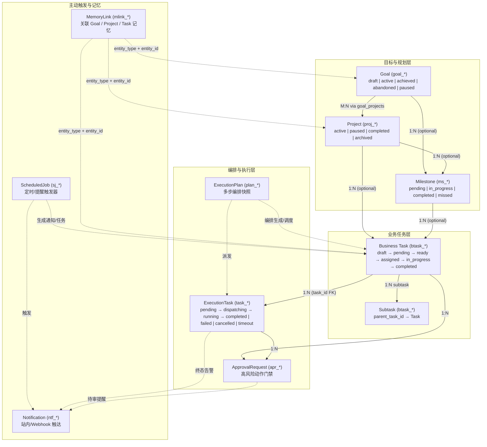
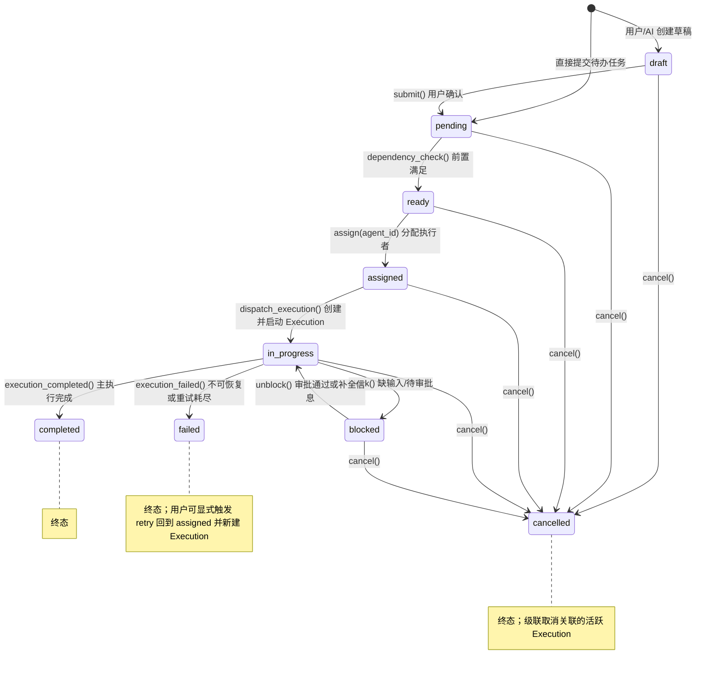
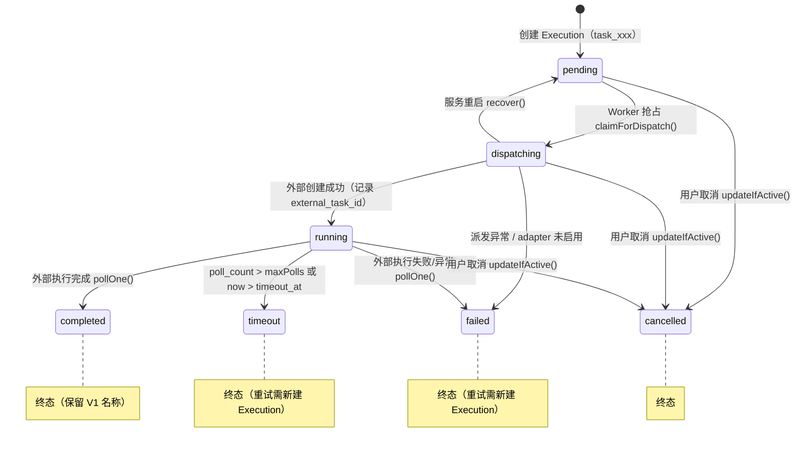

# 知忆（Zhiyi）Personal AI V1.5 · 数据模型设计

> 本文档定义知忆（Zhiyi）Personal AI V1.5 的完整数据实体、关系、Migration 004 DDL、状态机、迁移策略与 API 兼容方案。
> 与 `ARCHITECTURE_GAP_ANALYSIS.md`、`API_DESIGN.md`、`RUNTIME_DESIGN.md` 保持统一约定。

---

## 目录

1. [设计决策总览](#1-设计决策总览)
2. [Scheme A vs B 分析](#2-scheme-a-vs-b-分析)
3. [核心实体 ER 图](#3-核心实体-er-图)
4. [Goal / Project / Task / Execution 关系图](#4-goal--project--task--execution-关系图)
5. [表定义（`migrations/004_v1_5.sql`）](#5-表定义migrations004_v1_5sql)
6. [字段说明](#6-字段说明)
7. [索引与约束](#7-索引与约束)
8. [业务任务状态机（`tasks`）](#8-业务任务状态机tasks)
9. [执行状态机（`execution_tasks`）](#9-执行状态机execution_tasks)
10. [迁移策略](#10-迁移策略)
11. [API 兼容说明](#11-api-兼容说明)

---

## 1. 设计决策总览

| # | 核心设计问题 | 决策 | 理由 |
|---|--------------|------|------|
| 1 | Goal ↔ Project 关系 | **M:N**（`goal_projects` 联结表） | 一个 Goal 可由多个 Project 支撑；一个 Project 也可同时服务多个 Goal |
| 2 | Task 能否属于多个 Goal？ | **否**。Task 归属 Project；Goal 通过 `goal_projects` 间接关联 Task | 避免三层 M:N 关系爆炸，Goal 进度通过聚合其关联 Projects 下的 Tasks 计算 |
| 3 | Task 必须属于 Project？ | **否**。`tasks.project_id` 可为 `NULL` | 支持独立任务（用户随手创建或对话直接触发的一次性任务） |
| 4 | Subtask 机制 | **是**。`tasks.parent_task_id` 自引用 FK | 支持父子任务拆解（建议 UI 与编排限制在 2~3 层内） |
| 5 | Task → 多次 Execution | **是**。`execution_tasks.task_id` FK（1:N） | 失败重试、换 Agent 执行、分段执行均保留独立执行轨迹 |
| 6 | Execution ↔ 现有 `execution_tasks` | **Scheme B**：新建 `tasks`（前缀 `btask_`）+ **保留 `execution_tasks` 表名**（前缀 `task_`）并扩展 `task_id` / `timeout_at` / `'timeout'` 状态 | `routes.ts` 与既有测试直接读写 `execution_tasks`，保留原表名与 `'completed'` 终态可实现 100% V1 零损兼容（详见 §2） |
| 7 | API 兼容策略 | 保留 V1 `GET /v1/personal-ai/tasks*` 与 `POST /v1/personal-ai/tasks/:id/cancel` 语义不变；V1.5 业务任务置于 `/v1/personal-ai/work-tasks` | 前缀隔离，既不破坏现有 ADP/Gateway 契约，又避免模型混用 |
| 8 | 避免双重状态冲突 | **单一真相源**：业务生命周期归 `tasks`，执行生命周期归 `execution_tasks` | 执行状态变化通过应用层编排器单向同步推进业务任务，互不覆盖各自专有字段 |

---

## 2. Scheme A vs B 分析

### Scheme A：直接扩展现有 `execution_tasks`

在 `execution_tasks` 上直接增加 `goal_id`、`project_id`（业务关联）、`milestone_id`、`parent_task_id`、`priority`、`description` 等业务列。

| 维度 | 评估 |
|------|------|
| 迁移复杂度 | ✅ 低：仅 `ALTER TABLE ADD COLUMN` |
| 关注点分离 | ❌ **差**：业务字段（`priority`、`description`、业务 `status`）与执行运维字段（`idempotency_key`、`poll_count`、`attempt_count`、`external_task_id`、`external_run_id`）混在同一行 |
| 多次执行（1:N） | ❌ **无法表达**：每次重试因 `idempotency_key` / `(user_id, request_id)` 唯一约束必须新开一行，导致同一个业务任务被拆成多个独立 ID |
| 纯手动/草稿任务 | ❌ **语义冲突**：尚未执行或纯手工完成的任务没有 `conversation_id`、`request_id`、`execution_mode`，强行写入 `execution_tasks` 会污染 Worker 轮询与去重键 |
| 状态机表达 | ❌ **混乱**：`draft`/`ready`/`blocked`（业务态）与 `dispatching`/`running`/`timeout`（运维态）耦合在同一 `status` 枚举中 |

### Scheme B：新建业务 `tasks` 表 + 保留 `execution_tasks` 作为执行日志表（✅ 推荐）

新建 `tasks` 表（主键前缀 `btask_`）管理业务任务生命周期；**保留现有 `execution_tasks` 表名及 `task_` 主键前缀**，仅为其增加 `task_id` 外键（指向 `tasks.id`）、`timeout_at` 字段，以及在 `status` 中追加 `'timeout'`（同时保留 `'completed'` 终态）。

| 维度 | 评估 |
|------|------|
| 迁移复杂度 | ⚠️ 中：需在 `migrations/004_v1_5.sql` 中新建 `tasks` 并为 `execution_tasks` 增加关联列与状态约束 |
| 关注点分离 | ✅ **优**：业务属性与生命周期在 `tasks`，底层派发/轮询/重试计数在 `execution_tasks` |
| 多次执行（1:N） | ✅ **天然支持**：一个 `btask_xxx` 可对应 N 条 `task_xxx`，每次重试/换 Agent 执行留存完整审计 |
| V1 零损兼容 | ✅ **极高**：保留 `execution_tasks` 表名、`id`（`task_` 前缀）及 `'completed'` 终态，`src/personal-ai/task/task-repository.ts`、`task-worker.ts`、`routes.ts:334` 及全部 104 个既有测试无需改表名即可继续工作 |
| 独立/草稿任务 | ✅ `tasks` 行可先处于 `draft` / `pending` / `blocked`，仅在真正派发执行时才生成 `execution_tasks` 记录 |

> **结论：采用 Scheme B（新建 `tasks` + 保留并扩展 `execution_tasks`）。**
> 不将 `execution_tasks` 更名为 `task_executions` 的核心原因：现有 `src/personal-ai/routes.ts`、`src/personal-ai/task/task-repository.ts` 及回归测试均直接引用 `execution_tasks` 与 `'completed'` 状态；保留表名与终态命名可彻底避免无谓的视图/别名层和状态有损映射。

---

## 3. 核心实体 ER 图

```mermaid
erDiagram
    users ||--o{ goals : "owns"
    users ||--o{ projects : "owns"
    users ||--o{ milestones : "owns"
    users ||--o{ tasks : "owns"
    users ||--o{ execution_tasks : "owns"
    users ||--o{ execution_plans : "owns"
    users ||--o{ approval_requests : "owns"
    users ||--o{ scheduled_jobs : "owns"
    users ||--o{ notifications : "receives"
    users ||--o{ memory_links : "owns"

    goals ||--o{ goal_projects : "links"
    projects ||--o{ goal_projects : "links"
    goals ||--o{ milestones : "tracks"
    projects ||--o{ milestones : "tracks"

    projects ||--o{ tasks : "contains"
    milestones ||--o{ tasks : "groups"
    tasks ||--o{ tasks : "subtasks via parent_task_id"
    tasks ||--o{ execution_tasks : "executes via"

    agents ||--o{ tasks : "assigned to"
    agents ||--o{ execution_tasks : "runs"
    agents ||--o{ scheduled_jobs : "default agent"

    tasks ||--o{ approval_requests : "gates"
    execution_tasks ||--o{ approval_requests : "gates"

    memories ||--o{ memory_links : "linked via"

    users {
        text user_id PK
        text display_name
        text preferences
        text timezone
        text work_style
        text created_at
        text updated_at
    }
    goals {
        text id PK
        text user_id FK
        text title
        text description
        text status
        integer priority
        text target_date
        text created_at
        text updated_at
    }
    projects {
        text id PK
        text user_id FK
        text title
        text description
        text status
        text created_at
        text updated_at
    }
    goal_projects {
        text goal_id FK
        text project_id FK
        text created_at
    }
    milestones {
        text id PK
        text goal_id FK
        text project_id FK
        text user_id FK
        text title
        text description
        text status
        text target_date
        text completed_at
        text created_at
        text updated_at
    }
    tasks {
        text id PK
        text user_id FK
        text project_id FK
        text milestone_id FK
        text parent_task_id FK
        text title
        text description
        text status
        integer priority
        text assignee_agent_id FK
        text due_at
        text created_at
        text updated_at
    }
    execution_tasks {
        text id PK
        text task_id FK
        text user_id
        text conversation_id
        text request_id
        text idempotency_key
        text agent_id FK
        text project_id
        text execution_mode
        text external_task_id
        text external_run_id
        text status
        text input_summary
        text result
        text error
        text progress_message
        integer poll_count
        integer attempt_count
        text timeout_at
        text created_at
        text started_at
        text completed_at
        text updated_at
    }
    agents {
        text agent_id PK
        text name
        text role
        text description
        text core_memory
        text capabilities
        text execution_backend
        text permission_policy
        text status
        integer concurrency_limit
        text instructions
        text created_at
        text updated_at
    }
    execution_plans {
        text id PK
        text user_id FK
        text conversation_id
        text request_id
        text intent
        real confidence
        text plan_json
        text status
        text current_step
        text results_json
        text created_at
        text updated_at
    }
    approval_requests {
        text id PK
        text user_id FK
        text task_id FK
        text execution_id FK
        text operation_type
        text scope
        text description
        text risk_level
        text status
        text requested_at
        text resolved_at
        text resolver
        text revoked_at
        text revoked_by
        text revoke_reason
        text timeout_at
        text created_at
        text updated_at
    }
    scheduled_jobs {
        text id PK
        text user_id FK
        text title
        text description
        text trigger_type
        text cron_expression
        text timezone
        text task_template
        text agent_id FK
        text status
        text paused_until
        integer cooldown_seconds
        text dedup_key
        text last_run_at
        text next_run_at
        text created_at
        text updated_at
    }
    notifications {
        text id PK
        text user_id FK
        text source_type
        text source_id
        text channel
        text title
        text body
        text severity
        text dedup_key
        text status
        integer delivery_attempts
        text delivered_at
        text read_at
        text created_at
        text updated_at
    }
    memory_links {
        text id PK
        text user_id FK
        text memory_id FK
        text entity_type
        text entity_id
        text relation_type
        text created_at
    }
```



---

## 4. Goal / Project / Task / Execution 关系图



**分层职责说明：**

- **Goal**：长期个人目标（如"完成 Q4 技术能力跃迁"），不直接挂接可执行动作。
- **Project**：有清晰边界与交付物的工作集，可通过 `goal_projects` 支撑多个 Goal。
- **Milestone**：可挂在 Goal 或 Project 下的阶段检查点（至少归属一方）。
- **Task（`tasks`）**：最小可分配业务单元，支持 `project_id` / `milestone_id` 为空的独立任务，也支持通过 `parent_task_id` 拆分 Subtask。
- **ExecutionTask（`execution_tasks`）**：面向底层 Runtime / MultiCA 的单次执行尝试；同一业务 `Task` 可对应多次 `ExecutionTask`（重试、切换 Agent 或恢复后重新派发）。

---

## 5. 表定义（`migrations/004_v1_5.sql`）

> 本迁移脚本在 `src/db.ts` 的 `MIGRATIONS` 数组中登记为 `'004_v1_5'`。
> 注意：`src/db.ts` 打开连接时已开启 `PRAGMA foreign_keys = ON;`，因此本迁移采用**先回填 `users`、用 `ALTER TABLE` 扩展 `agents`、再重建 `execution_tasks`（无外部引用前完成）**的顺序，确保全程事务内不会触发外键约束错误。

```sql
-- 004_v1_5.sql: 知忆（Zhiyi）Personal AI V1.5 数据模型扩展
-- 保留 execution_tasks 表名与 V1 语义，新增业务实体层、审批、定时触发、通知与记忆关联表。

BEGIN TRANSACTION;

-- ============================================================
-- 5.1 users（用户画像与偏好）
-- ============================================================
CREATE TABLE IF NOT EXISTS users (
  user_id       TEXT PRIMARY KEY,
  display_name  TEXT NOT NULL DEFAULT '',
  preferences   TEXT NOT NULL DEFAULT '{}',         -- JSON: 语言、通知偏好等
  timezone      TEXT NOT NULL DEFAULT 'Asia/Shanghai',
  work_style    TEXT NOT NULL DEFAULT '{}',         -- JSON: 沟通风格、自主权级别、工作时段
  created_at    TEXT NOT NULL,
  updated_at    TEXT NOT NULL
);

-- 从既有 V1 表回填历史 user_id，防止后续 FK 约束在存量库上失败
INSERT OR IGNORE INTO users (user_id, created_at, updated_at)
SELECT user_id, strftime('%Y-%m-%dT%H:%M:%fZ', 'now'), strftime('%Y-%m-%dT%H:%M:%fZ', 'now')
FROM (
  SELECT user_id FROM memories
  UNION
  SELECT user_id FROM trajectories
  UNION
  SELECT user_id FROM memory_candidates
  UNION
  SELECT user_id FROM execution_tasks
  UNION
  SELECT user_id FROM conversation_contexts
);

-- ============================================================
-- 5.2 agents（在 V1 原表上原地扩展，避免 DROP 表影响外键）
-- ============================================================
ALTER TABLE agents ADD COLUMN capabilities      TEXT NOT NULL DEFAULT '[]';
ALTER TABLE agents ADD COLUMN execution_backend TEXT NOT NULL DEFAULT 'multica'
  CHECK (execution_backend IN ('multica', 'direct_llm', 'custom'));
ALTER TABLE agents ADD COLUMN permission_policy TEXT NOT NULL DEFAULT '{}';
ALTER TABLE agents ADD COLUMN status            TEXT NOT NULL DEFAULT 'active'
  CHECK (status IN ('active', 'disabled'));
ALTER TABLE agents ADD COLUMN concurrency_limit INTEGER NOT NULL DEFAULT 1;
ALTER TABLE agents ADD COLUMN instructions      TEXT NOT NULL DEFAULT '';

-- ============================================================
-- 5.3 goals（长期目标）
-- ============================================================
CREATE TABLE IF NOT EXISTS goals (
  id            TEXT PRIMARY KEY,                   -- goal_<uuid>
  user_id       TEXT NOT NULL REFERENCES users(user_id),
  title         TEXT NOT NULL,
  description   TEXT NOT NULL DEFAULT '',
  status        TEXT NOT NULL DEFAULT 'draft'
                CHECK (status IN ('draft', 'active', 'achieved', 'abandoned', 'paused')),
  priority      INTEGER NOT NULL DEFAULT 0,         -- 0=none, 1=low, 2=medium, 3=high, 4=urgent
  target_date   TEXT,                               -- ISO 8601 date, nullable
  created_at    TEXT NOT NULL,
  updated_at    TEXT NOT NULL
);
CREATE INDEX IF NOT EXISTS idx_goals_user ON goals(user_id, status);

-- ============================================================
-- 5.4 projects（项目）
-- ============================================================
CREATE TABLE IF NOT EXISTS projects (
  id            TEXT PRIMARY KEY,                   -- proj_<uuid>
  user_id       TEXT NOT NULL REFERENCES users(user_id),
  title         TEXT NOT NULL,
  description   TEXT NOT NULL DEFAULT '',
  status        TEXT NOT NULL DEFAULT 'active'
                CHECK (status IN ('active', 'paused', 'completed', 'archived')),
  created_at    TEXT NOT NULL,
  updated_at    TEXT NOT NULL
);
CREATE INDEX IF NOT EXISTS idx_projects_user ON projects(user_id, status);

-- ============================================================
-- 5.5 goal_projects（Goal <-> Project M:N 联结表）
-- ============================================================
CREATE TABLE IF NOT EXISTS goal_projects (
  goal_id       TEXT NOT NULL REFERENCES goals(id) ON DELETE CASCADE,
  project_id    TEXT NOT NULL REFERENCES projects(id) ON DELETE CASCADE,
  created_at    TEXT NOT NULL,
  PRIMARY KEY (goal_id, project_id)
);
CREATE INDEX IF NOT EXISTS idx_goal_projects_project ON goal_projects(project_id);

-- ============================================================
-- 5.6 milestones（里程碑）
-- ============================================================
CREATE TABLE IF NOT EXISTS milestones (
  id            TEXT PRIMARY KEY,                   -- ms_<uuid>
  goal_id       TEXT REFERENCES goals(id) ON DELETE SET NULL,
  project_id    TEXT REFERENCES projects(id) ON DELETE SET NULL,
  user_id       TEXT NOT NULL REFERENCES users(user_id),
  title         TEXT NOT NULL,
  description   TEXT NOT NULL DEFAULT '',
  status        TEXT NOT NULL DEFAULT 'pending'
                CHECK (status IN ('pending', 'in_progress', 'completed', 'missed')),
  target_date   TEXT,
  completed_at  TEXT,
  created_at    TEXT NOT NULL,
  updated_at    TEXT NOT NULL,
  CHECK (goal_id IS NOT NULL OR project_id IS NOT NULL)
);
CREATE INDEX IF NOT EXISTS idx_milestones_goal ON milestones(goal_id);
CREATE INDEX IF NOT EXISTS idx_milestones_project ON milestones(project_id);
CREATE INDEX IF NOT EXISTS idx_milestones_user ON milestones(user_id, status);

-- ============================================================
-- 5.7 tasks（V1.5 业务任务表）
-- ============================================================
CREATE TABLE IF NOT EXISTS tasks (
  id                TEXT PRIMARY KEY,               -- btask_<uuid>
  user_id           TEXT NOT NULL REFERENCES users(user_id),
  project_id        TEXT REFERENCES projects(id) ON DELETE SET NULL,
  milestone_id      TEXT REFERENCES milestones(id) ON DELETE SET NULL,
  parent_task_id    TEXT REFERENCES tasks(id) ON DELETE SET NULL,
  title             TEXT NOT NULL,
  description       TEXT NOT NULL DEFAULT '',
  status            TEXT NOT NULL DEFAULT 'draft'
                    CHECK (status IN (
                      'draft', 'pending', 'ready', 'assigned',
                      'in_progress', 'blocked', 'completed', 'failed', 'cancelled'
                    )),
  priority          INTEGER NOT NULL DEFAULT 0,
  assignee_agent_id TEXT REFERENCES agents(agent_id) ON DELETE SET NULL,
  due_at            TEXT,                           -- ISO 8601 timestamp, nullable
  created_at        TEXT NOT NULL,
  updated_at        TEXT NOT NULL
);
CREATE INDEX IF NOT EXISTS idx_tasks_user ON tasks(user_id, status);
CREATE INDEX IF NOT EXISTS idx_tasks_project ON tasks(project_id);
CREATE INDEX IF NOT EXISTS idx_tasks_milestone ON tasks(milestone_id);
CREATE INDEX IF NOT EXISTS idx_tasks_parent ON tasks(parent_task_id);
CREATE INDEX IF NOT EXISTS idx_tasks_assignee ON tasks(assignee_agent_id, status);
CREATE INDEX IF NOT EXISTS idx_tasks_due ON tasks(user_id, due_at);

-- ============================================================
-- 5.8 execution_tasks（保留原表名，增加 task_id FK、timeout_at 与 'timeout' 状态）
-- ============================================================
DROP TABLE IF EXISTS execution_tasks_v2;

CREATE TABLE execution_tasks_v2 (
  id                  TEXT PRIMARY KEY,             -- task_<uuid>
  task_id             TEXT REFERENCES tasks(id) ON DELETE SET NULL,
  user_id             TEXT NOT NULL REFERENCES users(user_id),
  conversation_id     TEXT NOT NULL DEFAULT '',
  request_id          TEXT NOT NULL DEFAULT '',
  idempotency_key     TEXT NOT NULL UNIQUE,
  agent_id            TEXT REFERENCES agents(agent_id) ON DELETE SET NULL,
  project_id          TEXT,
  execution_mode      TEXT NOT NULL,
  external_task_id    TEXT,
  external_run_id     TEXT,
  status              TEXT NOT NULL DEFAULT 'pending'
                      CHECK (status IN (
                        'pending', 'dispatching', 'running',
                        'completed', 'failed', 'cancelled', 'timeout'
                      )),
  input_summary       TEXT,
  result              TEXT,
  error               TEXT,
  progress_message    TEXT,
  poll_count          INTEGER NOT NULL DEFAULT 0,
  attempt_count       INTEGER NOT NULL DEFAULT 0,
  timeout_at          TEXT,                         -- 预期超时截止时间（ISO 8601）
  created_at          TEXT NOT NULL,
  started_at          TEXT,
  completed_at        TEXT,
  updated_at          TEXT NOT NULL
);

INSERT OR IGNORE INTO execution_tasks_v2
  (id, task_id, user_id, conversation_id, request_id, idempotency_key,
   agent_id, project_id, execution_mode, external_task_id, external_run_id,
   status, input_summary, result, error, progress_message,
   poll_count, attempt_count, timeout_at, created_at, started_at, completed_at, updated_at)
SELECT
  id, NULL, user_id, conversation_id, request_id, idempotency_key,
  agent_id, project_id, execution_mode, external_task_id, external_run_id,
  status, input_summary, result, error, progress_message,
  poll_count, attempt_count, NULL, created_at, started_at, completed_at, updated_at
FROM execution_tasks;

DROP TABLE execution_tasks;
ALTER TABLE execution_tasks_v2 RENAME TO execution_tasks;

CREATE UNIQUE INDEX IF NOT EXISTS idx_execution_tasks_user_request
  ON execution_tasks (user_id, request_id);
CREATE INDEX IF NOT EXISTS idx_execution_tasks_user_created
  ON execution_tasks (user_id, created_at DESC);
CREATE INDEX IF NOT EXISTS idx_execution_tasks_status
  ON execution_tasks (status, updated_at);
CREATE INDEX IF NOT EXISTS idx_execution_tasks_task
  ON execution_tasks (task_id, created_at DESC);
CREATE INDEX IF NOT EXISTS idx_execution_tasks_timeout
  ON execution_tasks (status, timeout_at);

-- ============================================================
-- 5.9 execution_plans（多步编排计划持久化）
-- ============================================================
CREATE TABLE IF NOT EXISTS execution_plans (
  id              TEXT PRIMARY KEY,                 -- plan_<uuid>
  user_id         TEXT NOT NULL REFERENCES users(user_id),
  conversation_id TEXT NOT NULL DEFAULT '',
  request_id      TEXT NOT NULL,
  intent          TEXT NOT NULL,
  confidence      REAL NOT NULL DEFAULT 0.0,
  plan_json       TEXT NOT NULL,                    -- JSON-serialized ExecutionStep[]
  status          TEXT NOT NULL DEFAULT 'pending'
                  CHECK (status IN ('pending', 'executing', 'completed', 'failed', 'abandoned')),
  current_step    TEXT,
  results_json    TEXT,                             -- JSON-serialized StepResult[]
  created_at      TEXT NOT NULL,
  updated_at      TEXT NOT NULL,
  UNIQUE (user_id, request_id)
);
CREATE INDEX IF NOT EXISTS idx_execution_plans_user_status
  ON execution_plans(user_id, status);

-- ============================================================
-- 5.10 approval_requests（高风险操作审批与撤销）
-- ============================================================
CREATE TABLE IF NOT EXISTS approval_requests (
  id              TEXT PRIMARY KEY,                 -- apr_<uuid>
  user_id         TEXT NOT NULL REFERENCES users(user_id),
  task_id         TEXT REFERENCES tasks(id) ON DELETE SET NULL,
  execution_id    TEXT REFERENCES execution_tasks(id) ON DELETE SET NULL,
  operation_type  TEXT NOT NULL,                    -- 'file_write', 'deploy', 'external_api', ...
  scope           TEXT NOT NULL DEFAULT '{}',       -- JSON: 目标资源/路径/参数范围约束
  description     TEXT NOT NULL DEFAULT '',
  risk_level      TEXT NOT NULL DEFAULT 'medium'
                  CHECK (risk_level IN ('low', 'medium', 'high', 'critical')),
  status          TEXT NOT NULL DEFAULT 'pending'
                  CHECK (status IN (
                    'pending', 'approved', 'rejected',
                    'timeout', 'auto_approved', 'revoked'
                  )),
  requested_at    TEXT NOT NULL,
  resolved_at     TEXT,
  resolver        TEXT,                             -- 'user' | 'auto_policy' | agent_id
  revoked_at      TEXT,                             -- 批准后撤销时间
  revoked_by      TEXT,                             -- 撤销操作人（通常为 user_id）
  revoke_reason   TEXT,
  timeout_at      TEXT,
  created_at      TEXT NOT NULL,
  updated_at      TEXT NOT NULL
);
CREATE INDEX IF NOT EXISTS idx_approval_user ON approval_requests(user_id, status);
CREATE INDEX IF NOT EXISTS idx_approval_task ON approval_requests(task_id);
CREATE INDEX IF NOT EXISTS idx_approval_execution ON approval_requests(execution_id);
CREATE INDEX IF NOT EXISTS idx_approval_timeout ON approval_requests(status, timeout_at);

-- ============================================================
-- 5.11 scheduled_jobs（可控主动触发与定时任务）
-- ============================================================
CREATE TABLE IF NOT EXISTS scheduled_jobs (
  id               TEXT PRIMARY KEY,                -- sj_<uuid>
  user_id          TEXT NOT NULL REFERENCES users(user_id),
  title            TEXT NOT NULL,
  description      TEXT NOT NULL DEFAULT '',
  trigger_type     TEXT NOT NULL DEFAULT 'cron'
                   CHECK (trigger_type IN (
                     'cron', 'task_due', 'stale_progress',
                     'agent_failure', 'pending_approval', 'summary'
                   )),
  cron_expression  TEXT NOT NULL,                   -- 标准 5 段 cron
  timezone         TEXT NOT NULL DEFAULT 'Asia/Shanghai',
  task_template    TEXT NOT NULL DEFAULT '{}',      -- JSON: 生成任务或通知的模板
  agent_id         TEXT REFERENCES agents(agent_id) ON DELETE SET NULL,
  status           TEXT NOT NULL DEFAULT 'active'
                   CHECK (status IN ('active', 'paused', 'disabled')),
  paused_until     TEXT,                            -- 用户临时静默截止时间（ISO 8601）
  cooldown_seconds INTEGER NOT NULL DEFAULT 3600,   -- 同一规则最小触发间隔（防刷屏）
  dedup_key        TEXT,                            -- 去重键模板或业务键
  last_run_at      TEXT,
  next_run_at      TEXT,
  created_at       TEXT NOT NULL,
  updated_at       TEXT NOT NULL
);
CREATE INDEX IF NOT EXISTS idx_scheduled_user ON scheduled_jobs(user_id, status);
CREATE INDEX IF NOT EXISTS idx_scheduled_next ON scheduled_jobs(status, next_run_at);

-- ============================================================
-- 5.12 notifications（通知记录与投递/去重追踪）
-- ============================================================
CREATE TABLE IF NOT EXISTS notifications (
  id                TEXT PRIMARY KEY,               -- ntf_<uuid>
  user_id           TEXT NOT NULL REFERENCES users(user_id),
  source_type       TEXT NOT NULL
                    CHECK (source_type IN ('task', 'execution', 'approval', 'schedule', 'system')),
  source_id         TEXT,                           -- 来源实体 id（btask_/task_/apr_/sj_）
  channel           TEXT NOT NULL DEFAULT 'in_app'
                    CHECK (channel IN ('in_app', 'webhook')),
  title             TEXT NOT NULL,
  body              TEXT NOT NULL DEFAULT '',
  severity          TEXT NOT NULL DEFAULT 'info'
                    CHECK (severity IN ('info', 'warning', 'urgent')),
  dedup_key         TEXT,                           -- 非空时用于同窗口幂等去重
  status            TEXT NOT NULL DEFAULT 'unread'
                    CHECK (status IN ('unread', 'read', 'dismissed', 'delivered', 'failed')),
  delivery_attempts INTEGER NOT NULL DEFAULT 0,
  delivered_at      TEXT,
  read_at           TEXT,
  created_at        TEXT NOT NULL,
  updated_at        TEXT NOT NULL
);
CREATE INDEX IF NOT EXISTS idx_notifications_user_status
  ON notifications(user_id, status, created_at DESC);
CREATE UNIQUE INDEX IF NOT EXISTS idx_notifications_dedup
  ON notifications(user_id, dedup_key)
  WHERE dedup_key IS NOT NULL;

-- ============================================================
-- 5.13 memory_links（记忆与 Goal / Project / Task 关联表）
-- ============================================================
CREATE TABLE IF NOT EXISTS memory_links (
  id            TEXT PRIMARY KEY,                   -- mlink_<uuid>
  user_id       TEXT NOT NULL REFERENCES users(user_id),
  memory_id     TEXT NOT NULL REFERENCES memories(memory_id) ON DELETE CASCADE,
  entity_type   TEXT NOT NULL
                CHECK (entity_type IN ('goal', 'project', 'milestone', 'task')),
  entity_id     TEXT NOT NULL,
  relation_type TEXT NOT NULL DEFAULT 'context'
                CHECK (relation_type IN ('context', 'outcome', 'preference', 'constraint')),
  created_at    TEXT NOT NULL,
  UNIQUE (user_id, memory_id, entity_type, entity_id)
);
CREATE INDEX IF NOT EXISTS idx_memory_links_entity
  ON memory_links(user_id, entity_type, entity_id);
CREATE INDEX IF NOT EXISTS idx_memory_links_memory
  ON memory_links(memory_id);

COMMIT;
```

---

## 6. 字段说明

### 6.1 `users`

| 字段 | 类型 | 说明 |
|------|------|------|
| `user_id` | TEXT PK | 身份标识（与 `memories.user_id`、`API_KEYS` 保持一致） |
| `display_name` | TEXT | 用户显示名称 |
| `preferences` | TEXT (JSON) | 通用偏好：语言、通知渠道、摘要时间等 |
| `timezone` | TEXT | IANA 时区（默认 `Asia/Shanghai`），供 `scheduled_jobs` 与摘要统计使用 |
| `work_style` | TEXT (JSON) | 个人工作风格：如响应详略偏好、自动审批阈值、勿扰时段 |
| `created_at` / `updated_at` | TEXT | ISO 8601 时间戳 |

### 6.2 `goals`

| 字段 | 类型 | 说明 |
|------|------|------|
| `id` | TEXT PK | `goal_` + UUIDv4 |
| `user_id` | TEXT FK → `users` | 所属用户（强制用户隔离） |
| `title` | TEXT | 目标标题 |
| `description` | TEXT | 目标背景与成功标准 |
| `status` | TEXT | `draft` \| `active` \| `achieved` \| `abandoned` \| `paused` |
| `priority` | INTEGER | 0=无 / 1=低 / 2=中 / 3=高 / 4=紧急 |
| `target_date` | TEXT | 预期达成日期（ISO 8601 date，可空） |

### 6.3 `projects`

| 字段 | 类型 | 说明 |
|------|------|------|
| `id` | TEXT PK | `proj_` + UUIDv4 |
| `user_id` | TEXT FK → `users` | 所属用户 |
| `title` | TEXT | 项目名称 |
| `description` | TEXT | 项目范围与说明 |
| `status` | TEXT | `active` \| `paused` \| `completed` \| `archived` |

### 6.4 `goal_projects`

| 字段 | 类型 | 说明 |
|------|------|------|
| `goal_id` | TEXT FK → `goals` | 关联目标 |
| `project_id` | TEXT FK → `projects` | 关联项目 |
| `created_at` | TEXT | 建立关联时间 |

### 6.5 `milestones`

| 字段 | 类型 | 说明 |
|------|------|------|
| `id` | TEXT PK | `ms_` + UUIDv4 |
| `goal_id` | TEXT FK → `goals` | 可空，与 `project_id` 至少填一个 |
| `project_id` | TEXT FK → `projects` | 可空，与 `goal_id` 至少填一个 |
| `user_id` | TEXT FK → `users` | 所属用户（冗余，简化按用户隔离查询） |
| `title` | TEXT | 里程碑标题 |
| `description` | TEXT | 验收标准说明 |
| `status` | TEXT | `pending` \| `in_progress` \| `completed` \| `missed` |
| `target_date` | TEXT | 目标完成日期 |
| `completed_at` | TEXT | 实际完成时间 |

### 6.6 `tasks`（业务任务）

| 字段 | 类型 | 说明 |
|------|------|------|
| `id` | TEXT PK | **`btask_` + UUIDv4**（与 `execution_tasks.id` 的 `task_` 明确区分） |
| `user_id` | TEXT FK → `users` | 所属用户 |
| `project_id` | TEXT FK → `projects` | 可空；为 `NULL` 表示独立任务 |
| `milestone_id` | TEXT FK → `milestones` | 可空 |
| `parent_task_id` | TEXT FK → `tasks` | 可空；非空表示为子任务（Subtask） |
| `title` | TEXT | 任务标题 |
| `description` | TEXT | 任务详情与上下文 |
| `status` | TEXT | 业务任务状态机（见 §8） |
| `priority` | INTEGER | 0~4，语义同 `goals.priority` |
| `assignee_agent_id` | TEXT FK → `agents` | 指派的执行 Agent（可空） |
| `due_at` | TEXT | 截止时间（可空；供 Proactive Engine 到期提醒扫描） |

### 6.7 `execution_tasks`（执行日志，V1 原表演进）

| 字段 | 类型 | V1.5 变更 | 说明 |
|------|------|-----------|------|
| `id` | TEXT PK | 保持 | `task_` + UUIDv4 |
| `task_id` | TEXT FK → `tasks` | **新增** | 关联业务任务（V1 存量行及纯兼容接口创建的行可为 `NULL`） |
| `user_id` | TEXT FK → `users` | 加 FK | 所属用户 |
| `conversation_id` | TEXT | 保持 | 触发会话 ID（由非对话触发的调度可为 `''`） |
| `request_id` | TEXT | 保持 | 请求 ID（非 HTTP 触发时填内部生成唯一串以满足复合唯一索引） |
| `idempotency_key` | TEXT UNIQUE | 保持 | `${user_id}:${request_id}` |
| `agent_id` | TEXT FK → `agents` | 加 FK | 实际执行 Agent |
| `project_id` | TEXT | 保持 | 保留供 V1 兼容；V1.5 业务任务优先读 `tasks.project_id` |
| `execution_mode` | TEXT | 保持 | `direct_llm` \| `agent_delegation` |
| `external_task_id` | TEXT | 保持 | 外部执行器（MultiCA）issue ID |
| `external_run_id` | TEXT | 保持 | 外部运行 ID |
| `status` | TEXT | **扩展** | `pending` \| `dispatching` \| `running` \| `completed` \| `failed` \| `cancelled` \| `timeout`（保留 `completed`） |
| `input_summary` | TEXT | 保持 | 派发输入摘要 |
| `result` | TEXT | 保持 | 执行输出 |
| `error` | TEXT | 保持 | 错误详情 |
| `progress_message` | TEXT | 保持 | 最近一次进度消息 |
| `poll_count` | INTEGER | 保持 | 累计轮询次数 |
| `attempt_count` | INTEGER | 保持 | 累计派发抢占次数 |
| `timeout_at` | TEXT | **新增** | 预计超时时间（ISO 8601），支持基于时间的超时判定 |
| `created_at` / `started_at` / `completed_at` / `updated_at` | TEXT | 保持 | 生命周期时间戳 |

### 6.8 `agents`（扩展现有表）

| 字段 | 类型 | V1.5 变更 | 说明 |
|------|------|-----------|------|
| `agent_id` .. `core_memory` | TEXT | 保持 | V1 原有 Agent Profile 字段（含 `developer` / `researcher` seed） |
| `capabilities` | TEXT (JSON) | **新增** | 能力标签列表，如 `["code","research","review"]` |
| `execution_backend` | TEXT | **新增** | `multica` \| `direct_llm` \| `custom` |
| `permission_policy` | TEXT (JSON) | **新增** | 权限与门禁规则，如 `{"require_approval":["deploy","file_write"],"allowed_scopes":["project"]}` |
| `status` | TEXT | **新增** | `active` \| `disabled` |
| `concurrency_limit` | INTEGER | **新增** | 单 Agent 允许的最大并行 `execution_tasks` 数 |
| `instructions` | TEXT | **新增** | 附加系统指令（Prompt 补充） |

### 6.9 `execution_plans`

| 字段 | 类型 | 说明 |
|------|------|------|
| `id` | TEXT PK | `plan_` + UUIDv4 |
| `user_id` | TEXT FK → `users` | 所属用户 |
| `conversation_id` | TEXT | 来源会话 ID |
| `request_id` | TEXT | 来源请求 ID（与 `user_id` 联合唯一） |
| `intent` | TEXT | `AssistantPlanner` 识别出的意图类别 |
| `confidence` | REAL | 意图置信度（`0.0 ~ 1.0`） |
| `plan_json` | TEXT (JSON) | `ExecutionStep[]` 序列化内容 |
| `status` | TEXT | `pending` \| `executing` \| `completed` \| `failed` \| `abandoned` |
| `current_step` | TEXT | 当前执行到的 step ID |
| `results_json` | TEXT (JSON) | `StepResult[]` 执行结果累计 |

### 6.10 `approval_requests`

| 字段 | 类型 | 说明 |
|------|------|------|
| `id` | TEXT PK | `apr_` + UUIDv4 |
| `user_id` | TEXT FK → `users` | 所属用户 |
| `task_id` | TEXT FK → `tasks` | 关联业务任务（可空） |
| `execution_id` | TEXT FK → `execution_tasks` | 关联执行记录（可空） |
| `operation_type` | TEXT | 动作类型，如 `file_write`、`deploy`、`external_api`、`shell_exec` |
| `scope` | TEXT (JSON) | 授权范围限定（路径白名单、目标环境、最大变更规模等），供 `PolicyChecker` 二次校验 |
| `description` | TEXT | 面向用户的风险说明与操作摘要 |
| `risk_level` | TEXT | `low` \| `medium` \| `high` \| `critical` |
| `status` | TEXT | `pending` \| `approved` \| `rejected` \| `timeout` \| `auto_approved` \| **`revoked`** |
| `requested_at` / `resolved_at` / `timeout_at` | TEXT | 发起、决议与过期时间 |
| `resolver` | TEXT | `user` \| `auto_policy` \| `agent_id` |
| `revoked_at` / `revoked_by` / `revoke_reason` | TEXT | 授权生效后的撤销审计字段（仅当 `status = 'revoked'` 时填充） |

### 6.11 `scheduled_jobs`

| 字段 | 类型 | 说明 |
|------|------|------|
| `id` | TEXT PK | `sj_` + UUIDv4 |
| `user_id` | TEXT FK → `users` | 所属用户 |
| `title` | TEXT | 规则名称 |
| `trigger_type` | TEXT | `cron` \| `task_due` \| `stale_progress` \| `agent_failure` \| `pending_approval` \| `summary` |
| `cron_expression` | TEXT | 5 段 cron 表达式 |
| `timezone` | TEXT | 调度时区（默认 `Asia/Shanghai`，创建时可继承 `users.timezone`） |
| `task_template` | TEXT (JSON) | 触发时生成任务或通知的参数模板 |
| `agent_id` | TEXT FK → `agents` | 可选默认执行 Agent |
| `status` | TEXT | `active` \| `paused` \| `disabled` |
| `paused_until` | TEXT | 用户临时暂停/勿扰截止时间（超过后可恢复） |
| `cooldown_seconds` | INTEGER | 冷却窗口秒数（默认 `3600`），防止同一告警短时间重复触发 |
| `dedup_key` | TEXT | 业务去重键前缀 |
| `last_run_at` / `next_run_at` | TEXT | 上次执行与下次计划执行时间 |

### 6.12 `notifications`

| 字段 | 类型 | 说明 |
|------|------|------|
| `id` | TEXT PK | `ntf_` + UUIDv4 |
| `user_id` | TEXT FK → `users` | 接收用户 |
| `source_type` | TEXT | `task` \| `execution` \| `approval` \| `schedule` \| `system` |
| `source_id` | TEXT | 来源实体主键（如 `btask_xxx`、`apr_xxx`） |
| `channel` | TEXT | `in_app`（主渠道） \| `webhook`（可选扩展） |
| `title` / `body` | TEXT | 通知标题与正文 |
| `severity` | TEXT | `info` \| `warning` \| `urgent` |
| `dedup_key` | TEXT | 与 `user_id` 构成条件唯一索引（`WHERE dedup_key IS NOT NULL`），避免重复推送 |
| `status` | TEXT | `unread` \| `read` \| `dismissed` \| `delivered` \| `failed` |
| `delivery_attempts` | INTEGER | Webhook 等外部通道投递尝试次数 |
| `delivered_at` / `read_at` | TEXT | 投递时间与用户已读时间 |

### 6.13 `memory_links`

| 字段 | 类型 | 说明 |
|------|------|------|
| `id` | TEXT PK | `mlink_` + UUIDv4 |
| `user_id` | TEXT FK → `users` | 所属用户 |
| `memory_id` | TEXT FK → `memories` | 关联的正式记忆（`ON DELETE CASCADE`） |
| `entity_type` | TEXT | `goal` \| `project` \| `milestone` \| `task` |
| `entity_id` | TEXT | 对应实体 ID |
| `relation_type` | TEXT | `context`（背景依赖） \| `outcome`（产出沉淀） \| `preference`（用户偏好） \| `constraint`（约束条件） |

---

## 7. 索引与约束

### 7.1 唯一约束

| 表 | 约束 | 用途 |
|----|------|------|
| `goal_projects` | `PRIMARY KEY (goal_id, project_id)` | 防止 Goal 与 Project 重复关联 |
| `execution_tasks` | `UNIQUE (idempotency_key)` | V1 幂等防重派 |
| `execution_tasks` | `UNIQUE (user_id, request_id)` | 同用户同请求仅一条执行 |
| `execution_plans` | `UNIQUE (user_id, request_id)` | 同用户同请求仅一份编排计划 |
| `notifications` | `UNIQUE (user_id, dedup_key) WHERE dedup_key IS NOT NULL` | 主动提醒与告警幂等去重 |
| `memory_links` | `UNIQUE (user_id, memory_id, entity_type, entity_id)` | 防止同一记忆重复绑定同一实体 |

### 7.2 外键与级联策略

| 子表 | 外键列 | 父表 | `ON DELETE` 策略 | 说明 |
|------|--------|------|------------------|------|
| `goals`, `projects`, `milestones`, `tasks`, `execution_tasks`, `execution_plans`, `approval_requests`, `scheduled_jobs`, `notifications`, `memory_links` | `user_id` | `users(user_id)` | `RESTRICT` | 保护用户孤儿数据 |
| `goal_projects` | `goal_id`, `project_id` | `goals`, `projects` | `CASCADE` | 删除 Goal/Project 时自动清理联结 |
| `milestones` | `goal_id`, `project_id` | `goals`, `projects` | `SET NULL` | 单侧解除时不误删里程碑（仍受 CHECK 约束保护） |
| `tasks` | `project_id`, `milestone_id`, `parent_task_id`, `assignee_agent_id` | 对应父表 | `SET NULL` | 删父节点不级联抹除业务任务历史 |
| `execution_tasks` | `task_id`, `agent_id` | `tasks`, `agents` | `SET NULL` | 保留执行审计日志 |
| `approval_requests` | `task_id`, `execution_id` | `tasks`, `execution_tasks` | `SET NULL` | 保留审批审计记录 |
| `memory_links` | `memory_id` | `memories(memory_id)` | `CASCADE` | 正式记忆删除后自动清理关联边 |

### 7.3 高频查询索引

| 索引名 | 表 | 列 | 核心查询场景 |
|--------|----|----|--------------|
| `idx_goals_user` | `goals` | `(user_id, status)` | 用户 Goal 面板 |
| `idx_projects_user` | `projects` | `(user_id, status)` | 用户 Project 面板 |
| `idx_goal_projects_project` | `goal_projects` | `(project_id)` | 由 Project 反查关联 Goals |
| `idx_tasks_user` | `tasks` | `(user_id, status)` | 业务任务列表与状态统计 |
| `idx_tasks_due` | `tasks` | `(user_id, due_at)` | Proactive Engine 到期任务扫描 |
| `idx_execution_tasks_task` | `execution_tasks` | `(task_id, created_at DESC)` | 查看某业务任务的全部执行历史 |
| `idx_execution_tasks_status` | `execution_tasks` | `(status, updated_at)` | `TaskWorker` 轮询活跃执行 |
| `idx_execution_tasks_timeout` | `execution_tasks` | `(status, timeout_at)` | 执行超时检测 |
| `idx_approval_timeout` | `approval_requests` | `(status, timeout_at)` | 待审批请求超时自动关闭 |
| `idx_scheduled_next` | `scheduled_jobs` | `(status, next_run_at)` | 调度器拉取到期触发器 |
| `idx_notifications_user_status` | `notifications` | `(user_id, status, created_at DESC)` | 未读通知中心与列表 |
| `idx_memory_links_entity` | `memory_links` | `(user_id, entity_type, entity_id)` | 按 Goal/Project/Task 拉取关联记忆 |

---

## 8. 业务任务状态机（`tasks`）

### 8.1 状态图



### 8.2 状态转换表

| 当前状态 | 目标状态 | 触发者 | 触发条件 / 守卫 | 是否新建 `execution_tasks` |
|----------|----------|--------|-----------------|----------------------------|
| `draft` | `pending` | 用户 / Planner | 任务标题非空 | 否 |
| `pending` | `ready` | 系统 | `parent_task_id` / 前置依赖均未阻塞 | 否 |
| `ready` | `assigned` | 调度器 / 用户 | `assignee_agent_id` 存在且 Agent `status = 'active'` | 否 |
| `assigned` | `in_progress` | 编排器 / Worker | 通过 `PolicyChecker` 或无需审批，成功写入执行记录 | **是**（新建 1 条 `pending` 执行） |
| `in_progress` | `blocked` | Worker / Agent / `PolicyChecker` | 生成 `pending` 状态的 `approval_requests` 或等待用户补充参数 | 否 |
| `blocked` | `in_progress` | 用户 / 审批回调 | 关联 `approval_requests.status IN ('approved','auto_approved')` 且未 `revoked`，或用户已回复输入 | **可选**（若旧 Execution 已终态/超时则新建，否则唤醒/继续） |
| `in_progress` | `completed` | Worker / 编排器 | 对应 `execution_tasks.status = 'completed'`（或纯手工任务由用户直接标记完成） | 否 |
| `in_progress` | `failed` | Worker / 编排器 | `execution_tasks.status IN ('failed','timeout')` 且策略不再自动重试 | 否 |
| `failed` | `assigned` | 用户显式重试（`POST /:id/execute`） | 任务当前为 `failed`，重置并指定/沿用 `assignee_agent_id` | 后续进入 `in_progress` 时**新建** |
| 任意非终态 | `cancelled` | 用户 | `status NOT IN ('completed','failed','cancelled')` | 否（同时调用 CAS 取消关联活跃 `execution_tasks`） |

---

## 9. 执行状态机（`execution_tasks`）

### 9.1 状态图



### 9.2 状态转换表

| 当前状态 | 目标状态 | 触发者 | 触发条件 / 守卫 | 重试是否新建 Execution |
|----------|----------|--------|-----------------|------------------------|
| `pending` | `dispatching` | `TaskWorker` | `claimForDispatch()` CAS：`WHERE id = ? AND status = 'pending'`，`attempt_count += 1` | 否（原地抢占） |
| `dispatching` | `running` | `TaskWorker` | `adapter.createTask()` 返回 `externalTaskId`，`updateIfActive()` 成功 | 否 |
| `dispatching` | `pending` | `TaskWorker.start()` | 启动时 `recover()` 将遗留 `dispatching` 回退为 `pending` | 否（同一记录恢复） |
| `dispatching` | `failed` | `TaskWorker` | `adapter === null` 或 `createTask()` 抛出异常，`updateIfActive()` 写入 | **是**（若业务重试，必须新建 `execution_tasks`） |
| `running` | `completed` | `TaskWorker` | `pollOne()` 获取外部状态 `completed` 且 `getTaskResult()` 成功 | 否（终态） |
| `running` | `failed` | `TaskWorker` | `pollOne()` 检测到外部 `failed` / `cancelled` 或 `getTaskResult()` 失败 | **是**（若业务重试，新建 `execution_tasks`） |
| `running` | `timeout` | `TaskWorker` | `poll_count + 1 > maxPolls` 或 `timeout_at IS NOT NULL AND now > timeout_at` | **是**（若业务重试，新建 `execution_tasks`） |
| `pending` \| `dispatching` \| `running` | `cancelled` | 用户 / 业务取消 | `updateIfActive()` CAS：`WHERE status IN ('pending','dispatching','running')` | 否（并尽力调用 `adapter.cancelTask()` 回收外部 run） |

**核心并发不变量（沿用 V1 已被测试锁定的设计）：**
1. **终态不可覆盖**：所有状态回写走 `updateIfActive()`（`WHERE status IN ('pending','dispatching','running')`），轮询慢快照不能覆写用户刚提交的 `cancelled`。
2. **原子抢占派发**：`claimForDispatch()` 使用单条 SQL 条件更新，避免「读到 `pending` → 用户取消 → 写入 `dispatching`」竞态。
3. **保留 `'completed'` 终态名**：V1.5 不将其更名为 `'succeeded'`，而是新增 `'timeout'` 区分显式失败与轮询/时长超时。

---

## 10. 迁移策略

### 10.1 迁移文件与执行流程（`migrations/004_v1_5.sql`）

1. 在 `src/db.ts` 的 `MIGRATIONS` 数组中追加 `'004_v1_5'`。
2. 迁移脚本全部包在 `BEGIN TRANSACTION ... COMMIT` 中，由 `schema_migrations` 保证幂等只执行一次：
   - **Step 1**：创建 `users` 表并从 `memories`、`trajectories`、`memory_candidates`、`execution_tasks`、`conversation_contexts` 回填全部既有 `user_id`。
   - **Step 2**：使用 `ALTER TABLE agents ADD COLUMN ...` 原地扩展 `agents`，保留 `developer`、`researcher` 两条内置种子数据与全部既有自定义 Agent。
   - **Step 3**：创建 `goals`、`projects`、`goal_projects`、`milestones`、`tasks`。
   - **Step 4**：通过 `execution_tasks_v2` 重建 `execution_tasks`（保留表名、全量历史数据、原有 3 个索引；追加 `task_id`、`timeout_at` 列与新 `status` CHECK 约束，并新建 `idx_execution_tasks_task` 与 `idx_execution_tasks_timeout`）。
   - **Step 5**：创建 `execution_plans`、`approval_requests`、`scheduled_jobs`、`notifications`、`memory_links`。

### 10.2 运行时用户惰性补齐（Lazy Upsert）

V1 鉴权（`resolvePersonalAIIdentity` / `API_KEYS`）允许在不预先注册的情况下使用新 `user_id` 发起请求。为确保 `PRAGMA foreign_keys = ON` 下新用户首次创建 Goal / Task / Execution 时不触发外键报错：
- 身份解析层或 Repository 写入入口在首次遇到未知 `user_id` 时执行幂等 `INSERT OR IGNORE INTO users (user_id, created_at, updated_at) VALUES (?, ?, ?)`。

### 10.3 回滚与安全边界

- 所有 V1 表（`memories`、`trajectories`、`memory_candidates`、`conversation_contexts`）结构零改动。
- `execution_tasks` 存量数据的 `task_id` 全部置为 `NULL`，`timeout_at` 置为 `NULL`，现有字段值原样保留。

---

## 11. API 兼容说明

### 11.1 V1 既有接口（100% 保持兼容）

对照 `src/personal-ai/routes.ts` 现有实现，V1 仅暴露以下任务路由（无 `POST /v1/personal-ai/tasks` 接口，执行记录由对话入口 `/chat/completions` 与 `/messages` 内部创建）：

| V1 端点 | 数据源 | V1.5 兼容行为 |
|---------|--------|---------------|
| `GET /v1/personal-ai/tasks` | `execution_tasks` | 原样返回 `ExecutionTask[]`；新增字段 `task_id` / `timeout_at` 对旧调用方透明 |
| `GET /v1/personal-ai/tasks/:id` | `execution_tasks` | 按 `(user_id, id)` 查询 `execution_tasks` |
| `POST /v1/personal-ai/tasks/:id/cancel` | `execution_tasks` | 继续走 `TaskManager.cancelForUser()` + `updateIfActive()` CAS；若存在关联 `task_id`，同步评估是否更新业务 `tasks` 状态 |
| `GET /health/personal-ai` | `execution_tasks` | `src/personal-ai/routes.ts` 直接对 `execution_tasks` 统计计数，因表名保留故无需改动 |

> **说明**：`execution_tasks.status = 'timeout'` 对只识别 V1 枚举的客户端可在 V1 `/v1/personal-ai/tasks*` 序列化层按需映射或直接透传（具体兼容细节见 `API_DESIGN.md`）；`'completed'`、`'failed'`、`'cancelled'` 保持原值零映射。

### 11.2 V1.5 新增端点（统一置于 `/v1/personal-ai/...` 与 `/v1/agents/...`）

| 模块 | 端点规划（详见 `API_DESIGN.md`） | 底层主表 |
|------|----------------------------------|----------|
| 用户画像 | `GET\|PATCH /v1/personal-ai/profile` | `users` |
| 长期目标 | `GET\|POST /v1/personal-ai/goals`, `GET\|PATCH\|DELETE /v1/personal-ai/goals/:id`, `POST\|DELETE /v1/personal-ai/goals/:id/projects` | `goals`, `goal_projects` |
| 项目管理 | `GET\|POST /v1/personal-ai/projects`, `GET\|PATCH\|DELETE /v1/personal-ai/projects/:id` | `projects` |
| 里程碑 | `GET\|POST /v1/personal-ai/milestones`, `GET\|PATCH\|DELETE /v1/personal-ai/milestones/:id` | `milestones` |
| 业务任务 | `GET\|POST /v1/personal-ai/work-tasks`, `GET\|PATCH /v1/personal-ai/work-tasks/:id`, `POST /v1/personal-ai/work-tasks/:id/execute`, `GET /v1/personal-ai/work-tasks/:id/executions`, `POST /v1/personal-ai/work-tasks/:id/cancel` | `tasks`, `execution_tasks` |
| 审批管理 | `GET /v1/personal-ai/approvals`, `POST /v1/personal-ai/approvals/:id/resolve`, `POST /v1/personal-ai/approvals/:id/revoke` | `approval_requests` |
| 主动调度 | `GET\|POST /v1/personal-ai/schedules`, `PATCH\|DELETE /v1/personal-ai/schedules/:id` | `scheduled_jobs` |
| 通知中心 | `GET /v1/personal-ai/notifications`, `POST /v1/personal-ai/notifications/:id/read` | `notifications` |
| Agent 管理 | `PATCH /v1/agents/:id`, `GET /v1/agents/:id/status` | `agents`, `execution_tasks` |
