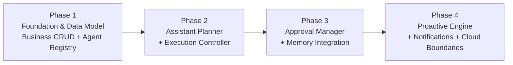

# 知忆（Zhiyi）Personal AI V1.5 · 实施计划（Implementation Plan）

> **状态**: Draft · **适用仓库**: `universal-memory-gateway/`  
> **目标**: 在严格保持 V1（Memory Core + Personal AI Runtime）100% 向后兼容的前提下，分 4 个阶段落地 Zhiyi V1.5 的 12 个能力模块（含 User Profile、Goals、Projects、Milestones、Business Tasks、Agent Registry、Assistant Planner + PolicyChecker + ExecutionController、Approval Manager、Memory Links、Proactive Engine、Notifications 与 Cloud Boundary 抽象）。

---

## 目录

1. [实施原则与架构护栏](#1-实施原则与架构护栏)
2. [分阶段交付计划（4 Phases）](#2-分阶段交付计划4-phases)
3. [数据库迁移方案（Migration 004）](#3-数据库迁移方案migration-004)
4. [测试策略与验收矩阵](#4-测试策略与验收矩阵)
5. [依赖关系、风险矩阵与灰度开关](#5-依赖关系风险矩阵与灰度开关)
6. [Phase 1 启动建议（Kickoff Recommendation）](#6-phase-1-启动建议kickoff-recommendation)

---

## 1. 实施原则与架构护栏

所有 V1.5 代码变更必须遵守以下 6 条不可妥协的工程护栏：

### 1.1 V1 104-Test 零回归不变量
- 每次提交与每个阶段结束时，必须保证既有 V1 测试套件全部通过（`npm run build` 零错误，`npm test` 8 个文件 **104/104** 通过，0 跳过）：
  - `tests/model-settings.test.ts` (32)
  - `tests/personal-ai.test.ts` (27)
  - `tests/config-context.test.ts` (12)
  - `tests/proxy.test.ts` (11)
  - `tests/memories.test.ts` (9)
  - `tests/extraction.test.ts` (7)
  - `tests/isolation-regression.test.ts` (3)
  - `tests/qa-regression.test.ts` (3)
- 既有对外接口契约不得破坏：
  - `/v1/chat/completions`、`/v1/memories*`、`/v1/trajectories*`、`/v1/memory-candidates*`、`/v1/agents`、`/v1/agents/:id/profile`
  - `/v1/personal-ai/chat/completions`、`/v1/personal-ai/messages`、`/v1/personal-ai/tasks`、`/v1/personal-ai/tasks/:id`、`/v1/personal-ai/tasks/:id/cancel`、`/health/personal-ai`
  - `src/config.ts` 中 `AppConfig` 的 16 个环境变量契约保持原样；V1.5 新增配置全部放入 `src/personal-ai/config.ts` 及 `.env.personal-ai.example`。

### 1.2 零新增运行时依赖 & Local-First
- `package.json` 的 `dependencies` **仅保留 `express`**，不新增任何 npm 运行时依赖。
- 存储基于 Node 22 内置 `node:sqlite`（`DatabaseSync`，见 [src/db.ts](file:///Users/mll/code/code/agent/universal-memory-gateway/src/db.ts)）；时间与时区计算使用内置 `Intl.DateTimeFormat` + 轻量纯 TS Cron 解析器；加密/签名/UUID 使用 `node:crypto`。
- **不引入 Docker、Redis、Kafka 或外部向量数据库**；单进程 `npm run dev` / `npm start` 即可开箱运行完整 V1.5 能力。

### 1.3 单一决策中心（Single Decision Center）
- [PersonalAIRuntime](file:///Users/mll/code/code/agent/universal-memory-gateway/src/personal-ai/runtime/personal-ai-runtime.ts) 是唯一的编排与智能决策入口，不允许出现第二套并发 Planner 或绕过 `PersonalAIRuntime` 直接派发外部 Agent 的隐式链路（仅受用户手动触发的 `/v1/personal-ai/work-tasks/:id/execute` 显式走统一的 `ExecutionController` / `PolicyChecker` / `TaskWorker` 管道）。

### 1.4 保留 `execution_tasks` 表名与状态兼容性（Scheme B）
- **严禁删除或重命名 `execution_tasks`**：[src/personal-ai/routes.ts:334](file:///Users/mll/code/code/agent/universal-memory-gateway/src/personal-ai/routes.ts#L334)、[tests/personal-ai.test.ts:587](file:///Users/mll/code/code/agent/universal-memory-gateway/tests/personal-ai.test.ts#L587)、[tests/personal-ai.test.ts:689](file:///Users/mll/code/code/agent/universal-memory-gateway/tests/personal-ai.test.ts#L689) 与 [tests/qa-regression.test.ts:168](file:///Users/mll/code/code/agent/universal-memory-gateway/tests/qa-regression.test.ts#L168) 均直接读写 `execution_tasks`。
- 业务任务使用独立新建的 `tasks` 表（ID 前缀 `btask_`）；`execution_tasks`（ID 前缀 `task_`）通过新增 `task_id TEXT REFERENCES tasks(id) ON DELETE SET NULL` 与 `timeout_at TEXT` 与之形成 `1:N` 关联。
- `execution_tasks.status` **保留 `'completed'`**，并扩展 `'timeout'`（即 `pending | dispatching | running | completed | failed | cancelled | timeout`），避免 V1 状态映射丢失或测试断言失败。

### 1.5 `adp-v2` 11 事件白名单不变量
- [src/personal-ai/adapters/protocol/adp-protocol-adapter.ts](file:///Users/mll/code/code/agent/universal-memory-gateway/src/personal-ai/adapters/protocol/adp-protocol-adapter.ts) 中的 `ADP_V2_EVENT_TYPES`（11 个固定顶层 `Type`）严禁扩展。
- V1.5 新增的所有内部 `PersonalAIEvent` 类型必须在 `progressText(event)` 中降级为可读纯文本（`adp-v2` 模式映射为 `text.delta`，`openai` 模式映射为 `choices[0].delta.content`）或静默忽略（返回 `null`）。

### 1.6 严格用户隔离与 CAS 终态保护
- 所有用户可见表（`users`, `goals`, `projects`, `milestones`, `tasks`, `execution_tasks`, `approval_requests`, `scheduled_jobs`, `notifications`, `memory_links`, `execution_plans`）的读写必须携带服务端解析的 `identity.user_id`，**绝对忽略请求体中的身份字段**。
- 所有并发状态推进（`execution_tasks` 抢占与终态回写、`tasks` 状态流转、`approval_requests` 审批/超时/撤销、`scheduled_jobs` 触发抢占）必须使用带状态前置条件的单条 SQL `UPDATE ... WHERE id = ? AND status IN (...)`（CAS）。

---

## 2. 分阶段交付计划（4 Phases）

### 总览路线图



---

### Phase 1: Foundation & Data Model + Business CRUD + Agent Registry

#### Scope（范围）
建立 V1.5 全量数据库 Schema（Migration 004），实现用户画像（`users`）、业务实体管理（Goals、Projects、Goal-Project M:N、Milestones、Business Tasks + Subtasks）以及 Agent Registry 扩展（能力标签、执行后端、权限策略、并发上限、系统指令、启用状态），并开放 `/v1/personal-ai/*` 与 `/v1/agents/:id` REST API。本阶段**不改变** `PersonalAIRuntime.run()` 的 V1 对话决策流。

#### Deliverables（交付物）
1. **Migration 004**（`migrations/004_v1_5.sql`）并在 [src/db.ts](file:///Users/mll/code/code/agent/universal-memory-gateway/src/db.ts) `MIGRATIONS` 数组注册。
2. **User Profile 模块**：`UserProfileStore`（upsert / get / update preferences & work_style & timezone）与自动建档辅助（兼容既有 `u1`/`u2` 密钥映射）。
3. **Business Entity Stores**：
   - `GoalStore`（`draft | active | achieved | abandoned | paused`，进度更新与关联项目查询）
   - `ProjectStore`（`active | paused | completed | archived`，上下文聚合接口）
   - `MilestoneStore`（强制 `goal_id IS NOT NULL OR project_id IS NOT NULL`）
   - `BusinessTaskRepository` + `BusinessTaskManager`（`btask_` 前缀，9 态生命周期与 CAS 状态守卫，支持 `parent_task_id` 子任务树、绑定 `execution_tasks` 历史列表）
4. **Agent Registry 扩展**：扩展 [src/agents.ts](file:///Users/mll/code/code/agent/universal-memory-gateway/src/agents.ts) 与 [src/types.ts](file:///Users/mll/code/code/agent/universal-memory-gateway/src/types.ts)，支持 `capabilities`、`execution_backend`、`permission_policy`、`status`、`concurrency_limit`、`instructions` 持久化，更新 `SEED_AGENTS` 默认能力标签，并新增 `PATCH /v1/agents/:id` 与 `GET /v1/agents/:id/status`。
5. **REST API 路由（独立模块化挂载到 `personalAI.router`）**：
   - `GET/PUT /v1/personal-ai/profile`
   - `GET/POST /v1/personal-ai/goals`、`GET/PATCH/DELETE /v1/personal-ai/goals/:id`、`POST/DELETE /v1/personal-ai/goals/:id/projects`、`POST /v1/personal-ai/goals/:id/progress`
   - `GET/POST /v1/personal-ai/projects`、`GET/PATCH/DELETE /v1/personal-ai/projects/:id`、`GET /v1/personal-ai/projects/:id/context`
   - `GET/POST /v1/personal-ai/milestones`、`GET/PATCH/DELETE /v1/personal-ai/milestones/:id`
   - `GET/POST /v1/personal-ai/work-tasks`、`GET/PATCH/DELETE /v1/personal-ai/work-tasks/:id`、`POST /v1/personal-ai/work-tasks/:id/cancel`、`GET /v1/personal-ai/work-tasks/:id/executions`、`POST /v1/personal-ai/work-tasks/:id/execute`（Phase 1 提供创建关联 `execution_tasks` 并交由 `TaskWorker.dispatch` 的基础入口）

#### Exact New Files（新增文件）
- `migrations/004_v1_5.sql`
- `src/personal-ai/profile/user-profile-store.ts`
- `src/personal-ai/domain/types.ts`（V1.5 实体与状态机类型定义）
- `src/personal-ai/domain/goal-store.ts`
- `src/personal-ai/domain/project-store.ts`
- `src/personal-ai/domain/milestone-store.ts`
- `src/personal-ai/task/business-task-repository.ts`
- `src/personal-ai/task/business-task-manager.ts`
- `src/personal-ai/routes/v15-domain-routes.ts`（拆分路由防止 `src/personal-ai/routes.ts` 膨胀）
- `tests/v15-foundation.test.ts`

#### Exact Modified Files（修改文件）
- `src/db.ts`（`MIGRATIONS` 加入 `'004_v1_5'`）
- `src/types.ts`（`AgentProfile` / `NewAgentProfile` 增加可选扩展字段 + `AgentPatch`）
- `src/agents.ts`（`AgentStore` 支持新列序列化/反序列化、`update()`、`status` 过滤与默认 seed 字段）
- `src/routes.ts`（新增 `PATCH /v1/agents/:id` 与 `GET /v1/agents/:id/status`，保持现有 `/v1/agents` 与 `/v1/agents/:id/profile` 不变）
- `src/personal-ai/config.ts`（`ExecutionStatus` 增加 `'timeout'`；新增 V1.5 功能开关配置结构，默认全部 `false`）
- `src/personal-ai/task/task-repository.ts`（`ExecutionTask` 增加 `task_id: string | null` 与 `timeout_at: string | null`，`NewExecutionTask` 支持可选 `task_id` 与 `timeout_at`；保留 `execution_tasks` 表名与 `'completed'` 状态）
- `src/personal-ai/task/task-manager.ts`（`cancelForUser` 识别 `'timeout'` 为终态；新增 `listByBusinessTask(userId, taskId)`）
- `src/personal-ai/index.ts`（实例化新 Stores 传入路由与 Runtime 装配对象）
- `src/personal-ai/routes.ts`（挂载 `v15-domain-routes.ts`，保持 `/v1/personal-ai/tasks*` 完全不变）

#### Acceptance Criteria（验收标准）
- [ ] `npm run build` 无错误且 `dist/migrations/004_v1_5.sql` 正确复制。
- [ ] `npm test` 原有 **104/104** V1 测试全部通过，无修改既有测试断言。
- [ ] 在旧 V1 SQLite 库（含历史 `execution_tasks` 与 `agents` 行）上执行 `db.migrate()` 幂等成功，历史行 `task_id IS NULL` 且可正常查询与取消。
- [ ] 所有新增 `/v1/personal-ai/*` CRUD 接口强制 `user_id` 隔离（跨用户读写返回 404，忽略 body 中伪造 `user_id`）。
- [ ] `BusinessTaskManager` 状态机非法流转（如 `completed -> in_progress`）返回 409，并发 `cancel` 仅一次成功。
- [ ] `PATCH /v1/agents/:id` 可更新 `capabilities`、`execution_backend`、`permission_policy`、`status`、`concurrency_limit`、`instructions`。

---

### Phase 2: Assistant Planner + Execution Controller

#### Scope（范围）
在 `PersonalAIRuntime` 内部引入 LLM 辅助规划器（`AssistantPlanner`）、三阶段 Agent 选择管线（确定性过滤 → Planner 推荐 → 服务端校验）以及多步骤执行引擎（`ExecutionController` + `execution_plans` 持久化与恢复）。通过 `PLANNER_V15_ENABLED`（默认 `false`）控制灰度切换；关闭时 100% 走 V1 `understandIntent` + `planExecution` 链路。

#### Deliverables（交付物）
1. **配置与事件扩展**：
   - `src/personal-ai/config.ts` 增加 `planner` 配置段：`PLANNER_V15_ENABLED`（默认 `false`）、`PLANNER_CLARIFICATION_THRESHOLD`（0.4）、`PLANNER_CONFIRMATION_THRESHOLD`（0.7）、`PLANNER_MAX_ITERATIONS`（3）、`PLANNER_MAX_STEPS`（10）。
   - `src/personal-ai/events/event-types.ts` 扩展 V1.5 内部事件（`planning_start`, `planning_complete`, `clarification_needed`, `plan_proposed`, `plan_rejected`, `step_started`, `step_completed`, `step_failed`, `step_skipped`, `entity_created`, `entity_updated`）。
   - `src/personal-ai/adapters/protocol/adp-protocol-adapter.ts` 更新 `progressText(event)`，确保所有 V1.5 事件在 `adp-v2` 模式下严格输出 `text.delta` 或静默忽略，**绝不触犯 11 事件白名单**。
2. **Context Builder 扩展**：
   - `src/personal-ai/runtime/context-builder.ts` 注入 `userProfile`、`activeGoals`、`activeProjects`、`recentTasks` 摘要到 `BuiltContext`（保持 V1 `memoryInjected` / `hits` / `systemMessage` 注入规则与防覆盖安全提示不变）。
3. **Assistant Planner 模块**：
   - `planner-prompt.ts`：结构化输出 System Prompt 模板（注入可用 Agents、Goals/Projects/Tasks、Memories、Conversation Context）。
   - `planner-validator.ts`：JSON 解析、Intent/StepType 白名单校验、环检测（DAG 拓扑排序）、`agentId` 必须在服务端过滤列表内、`MAX_PLAN_STEPS` 上限检查。
   - `assistant-planner.ts`：`GREETING_ONLY` 快速路径（免 LLM 调用）；`ModelAdapter.complete()` 结构化规划；失败重试最多 `MAX_PLANNING_ITERATIONS` 次；全失败自动降级至 `FALLBACK_PLAN`（`direct_llm`）。
4. **Agent Selection Pipeline**：
   - `agent-selector.ts`：按 `status === 'active'`、能力标签匹配、当前活跃 `execution_tasks` 并发数 `< concurrency_limit` 进行确定性过滤，空列表时兼容降级至 `config.multica.defaultAgent`。
5. **Execution Controller & Plan Persistence**：
   - `execution-plan-store.ts`：`execution_plans` 表 CRUD、幂等创建 `(user_id, request_id)`、重启恢复（`listIncomplete` → 标记 `abandoned` 或可重试状态）。
   - `execution-controller.ts`：拓扑排序 + 分波次 `Promise.allSettled` 并行执行就绪步骤；支持 `direct_llm`、`agent_delegation`（绑定 `task_id` 并沿用 `TaskWorker` 轮询）、`create_entity`、`update_entity`、`query`；上游失败自动 `step_skipped` 下游依赖；单步计划与 V1 事件流等价。
   - `result-aggregator.ts` 扩展多步骤结果聚合。
   - `task-worker.ts` 扩展：`pollOne()` 达到 `maxPolls` 或 `timeout_at` 时写入 `'timeout'` 状态（通过配置开关或新执行字段控制，保证 V1 回归测试断言不被破坏）；`start()` 清理遗留未完成 `execution_plans`。

#### Exact New Files（新增文件）
- `src/personal-ai/runtime/assistant-planner.ts`
- `src/personal-ai/runtime/planner-prompt.ts`
- `src/personal-ai/runtime/planner-validator.ts`
- `src/personal-ai/runtime/agent-selector.ts`
- `src/personal-ai/runtime/execution-plan-store.ts`
- `src/personal-ai/runtime/execution-controller.ts`
- `tests/v15-planner-controller.test.ts`

#### Exact Modified Files（修改文件）
- `src/personal-ai/config.ts`（新增 `planner` 配置与环境变量解析）
- `src/personal-ai/events/event-types.ts`（追加 V1.5 `PersonalAIEvent` 联合分支）
- `src/personal-ai/adapters/protocol/adp-protocol-adapter.ts`（`progressText()` 映射新事件为纯文本）
- `src/personal-ai/runtime/context-builder.ts`（`BuiltContext` 扩展业务实体上下文）
- `src/personal-ai/runtime/result-aggregator.ts`（新增多步骤 `aggregateMultiStepResults()`）
- `src/personal-ai/runtime/personal-ai-runtime.ts`（按 `PLANNER_V15_ENABLED` 分流：V1 路径原样保留；V1.5 路径走 `AssistantPlanner` → `ExecutionController`；轨迹响应同时记录计划摘要）
- `src/personal-ai/worker/task-worker.ts`（支持 `timeout_at` 超时流转 `'timeout'` 及 `execution_plans` 重启恢复）
- `src/personal-ai/index.ts`（装配 `ExecutionPlanStore`、`ExecutionController` 等注入 `PersonalAIRuntime`）

#### Acceptance Criteria（验收标准）
- [ ] `PLANNER_V15_ENABLED=false` 时行为与 V1 完全一致，104 V1 测试 100% 通过。
- [ ] `PLANNER_V15_ENABLED=true` 时，使用 Mock LLM（自定义 `UpstreamTransport`）：
  - 问候语命中 fast-path，**0 次**额外规划 LLM 调用；
  - 非法 JSON / 含循环依赖 / 幻觉 `agentId` 的模型输出能被 `planner-validator.ts` 拦截，重试 3 次后安全降级为 `direct_llm`；
  - `confidence < 0.4` 触发 `clarification_needed`；`0.4 <= confidence < 0.7` 或 `requiresConfirmation=true` 触发 `plan_proposed` 并停止执行；
  - 多步骤 DAG 计划可并行执行无依赖步骤、按序执行依赖步骤，前置失败时下游精确标记 `step_skipped`；
  - `adp-v2` SSE 输出所有帧顶层 `Type` 100% 属于 `ADP_V2_EVENT_TYPES` 白名单。

---

### Phase 3: Approval Manager + Memory Integration

#### Scope（范围）
落地服务端权威的权限与风险控制体系（`PolicyChecker` + `ApprovalManager` + `approval_requests` 状态机与超时/撤销机制）以及业务实体与长期记忆的双向集成（`memory_links`、分类记忆 `fact | preference | experience | temp_context`、基于 Agent/Scope 的访问控制与基于业务事件的候选记忆自动提取）。

#### Deliverables（交付物）
1. **Policy Checker（服务端权限与风险评估）**：
   - `src/personal-ai/runtime/policy-checker.ts`：校验用户权限、Agent 状态/并发/`permission_policy` 规则；确定性高风险关键词与操作类型分级（`low | medium | high | critical`）；**绝不信任 LLM 自评风险**。
   - 受 `POLICY_APPROVAL_ENABLED`（默认 `false`）控制：开启时 `high`/`critical` 操作拦截执行并生成 `approval_requests` 记录，发送 `approval_needed` 事件。
2. **Approval Manager 模块**：
   - `approval-store.ts` & `approval-manager.ts`：`apr_` 前缀，支持 `pending → approved | rejected | timeout | auto_approved | revoked`；`POST /v1/personal-ai/approvals/:id/approve` 通过后**幂等恢复**关联计划或触发关联业务任务执行；`revoke` 支持撤销尚未执行或运行中的高风险授权并级联取消活跃 `execution_tasks`。
   - 超时扫描：在 `TaskWorker.tick()` 中顺带检查过期 `approval_requests`（`timeout_at <= now`），CAS 更新为 `timeout` 并将关联 `tasks` 从 `blocked` 转为 `cancelled`/`failed`。
   - API 路由：`GET /v1/personal-ai/approvals`、`GET /v1/personal-ai/approvals/:id`、`POST /v1/personal-ai/approvals/:id/approve`、`POST /v1/personal-ai/approvals/:id/reject`、`POST /v1/personal-ai/approvals/:id/revoke`。
3. **Memory Integration（Entity ↔ Memory + 分类 + ACL）**：
   - `memory-link-store.ts`：`memory_links` 表（关联 `memory_id` ↔ `goal | project | milestone | task`，关系类型 `relation_type` ∈ `context | outcome | preference | constraint`；配合 `memories.type` / 分类区分事实 `semantic`、偏好 `preference`、经验 `episodic` 与临时上下文 `working`）。
   - 检索增强（无向量 DB）：扩展 `src/search.ts` 与 `src/personal-ai/runtime/context-builder.ts`，支持按 `memory_links` 联合召回当前活跃 Goal/Project/Task 的关联记忆，去重排序后受 `memoryTokenBudget` 约束注入；在 `searchMemories()` 前增加 SQL 预过滤（`scope` / `type` / 最近 N 条上限保护），缓解全表扫描性能瓶颈；强化 `scope='agent'` 的服务端 ACL 校验。
   - 业务事件驱动候选提取：当业务任务完成（`tasks.status -> completed`）或 Goal 达成（`goals.status -> achieved`）时，复用现有 `ExtractionQueue` / `CandidateStore` 生成结构化候选记忆（如任务经验 `experience` 或用户偏好 `preference`），并附带去重与过期标记（`temp_context` TTL 清理策略）。
   - API 扩展：Goal/Project/Task 查询端点可选返回关联记忆列表，支持手动挂载/解绑 `POST/DELETE /v1/personal-ai/memories/:id/links`。

#### Exact New Files（新增文件）
- `src/personal-ai/runtime/policy-checker.ts`
- `src/personal-ai/approval/approval-store.ts`
- `src/personal-ai/approval/approval-manager.ts`
- `src/personal-ai/memory/memory-link-store.ts`
- `src/personal-ai/memory/entity-memory-extractor.ts`
- `tests/v15-approval-memory.test.ts`

#### Exact Modified Files（修改文件）
- `src/personal-ai/config.ts`（新增 `POLICY_APPROVAL_ENABLED`、`APPROVAL_DEFAULT_TIMEOUT_MS`）
- `src/personal-ai/runtime/personal-ai-runtime.ts`（在 Planner 与 ExecutionController 之间插入 `PolicyChecker` + `ApprovalManager` 门禁）
- `src/personal-ai/runtime/execution-controller.ts`（支持审批通过后恢复执行，以及写入 `memory_links`）
- `src/personal-ai/runtime/context-builder.ts`（接入 `MemoryLinkStore` 联合召回与分类过滤）
- `src/personal-ai/worker/task-worker.ts`（周期扫描超时 `approval_requests`；任务完成时触发经验记忆提取回调）
- `src/search.ts`（新增可选预过滤参数 `limitCandidates` / `excludeExpired`，保持默认调用签名向后兼容）
- `src/personal-ai/routes/v15-domain-routes.ts`（新增 `/approvals*` 与 `/memories/:id/links` 路由）
- `src/personal-ai/index.ts`（装配 `ApprovalManager`、`PolicyChecker`、`MemoryLinkStore`）

#### Acceptance Criteria（验收标准）
- [ ] `POLICY_APPROVAL_ENABLED=true` 时，含高风险关键词（`deploy`/`delete`/`删除`/`部署`）或命中 Agent `permission_policy.require_approval` 的计划必被拦截进入 `pending` 审批，**即使 mock LLM 返回 `requiresConfirmation: false` 也不放行**。
- [ ] 审批 `approve` / `reject` / `revoke` / `timeout` 并发竞争时，CAS 保证仅一方成功，其余返回 409。
- [ ] 关联 Goal/Project/Task 的 `memory_links` 能在对话上下文中按相关性召回，且跨用户或跨 Agent `scope=agent` 私有记忆绝不泄漏。
- [ ] 104 V1 测试继续 100% 通过。

---

### Phase 4: Proactive Engine + Notifications + Cloud Boundary Interfaces

#### Scope（范围）
交付**有界、可控的** V1.5 主动触达引擎（仅限 5 类确定性触发器，禁止无界自主循环）、异步持久化通知系统（`notifications`）以及面向未来多实例/云端演进的边界接口抽象（Repository/Storage/Worker/Scheduler/Secret/Backup 契约）。受 `PROACTIVE_ENABLED`（默认 `false`）控制。

#### Deliverables（交付物）
1. **Notification Manager（异步持久化通知）**：
   - `notification-store.ts` & `notification-manager.ts`：`ntf_` 前缀，支持 `in_app` 主通道 + 可选 `webhook` 通道（内置 Node `fetch` + 超时保护 + 私网地址 SSRF 防护校验）。
   - 去重键 `dedup_key` 唯一约束（防止同一任务/提醒短时间重复轰炸）；支持已读追踪与按用户暂停（基于 `users.preferences` 中的静默时段/开关）。
   - 接入场景：客户端断连后的后台任务完成通知、Agent 执行失败告警、待审批提醒、Proactive 定时触发结果。
   - API：`GET /v1/personal-ai/notifications`、`POST /v1/personal-ai/notifications/:id/read`、`POST /v1/personal-ai/notifications/read-all`。
2. **Proactive Engine（有限可控触发器 + Cron 调度）**：
   - `cron-parser.ts`：纯 TypeScript 标准 5 段 Cron 解析器 + IANA 时区计算（基于 `Intl.DateTimeFormat`，0 第三方依赖），支持算得下一触发时间 `next_run_at`。
   - `scheduled-job-store.ts`：`scheduled_jobs` 表（`sj_` 前缀），包含 `trigger_type`（`cron | task_due | stale_progress | agent_failure | pending_approval | summary`）、`cron_expression`、`timezone`、`cooldown_seconds`、`paused_until`、`dedup_key`、`status`（`active | paused | disabled`）、`last_run_at`、`next_run_at`；支持 CAS 抢占触发（`WHERE status = 'active' AND next_run_at <= ?`）与进程重启漏触发补算策略（仅补一次或按配置跳过过期窗口，绝不雪崩）。
   - `proactive-engine.ts`：复用 `TaskWorker` 定时器模式（或独立轻量 ticker），**严格限定 V1.5 五类触发器**：
     1. 任务截止提醒（`task_due_reminder`：`tasks.due_at` 临近）
     2. 长期无进展提醒（`stale_progress_reminder`：`in_progress`/`blocked` 超阈值）
     3. Agent 执行失败告警（`agent_failure_alert`：`execution_tasks` 进入 `failed`/`timeout`）
     4. 待审批超时前提醒（`approval_reminder`：`approval_requests` 待批超时临近）
     5. 每日/每周总结（`periodic_summary`：基于 `scheduled_jobs` 汇总活跃 Goal/Task 进展）
   - API：`GET/POST /v1/personal-ai/schedules`、`GET/PATCH/DELETE /v1/personal-ai/schedules/:id`、`POST /v1/personal-ai/schedules/:id/pause`、`POST /v1/personal-ai/schedules/:id/resume`。
3. **Cloud Migration Boundary Interfaces（云端演进边界接口）**：
   - 定义纯接口契约文件 `src/personal-ai/boundaries/cloud-contracts.ts`（无外部实现引入）：
     - `ExecutionLockProvider` / `SchedulerLeaderLock`（当前本地单进程 `NoopLock` 实现，未来替换 Redis/DB 分布式锁）
     - `NotificationTransport`（当前 `InAppTransport` + `WebhookTransport`，未来扩展邮件/Push）
     - `SecretProvider`（当前 `EnvSecretProvider`，未来对接 KMS）
     - `DatabaseBackupService`（提供 SQLite 在线备份命令 `VACUUM INTO` 封装与路径校验，供 `/v1/personal-ai/admin/backup` 或 CLI 脚本调用）

#### Exact New Files（新增文件）
- `src/personal-ai/notification/notification-store.ts`
- `src/personal-ai/notification/notification-manager.ts`
- `src/personal-ai/scheduler/cron-parser.ts`
- `src/personal-ai/scheduler/scheduled-job-store.ts`
- `src/personal-ai/scheduler/proactive-engine.ts`
- `src/personal-ai/boundaries/cloud-contracts.ts`
- `scripts/backup-db.ts`（可选本地热备份脚本，`VACUUM INTO`）
- `tests/v15-proactive-notifications.test.ts`

#### Exact Modified Files（修改文件）
- `src/personal-ai/config.ts`（新增 `PROACTIVE_ENABLED`、`PROACTIVE_TICK_INTERVAL_MS`、`PROACTIVE_STALE_TASK_HOURS`、`NOTIFICATION_WEBHOOK_ENABLED`）
- `src/personal-ai/worker/task-worker.ts`（任务进入 `completed`/`failed`/`timeout` 终态时发射钩子通知 `NotificationManager`）
- `src/personal-ai/approval/approval-manager.ts`（新建待审批记录时触发 `NotificationManager` 提醒）
- `src/personal-ai/routes/v15-domain-routes.ts`（新增 `/schedules*` 与 `/notifications*` 路由）
- `src/personal-ai/index.ts`（装配 `NotificationManager` 与 `ProactiveEngine`，在 `close()` 中优雅停止定时器）
- `src/app.ts`（`CreatedApp.close()` 调用 `personalAI.proactiveEngine?.stop()`，确保测试结束后无残留定时器）
- `package.json`（仅在 `scripts` 中可选增加 `"db:backup"`，**不增加任何 `dependencies`**）

#### Acceptance Criteria（验收标准）
- [ ] `PROACTIVE_ENABLED=false` 时不启动任何主动扫描定时器，V1 行为零干扰。
- [ ] `PROACTIVE_ENABLED=true` 时，5 类触发器均遵循 `cooldown_seconds`、`dedup_key` 去重以及用户暂停开关（`paused_until` / `status='paused'`），重复 tick 不会产生重复通知。
- [ ] 5 段 Cron 解析器在不同 IANA 时区（如 `Asia/Shanghai`、`America/New_York` 含夏令时切换日）下计算 `next_run_at` 精确。
- [ ] 进程模拟重启（新建 `App` 实例共享同一 SQLite 文件）后，过期的 `scheduled_jobs` 不会发生补发风暴，且幂等推进到下一个未来 `next_run_at`。
- [ ] `CreatedApp.close()` 后无活跃 `setInterval` 泄漏（Vitest 进程干净退出），104 + 全部 V1.5 测试通过。

---

## 3. 数据库迁移方案（Migration 004）

### 3.1 迁移文件与注册机制
- **迁移文件路径**：`migrations/004_v1_5.sql`
- **构建复制**：[package.json:8](file:///Users/mll/code/code/agent/universal-memory-gateway/package.json#L8) 的 `build` 脚本已执行 `cpSync('migrations','dist/migrations',{recursive:true})`，新增 `004_v1_5.sql` 会自动同步进 `dist/migrations/`。
- **版本登记**：在 [src/db.ts:47-51](file:///Users/mll/code/code/agent/universal-memory-gateway/src/db.ts#L47-L51) 注册：

```typescript
const MIGRATIONS: readonly string[] = [
  '001_init',
  '002_trajectory_request_scope',
  '003_personal_ai',
  '004_v1_5',
];
```

### 3.2 `migrations/004_v1_5.sql` 结构与关键设计
按依赖拓扑顺序编排，全程包裹在 `BEGIN TRANSACTION; ... COMMIT;` 中（失败自动回滚且不写入 `schema_migrations`）：

1. **创建 `users`**：
   - `user_id TEXT PRIMARY KEY`, `display_name TEXT NOT NULL DEFAULT ''`, `preferences TEXT NOT NULL DEFAULT '{}'`, `timezone TEXT NOT NULL DEFAULT 'Asia/Shanghai'`, `work_style TEXT NOT NULL DEFAULT '{}'`, `created_at TEXT NOT NULL`, `updated_at TEXT NOT NULL`。
   - **历史用户零停机回填（关键）**：由于 `src/db.ts:96` 强制开启 `PRAGMA foreign_keys = ON;`，迁移脚本内部立即执行回填：
     ```sql
     INSERT OR IGNORE INTO users (user_id, display_name, created_at, updated_at)
     SELECT DISTINCT user_id, user_id, datetime('now'), datetime('now')
     FROM (
       SELECT user_id FROM memories
       UNION SELECT user_id FROM trajectories
       UNION SELECT user_id FROM memory_candidates
       UNION SELECT user_id FROM execution_tasks
       UNION SELECT user_id FROM conversation_contexts
     );
     ```
     同时在应用层创建 Goal / Project / Task / Approval / Schedule 时调用 `UserProfileStore.ensureUser(userId)`（`INSERT OR IGNORE`），彻底防止未预先调用 `/profile` 的测试用户（如测试中的 `'u1'`、`'u2'`、`'user-a'`）触发 SQLite FK 违例。

2. **创建业务实体表**：
   - `goals`（`id`, `user_id REFERENCES users`, `title`, `description`, `status CHECK(...)`, `priority`, `target_date`, `progress REAL DEFAULT 0`, `created_at`, `updated_at`）
   - `projects`（`id`, `user_id REFERENCES users`, `title`, `description`, `status CHECK(...)`, `created_at`, `updated_at`）
   - `goal_projects`（`goal_id REFERENCES goals ON DELETE CASCADE`, `project_id REFERENCES projects ON DELETE CASCADE`, `created_at`, PK `(goal_id, project_id)`）
   - `milestones`（`id`, `goal_id REFERENCES goals ON DELETE SET NULL`, `project_id REFERENCES projects ON DELETE SET NULL`, `user_id REFERENCES users`, `title`, `description`, `status CHECK(...)`, `target_date`, `completed_at`, `created_at`, `updated_at`, `CHECK (goal_id IS NOT NULL OR project_id IS NOT NULL)`）
   - `tasks`（业务任务，`id`, `user_id REFERENCES users`, `project_id REFERENCES projects ON DELETE SET NULL`, `milestone_id REFERENCES milestones ON DELETE SET NULL`, `parent_task_id REFERENCES tasks(id) ON DELETE SET NULL`, `title`, `description`, `status CHECK(...)`, `priority`, `assignee_agent_id REFERENCES agents(agent_id) ON DELETE SET NULL`, `due_at`, `created_at`, `updated_at`）

3. **扩展 `execution_tasks`（必须在 `tasks` 建表之后，详见 `DATA_MODEL.md §5.8`）**：
   - 在事务内保留原表名 `execution_tasks`，新增 `task_id TEXT REFERENCES tasks(id) ON DELETE SET NULL` 与 `timeout_at TEXT`，并将合法状态集合扩展为 `('pending','dispatching','running','completed','failed','cancelled','timeout')`（可采用 `execution_tasks_v2` 建表复制重命名以补齐 `CHECK` 约束，或采用 `ALTER TABLE ADD COLUMN` 增量加列）。
   - V1 存量行 `task_id` 与 `timeout_at` 自动为 `NULL`，`status = 'completed'` 原样保留，V1 全部 SQL 查询与测试零改动通过。

4. **非破坏性扩展 `agents`**：
   - 直接使用 `ALTER TABLE agents ADD COLUMN ...` 追加 6 列（均带合法 `DEFAULT`，`src/agents.ts` 的既有 `INSERT OR IGNORE` / `INSERT OR REPLACE` 语句无需立即报错即可向后兼容）：
     ```sql
     ALTER TABLE agents ADD COLUMN capabilities TEXT NOT NULL DEFAULT '[]';
     ALTER TABLE agents ADD COLUMN execution_backend TEXT NOT NULL DEFAULT 'multica';
     ALTER TABLE agents ADD COLUMN permission_policy TEXT NOT NULL DEFAULT '{}';
     ALTER TABLE agents ADD COLUMN status TEXT NOT NULL DEFAULT 'active';
     ALTER TABLE agents ADD COLUMN concurrency_limit INTEGER NOT NULL DEFAULT 1;
     ALTER TABLE agents ADD COLUMN instructions TEXT NOT NULL DEFAULT '';
     ```

5. **创建 V1.5 治理、调度与记忆关联表（与 `DATA_MODEL.md` §5.9–5.13 保持一致）**：
   - `approval_requests`（`id` `apr_`、`user_id`、`task_id REFERENCES tasks`、`execution_id REFERENCES execution_tasks`、`operation_type`、`scope` JSON、`description`、`risk_level`、`status CHECK('pending','approved','rejected','timeout','auto_approved','revoked')`、`requested_at`、`resolved_at`、`resolver`、`revoked_at`、`revoked_by`、`revoke_reason`、`timeout_at`、`created_at`、`updated_at`）
   - `scheduled_jobs`（`id` `sj_`、`user_id`、`title`、`description`、`trigger_type`、`cron_expression`、`timezone`、`task_template`、`agent_id REFERENCES agents`、`status CHECK('active','paused','disabled')`、`paused_until`、`cooldown_seconds`、`dedup_key`、`last_run_at`、`next_run_at`、`created_at`、`updated_at`）
   - `notifications`（`id` `ntf_`、`user_id`、`source_type`、`source_id`、`channel`、`title`、`body`、`severity`、`dedup_key`、`status CHECK('unread','read','dismissed','delivered','failed')`、`delivery_attempts`、`delivered_at`、`read_at`、`created_at`、`updated_at`；部分唯一索引 `UNIQUE(user_id, dedup_key) WHERE dedup_key IS NOT NULL`）
   - `memory_links`（`id` `mlink_`、`user_id`、`memory_id REFERENCES memories(memory_id) ON DELETE CASCADE`、`entity_type`、`entity_id`、`relation_type`、`created_at`，`UNIQUE(user_id, memory_id, entity_type, entity_id)`）
   - `execution_plans`（`id` `plan_`、`user_id`、`conversation_id`、`request_id`、`intent`、`confidence`、`plan_json`、`status`、`current_step`、`results_json`、`created_at`、`updated_at`，`UNIQUE(user_id, request_id)`）

### 3.3 幂等性、回滚与零停机策略
- **幂等性**：`Database.migrate()`（[src/db.ts:111-122](file:///Users/mll/code/code/agent/universal-memory-gateway/src/db.ts#L111-L122)）先查 `schema_migrations` 表，已应用 `'004_v1_5'` 直接跳过；若迁移中途失败，事务回滚确保不留半成品表或错误版本号。
- **升级前热备份**：生产/本地升级脚本在打开库执行 `migrate()` 前，先复制一份 `.db` 快照（或通过 `VACUUM INTO` 导出带时间戳备份文件）。
- **回滚策略**：
  1. 若代码需要回退至 V1，由于 `execution_tasks` 与 `agents` 的所有旧列名称、语义及 V1 行数据 100% 保持原样，**无需降级数据库即可直接回退 V1 服务二进制**（V1 代码仅读取原有列并忽略新增表与可空列）。
  2. 若需彻底清理 V1.5 Schema，可从升级前备份文件直接恢复；对于 SQLite 3.35+（Node 22 内置版本支持 `ALTER TABLE DROP COLUMN`），也可提供 `scripts/rollback-004.sql` 先 `DROP TABLE` 所有新表并删除新增列与 `'004_v1_5'` 版本记录。

---

## 4. 测试策略与验收矩阵

所有测试继续使用 Vitest + `Database.open(':memory:')` + `MockUpstream` / `scripts/mock-multica-cli.mjs` 桩，不依赖外部网络、Docker 或真实 MultiCA daemon。

| 测试类别 | 目标文件 | 覆盖重点与断言要求 |
|---|---|---|
| **V1 回归基线** | 既有 8 个测试文件（104 用例） | 每次 PR 与每个 Phase 必跑：`model-settings` (32), `personal-ai` (27), `config-context` (12), `proxy` (11), `memories` (9), `extraction` (7), `isolation-regression` (3), `qa-regression` (3)。要求 **104/104 全绿**，含 `execution_tasks` 直查与 `ADP_V2_EVENT_TYPES` 白名单校验。 |
| **Migration 004 与兼容测试** | `tests/v15-foundation.test.ts` | 先用 `001`–`003` 初始化并插入 V1 `execution_tasks`/`agents`/`memories` 数据，再运行 `004_v1_5`：验证 `execution_tasks.task_id` 为 `NULL`、`status='completed'` 保留、历史 `user_id` 自动回填 `users`、`PRAGMA foreign_keys = ON` 下所有约束生效、重复 `migrate()` 幂等。 |
| **业务 CRUD 与多租户隔离** | `tests/v15-foundation.test.ts` | 覆盖 `/profile`, `/goals`, `/projects`, `/milestones`, `/work-tasks`, `/v1/agents/:id`：验证用户 A 无法读取/修改/关联/取消用户 B 的任何实体（返回 404）；验证请求体伪造 `user_id` 被彻底忽略；验证 Milestone 至少归属 Goal 或 Project 之一的 CHECK 约束。 |
| **状态机与并发竞态** | `tests/v15-foundation.test.ts`<br>`tests/v15-approval-memory.test.ts` | 1. `BusinessTask` 非法流转拦截（`completed -> in_progress` 返 409）。<br>2. 并发 `cancel` 与 `TaskWorker.pollOne()` 竞态（沿用 `deferred` 门控模式），确保 `cancelled` / `timeout` 终态不可逆。<br>3. `approval_requests` 并发 `approve` vs `reject` vs `timeout` vs `revoke`，CAS 保证仅一个决策生效。<br>4. `execution_plans` 重启恢复竞态。 |
| **Mock LLM Planner 与 Controller** | `tests/v15-planner-controller.test.ts` | 通过注入自定义 `UpstreamTransport` 模拟 LLM 返回：<br>1. 问候语走 fast-path，transport 调用次数为 0；<br>2. 非法 JSON / 环依赖 / 未知 `agentId` 触发 validator 重试并在 3 次后安全降级 `direct_llm`；<br>3. `confidence < 0.4` 输出 `clarification_needed`；`0.4..0.7` 输出 `plan_proposed`；<br>4. 多步骤 DAG 并行执行 + 上游失败下游 `step_skipped`；<br>5. `adp-v2` 协议编码所有新事件，逐帧 `frameEventType()` 断言全部属于 `ADP_V2_EVENT_TYPES`。 |
| **Policy 与 Memory Links** | `tests/v15-approval-memory.test.ts` | 1. 即使 Mock LLM 返回 `requiresConfirmation: false`，含高风险操作仍被服务端 `PolicyChecker` 拦截；<br>2. `memory_links` 联合召回不跨 `user_id`，且 `scope='agent'` 记忆遵守服务端 `agent_id` ACL；<br>3. 任务完成自动提取候选记忆并走 `CandidateStore` 审批闭环。 |
| **Proactive 去重与时区** | `tests/v15-proactive-notifications.test.ts` | 1. 5 段 Cron 在 `Asia/Shanghai`、`UTC`、`America/New_York`（含 DST 边界）下的 `next_run_at` 计算；<br>2. 同一 `dedup_key` 与 `cooldown_seconds` 窗口内多次 `tick()` 仅生成 1 条通知；<br>3. 用户暂停开关（`paused_until` / `status='paused'`）生效；<br>4. 模拟进程重启恢复后无历史积压雪崩。 |

---

## 5. 依赖关系、风险矩阵与灰度开关

### 5.1 模块依赖顺序
1. `migrations/004_v1_5.sql` + `src/db.ts`（所有后续模块的数据基础）
2. `UserProfileStore` + `AgentStore` 扩展 + `Domain Stores (Goal/Project/Milestone/BusinessTask)`（无运行时开关风险，Phase 1 可独立上线）
3. `ContextBuilder` 实体增强 → `AssistantPlanner` + `AgentSelector` → `ExecutionController`（强依赖 Phase 1 数据层）
4. `PolicyChecker` + `ApprovalManager`（依赖 `AssistantPlanner` / `ExecutionController` 的 Plan Step 结构与 `execution_tasks`）
5. `MemoryLinkStore` + 业务提取（依赖 Phase 1 实体表与 Memory Core）
6. `NotificationManager` → `ProactiveEngine`（依赖 `tasks`/`approval_requests`/`goals` 与 `TaskWorker` 生命周期）

### 5.2 技术风险与缓解措施

| 风险 | 严重度 | 缓解措施 |
|---|---|---|
| **SQLite `PRAGMA foreign_keys = ON` 导致既有测试或匿名测试用户插表失败** | 高 | Migration 004 回填历史 `user_id`；所有写入 `goals`/`projects`/`tasks`/`approvals`/`schedules` 的 Store 入口先调用 `UserProfileStore.ensureUser(userId)` 幂等建档。 |
| **LLM 规划器输出不稳定或引入延迟** | 高 | 保留 `GREETING_ONLY` 快速路径；校验失败最多重试 3 次并带超时保护，兜底退回 `direct_llm`；通过 `PLANNER_V15_ENABLED` 开关灰度验证。 |
| **`adp-v2` 协议客户端因自定义事件崩溃** | 高 | 所有新增 `PersonalAIEvent` 强制在 `progressText()` 转为纯文本；CI 测试对每帧执行 `ADP_V2_EVENT_TYPES` 白名单断言。 |
| **定时任务/主动提醒重复推送或重启风暴** | 中 | `scheduled_jobs` 采用 SQLite CAS 抢占更新 `next_run_at`；`notifications` 通过 `(user_id, dedup_key)` 唯一约束兜底去重；重启仅推进到未来窗口，不按漏跑次数循环补发。 |
| **`searchMemories()` 全表扫描随记忆与链接增长变慢** | 中 | Phase 3 在 SQL 层引入预过滤条件与候选条数上限（按 `updated_at DESC` 优先截取窗口），同时保持小数据集下排序结果与 V1 测试一致。 |
| **单进程 `TaskWorker` 定时器在 Vitest 未清理导致进程挂起** | 中 | 所有新 `setInterval` 必须调用 `timer.unref?.()`，并在 `CreatedApp.close()` 中显式 `clearInterval`。 |

### 5.3 灰度功能开关（Feature Flags，全部定义于 `src/personal-ai/config.ts`）

| 环境变量 | 默认值 | 所属阶段 | 作用与回滚语义 |
|---|---|---|---|
| `PLANNER_V15_ENABLED` | `false` | Phase 2 | 关闭时 `PersonalAIRuntime` 100% 走 V1 正则意图 + 单步规划；开启后启用 `AssistantPlanner` + `ExecutionController`。 |
| `PLANNER_CLARIFICATION_THRESHOLD` | `0.4` | Phase 2 | 低于此置信度触发澄清反问。 |
| `PLANNER_CONFIRMATION_THRESHOLD` | `0.7` | Phase 2 | 介于 `0.4`–`0.7` 之间输出 `plan_proposed` 等待用户确认。 |
| `PLANNER_MAX_ITERATIONS` | `3` | Phase 2 | 结构化输出校验失败最大重试次数。 |
| `PLANNER_MAX_STEPS` | `10` | Phase 2 | 单次执行计划允许的最大步骤数。 |
| `POLICY_APPROVAL_ENABLED` | `false` | Phase 3 | 关闭时 `PolicyChecker` 仅记录审计日志不阻断；开启后高风险操作进入 `approval_requests` 门禁。 |
| `APPROVAL_DEFAULT_TIMEOUT_MS` | `1800000` | Phase 3 | 审批默认超时（30 分钟），超时由 Worker CAS 置为 `timeout`。 |
| `PROACTIVE_ENABLED` | `false` | Phase 4 | 关闭时不启动 `ProactiveEngine` 扫描定时器；开启后启用 5 类有限主动提醒与 `scheduled_jobs` 调度。 |
| `PROACTIVE_TICK_INTERVAL_MS` | `60000` | Phase 4 | `ProactiveEngine` 扫描周期。 |
| `PROACTIVE_STALE_TASK_HOURS` | `48` | Phase 4 | 判定任务无进展提醒的阈值小时数。 |
| `NOTIFICATION_WEBHOOK_ENABLED` | `false` | Phase 4 | 是否允许向用户配置的 Webhook URL 投递通知（默认仅 `in_app`）。 |

**推荐灰度顺序**：Phase 1 默认开启新 CRUD API（零影响 V1 对话主链路） → Phase 2 先以 `PLANNER_V15_ENABLED=true` 在测试/单用户灰度验证规划质量 → Phase 3 开启 `POLICY_APPROVAL_ENABLED=true` 保护高风险执行 → Phase 4 开启 `PROACTIVE_ENABLED=true`（仅 `in_app` 通知）。任意阶段出现异常，置对应 Flag 为 `false` 即可秒级回退。

---

## 6. Phase 1 启动建议（Kickoff Recommendation）

### 6.1 推荐实现顺序（为什么这样排风险最低、最易测试）

建议严格按以下 **4 个微步（Micro-steps）** 启动 Phase 1，每完成一步均可立即跑通 `npm run build && npm test`：

1. **Step 1：Migration 004 + DB 注册 + 零破坏基线验证**
   - 先落盘 `migrations/004_v1_5.sql` 并在 `src/db.ts` `MIGRATIONS` 中登记 `'004_v1_5'`。
   - **原因**：先把全部 11 个新表与 `execution_tasks`/`agents` 的非破坏性 `ALTER TABLE` 固定下来，第一时间运行全量 104 个 V1 测试。如果任何 FK、默认值或表定义影响既有测试，在写一行业务逻辑之前就能立刻暴露并修复。
2. **Step 2：`UserProfileStore` 与 `AgentStore` 扩展**
   - 创建 `src/personal-ai/profile/user-profile-store.ts`（含 `ensureUser()`），再扩展 `src/types.ts`、`src/agents.ts` 与 `src/routes.ts`（`PATCH /v1/agents/:id`、`GET /v1/agents/:id/status`）。
   - **原因**：`users` 与 `agents` 是所有业务实体（Goal/Project/Task）与运行时的外键父表；`AgentStore` 已有 V1 测试覆盖，先改完并跑绿测试能确保 Memory Core 与既有 Agent 路由无回归。
3. **Step 3：领域实体 Stores 与 `BusinessTask` 状态机**
   - 创建 `src/personal-ai/domain/types.ts`、`goal-store.ts`、`project-store.ts`、`milestone-store.ts`、`src/personal-ai/task/business-task-repository.ts`、`business-task-manager.ts`，并扩展 `task-repository.ts` / `task-manager.ts`（支持 `task_id` 与 `timeout` 终态）。
   - **原因**：纯 SQLite 同步逻辑（`Database.open(':memory:')`），无需启动 Express HTTP 服务即可编写高密度的单元测试覆盖状态机守卫、M:N 关联、子任务查询与并发 CAS。
4. **Step 4：HTTP 路由装配与端到端隔离测试**
   - 创建 `src/personal-ai/routes/v15-domain-routes.ts` 并在 `src/personal-ai/index.ts`、`src/personal-ai/routes.ts`、`src/personal-ai/config.ts` 中装配。
   - 编写 `tests/v15-foundation.test.ts` 验证权限隔离、400/404/409 错误码语义以及通过 `/v1/personal-ai/work-tasks/:id/execute` 触发 `execution_tasks` 执行闭环。
   - **原因**：路由层保持薄封装（只做参数校验、服务端身份注入与 HTTP 状态码映射），在底层 Store 已自测通过后再接入路由，联调成本最低。

### 6.2 Phase 1 首日必改/必建文件清单

| 顺序 | 动作 | 文件路径 | 核心职责 |
|---|---|---|---|
| 1 | **新建** | `migrations/004_v1_5.sql` | 建表（`users`, `goals`, `projects`, `goal_projects`, `milestones`, `tasks`, `approval_requests`, `scheduled_jobs`, `notifications`, `memory_links`, `execution_plans`），回填历史用户，扩展 `execution_tasks` 与 `agents` |
| 2 | **修改** | `src/db.ts` | `MIGRATIONS` 数组追加 `'004_v1_5'` |
| 3 | **新建** | `src/personal-ai/profile/user-profile-store.ts` | `ensureUser()`、`getProfile()`、`upsertProfile()` |
| 4 | **修改** | `src/types.ts`, `src/agents.ts`, `src/routes.ts` | `AgentProfile` 新字段序列化、`PATCH /v1/agents/:id`、`GET /v1/agents/:id/status` |
| 5 | **新建** | `src/personal-ai/domain/types.ts`, `goal-store.ts`, `project-store.ts`, `milestone-store.ts` | Goal/Project/Milestone CRUD、`goal_projects` M:N、Project 上下文聚合 |
| 6 | **新建** | `src/personal-ai/task/business-task-repository.ts`, `business-task-manager.ts` | `tasks`（`btask_`）CRUD 与 CAS 状态机守卫 |
| 7 | **修改** | `src/personal-ai/config.ts`, `task/task-repository.ts`, `task/task-manager.ts` | `ExecutionStatus` 增加 `'timeout'`；支持 `task_id` 外键关联与 `timeout_at` |
| 8 | **新建** | `src/personal-ai/routes/v15-domain-routes.ts` | `/v1/personal-ai/{profile,goals,projects,milestones,work-tasks}` 路由 |
| 9 | **修改** | `src/personal-ai/index.ts`, `src/personal-ai/routes.ts` | 挂载 V1.5 领域 Stores 与路由 |
| 10 | **新建** | `tests/v15-foundation.test.ts` | 迁移兼容、隔离、状态机与 API 契约测试 |
